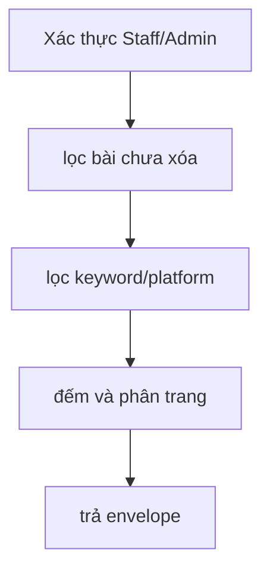

# GetPostCoreList

Kiểm chứng ngày 2026-09-12 bằng HTTP cục bộ, JWT kiểm thử và PostgreSQL 16 riêng.

#### Request

`GET /api/v1/posts?pageSize=200&keyword=hoa`

Policy: `StaffOrAdminPolicy`.

#### Response

HTTP 200; ví dụ dựa trên lần chạy thực tế, cập nhật trường `children` ngày 2026-09-17.

```json
{
  "value": {
    "items": [
      {
        "basePostId": "8a99eb32-6df5-458e-aa2a-27e1bb45087a",
        "title": "Hoa mùa thu",
        "content": "Nội dung gốc",
        "hashtag": "#hoa",
        "createdAt": "2026-09-12T07:10:47.090101+00:00",
        "updatedAt": null,
        "children": []
      }
    ],
    "pageIndex": 1,
    "pageSize": 100,
    "totalCount": 1,
    "hasNextPage": false,
    "hasPreviousPage": false
  },
  "isSuccess": true,
  "isFailed": false,
  "error": null,
  "traceId": "0HNOGJJRTDS8B:00000005",
  "timestampUtc": "0001-01-01T00:00:00"
}
```

#### Các bài đã đăng (`children`)

Mỗi bài gốc có `children`, gồm các publication có trạng thái `Succeeded`, mới nhất trước (theo `completedAt`, rồi `id`). Chưa đăng thành công trả `[]`. Không đưa tác vụ chờ đăng, lỗi hoặc cần đối soát vào danh sách này.

Mỗi child trả `publicationId`, `platformPostId`, `platformAccountId`, `platform` (facebook/instagram/zalo), `status` (Succeeded), `title`, `content`, `hashtag`, `imageUrls`, `externalPostId`, `externalPostUrl`, `publishedAt`. Nội dung và ảnh lấy từ snapshot tại thời điểm đăng; không lấy bản chỉnh sửa hiện tại. `externalPostUrl` có thể null nếu nhà cung cấp không trả liên kết.

Dùng `publicationId` để gọi `GET /api/v1/post-gen/publications/{publicationId}/insights`.

Phân trang và `totalCount` vẫn tính theo bài gốc. Chỉ truy vấn publication của các bài trong trang bằng một truy vấn chung. API chi tiết `GET /api/v1/posts/{id}` cũng trả `children` cùng cấu trúc.

#### Flow diagram



#### Test case

- Mọi Staff/Admin thấy cùng danh sách bài; bài soft delete không xuất hiện.
- Keyword không phân biệt hoa thường; có lọc platform.
- PageIndex 1-based; pageSize clamp 100.
- Children chỉ chứa publication thành công, đúng bài gốc, giữ nguyên nội dung snapshot và thứ tự ảnh đã đăng.
- Children không làm thay đổi số bài hoặc phân trang; bài chưa đăng trả mảng rỗng.

Test tự động: `HoaTheoMua.Service.Test/PostGenTest/GetPostCoreList.cs`; kiểm DB thật tại `PostGenPostgres.cs`.
