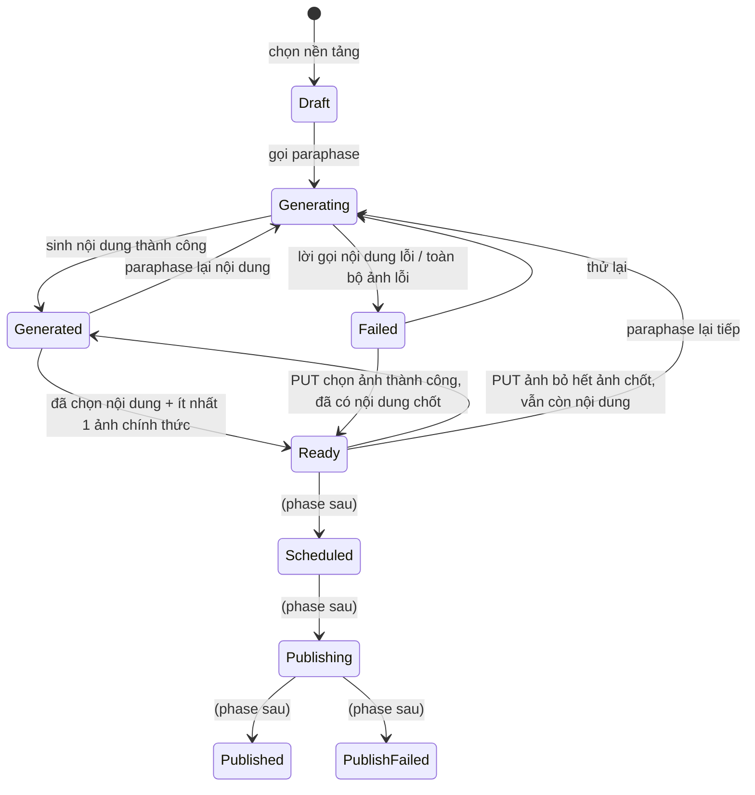

# PostGen — Dự án AI Marketing

> **Phạm vi đăng tải chốt ngày 2026-09-15:** hiện chỉ cấu hình, kết nối và triển khai xuất bản cho **Facebook và Instagram**. **Zalo tạm hoãn**, không yêu cầu tài khoản/app/OA, cấu hình OAuth hoặc kiểm thử đăng thật trong đợt này; mốc 13C và nghiệm thu Zalo ở mốc 14–15 chờ yêu cầu tiếp tục. Giữ `PlatformAccountOptions:Zalo:Enabled=false` (mặc định). Code/contract Zalo đã có được giữ lại; quyết định này không thay đổi tính năng sinh nội dung/ảnh Zalo ở mốc 0–7.

> **Cập nhật 2026-09-14:** mốc **0–7 đã triển khai và push** trên `feature/post-gen`, chưa deploy. Bổ sung kế hoạch **mốc 8–15** cho contract xuất bản, xác thực AI, lưu ảnh, tài khoản nền tảng, đăng bài, lập lịch và nghiệm thu. Phần code xuất bản **chưa triển khai**. **Mốc 9 và 10 tạm hoãn theo yêu cầu người dùng. Cập nhật 2026-09-15: mốc 11 đã triển khai và kiểm chứng local; trên nhánh `feature/post-gen`, chưa deploy. Bước tiếp theo là mốc 12.** Đã chốt backend gọi trực tiếp API chính thức Facebook/Instagram/Zalo; các lựa chọn khác chưa được xác nhận vẫn là đề xuất thiết kế.

Cập nhật 2026-09-14: đã bỏ bảng PlatformStandard và cả API chuẩn nền tảng/preset riêng. Đã bỏ cả key `postgen.platform.*`; Admin dùng [Config prompt theo nền tảng](PlatformConfig.md) và [Config ratio preset](RatioPresetConfig.md).

## Đọc gì trước khi code

Mốc 0–7 đã hiện thực. Mốc 6–7 đã được đưa vào nhánh `feature/post-gen`; chưa deploy. Đọc kèm:

- **`CLAUDE.md` ở gốc repo** — quy ước feature folder `IService`/`Service`, đăng ký trong `Program.cs`, `ApiResponseFactory`, exception, và hai thư mục cố tình viết sai chính tả `Extentions` / `Abtraction`.
- **`HoaTheoMua.Service/XanhSm/Service.cs`** — mẫu để viết `AiService/`: typed `HttpClient`, `SendAsync<T>` tập trung, map lỗi provider sang `BadGatewayException`.
- **`HoaTheoMua.Service/Mockup/Service.cs`** — mẫu phân trang chuẩn (1-based, `pageSize` clamp 100).
- **`HoaTheoMua.Repository/Configurations/PostGenConfigurations.cs`** — cấu hình schema PostGen đã hiện thực; các phần AI khác ở `AiCustomizationConfigurations.cs`.

Các mục cần đọc kỹ nhất trong `DataModel.md`, vì chúng là chỗ dễ làm sai nhất: "Đánh số version lúc đọc", "Hai cái bẫy khi hiện thực hóa", "Cấu hình tái sử dụng", "Dữ liệu khởi tạo bắt buộc".

## Phạm vi dùng chung

BasePost và preset PostGen dùng chung cho mọi Staff/Admin. BasePost không có UserId; API Post Core không lọc theo người tạo. Preset chỉ có một cấu hình chung theo Group/Key; quản trị qua API Config chung với quyền Admin.

## Trạng thái

- **Thiết kế nghiệp vụ**: đã chốt mô hình dữ liệu, API PostGen và state machine. Contract AI proxy đã được người dùng cung cấp ngày 2026-09-14 và kiểm chứng một lời gọi text thật.
- **Tài liệu tách riêng**: đã có [DataModel.md](DataModel.md), [ApiContract.md](ApiContract.md), [AiServiceContract.md](AiServiceContract.md), [PublishingReserved.md](PublishingReserved.md).
- **Bàn giao FE mốc 7**: [FE-API-Handoff-PostGen-Milestone7.md](../FE-API-Handoff-PostGen-Milestone7.md) — payload chốt và readiness, GET chỉ đọc.
- **Bàn giao FE mốc 6**: [FE-API-Handoff-PostGen-Milestone6.md](../FE-API-Handoff-PostGen-Milestone6.md) — kho ảnh, sinh lại và chọn/sắp xếp ảnh.
- **Bàn giao FE mốc 5**: [FE-API-Handoff-PostGen-Milestone5.md](../FE-API-Handoff-PostGen-Milestone5.md) — sinh lại, sửa tay, lịch sử/chốt nội dung; dùng cùng detail chỉ trả bản chốt.
- **Bàn giao FE mốc 3**: [FE-API-Handoff-PostGen-Milestone3.md](../FE-API-Handoff-PostGen-Milestone3.md) — request/response, trạng thái UI, xử lý lỗi và Config prompt.
- **Code**: đã triển khai mốc 0–2 (schema, 5 API Post Core, cấu hình nền tảng/preset qua API Config chung). Code đã commit/push trên `feature/post-gen`, chưa deploy. Mốc 3 đã có migration seed prompt và migration gộp `20260914073414_ConsolidatePostGenPlatformConfigs`, AiService và PostGeneration; mốc 6–7 đã triển khai trên nhánh `feature/post-gen`.
- **Kiểm thử mốc 7**: 18 test PASS (1 PostgreSQL snapshot integration), API/probe build PASS; 134 request HTTP / 259 kiểm tra PASS, không gọi AI thật. Xem [Implementation.md](Implementation.md).
- **Kiểm thử mốc 6**: 114 test PostGen PASS, gồm 7 PostgreSQL integration; test rollback sau SQL chạy bổ sung PASS. HTTP probe 121 request / 234 kiểm tra PASS; toàn bộ AI mock. Xem [Implementation.md](Implementation.md).
- **Kiểm thử mốc 5 trước thay đổi ảnh tùy chọn**: mốc 5 có 102 test PostGen PASS (6 PostgreSQL integration, không fail/skip), HTTP probe 79 request / 168 kiểm tra PASS, gồm bốn API mới bằng AI mock. Không gọi proxy thật trong thay đổi này. Số request/check và evidence tại [Implementation.md](Implementation.md).
- **Tiến độ hiện tại**: hoàn thành mốc 0–7; mốc 7 trả nội dung/ảnh chốt với `isReady/notReadyReasons`. **Mốc 8 đã chốt hướng tích hợp trực tiếp. Mốc 9–10 tạm hoãn. Mốc 11 đã triển khai tài khoản và OAuth/token, kiểm chứng bằng provider giả lập; bước tiếp theo là mốc 12 — tác vụ đăng và snapshot.** Mốc 11 có API account đã hiện thực; các API publish/schedule của mốc 12–15 vẫn ở mức kế hoạch. Các tham chiếu giai đoạn 2/3/4 trong bản brief cũ tương ứng schema/CRUD/AI; dùng số mốc trong tài liệu này khi triển khai.

## Bối cảnh nghiệp vụ

### Post Core

Người dùng nhập một bài gốc gồm:

- Title
- Content
- Hashtag
- Nhiều hình ảnh

Từ bài gốc đó, AI Service paraphase ra nội dung mới phù hợp với từng nền tảng theo System Prompt, và dựng lại ảnh theo các tỷ lệ mà người dùng chọn.

### Nền tảng đích

- Facebook Page
- Instagram chuyên nghiệp
- Zalo Official Account (OA)

Mỗi nền tảng có các tỷ lệ ảnh đặc thù. Khả năng đăng qua API của từng nền tảng cần được kiểm chứng khi thiết kế tích hợp.

**Bổ sung 2026-09-14 — tạo bài chưa có ảnh:** đã sửa validation/service và tài liệu FE. 27 test tạo/sửa/sinh nội dung PASS; build API/probe PASS. Không cần migration, không gọi AI thật; HTTP probe đã cập nhật kịch bản mới nhưng chưa chạy lại trong thay đổi này.

### Luồng tạo bài

1. **Nhập Post Core** — title, content, hashtag; ảnh nguồn tùy chọn, có thể upload/bổ sung sau qua PUT. POST chấp nhận bỏ images/null/[]; PUT vẫn gửi mảng đầy đủ 0–20 ảnh. Có thể sinh nội dung trước bằng mode content.

2. **Chọn nền tảng cần paraphase.** Không bắt buộc đủ ba: có những bài chỉ hợp với một vài nền tảng.

3. **Cấu hình cho từng nền tảng.** Chọn các tỷ lệ ảnh, rồi với mỗi tỷ lệ chọn những ảnh nào sẽ được dựng ra tỷ lệ đó. Nếu đã lưu cấu hình tái sử dụng thì bỏ qua bước này.

4. **Bấm tạo.** AI paraphase nội dung theo System Prompt của từng nền tảng, và dựng ảnh theo từng tỷ lệ.

5. **Nhận kết quả.** Hệ thống trả về nội dung và ảnh cho từng nền tảng. Người dùng chọn ảnh nào dùng chính thức và thứ tự xuất hiện.

### Paraphase lại

Nếu nội dung hoặc ảnh chưa phù hợp, người dùng tạo lại dựa trên feedback nhập liệu. Mỗi lần tạo lại sinh ra một phiên bản mới, phiên bản cũ vẫn giữ nguyên.

### Chọn bản chính thức

Đôi khi bản mới lại không hợp bằng bản cũ, nên người dùng phải chọn lại được bản trước đó. Cụ thể:

- Chọn **nội dung** và **từng ảnh** độc lập với nhau, từ các lần tạo khác nhau.
- Được phép ghép nội dung phiên bản cũ với ảnh phiên bản mới.
- Chọn ảnh nào dùng chính thức và thứ tự xuất hiện trên nền tảng.

### Xử lý ảnh

- AI đổi bố cục hoặc mở rộng nền theo tỷ lệ người dùng chọn.
- **Giữ nguyên sản phẩm và các chi tiết nhận diện trong ảnh gốc** — đây là ràng buộc cứng, mọi quyết định thiết kế về ảnh đều phải tôn trọng nó.

### Đăng bài — giai đoạn tiếp theo, mốc 8–15

Sau khi có nội dung cho các nền tảng, người dùng đăng ngay hoặc đặt lịch. Không bấm đăng và không đặt lịch thì bài không bao giờ được đăng.

Phần này **chưa triển khai trong mốc 0–7**. Các cột đã dành sẵn trên `PlatformPost` sẽ được tái sử dụng; mốc 11 đã có migration tài khoản/phiên OAuth. Các mốc sau vẫn cần migration cho tác vụ đăng, bản sao nội dung xuất bản và lịch sử lần gọi provider.

## Quyết định đã chốt

| # | Vấn đề | Quyết định |
| --- | --- | --- |
| 1 | Phạm vi | Thiết kế trước, code sau. Phần đăng bài tách hẳn sang phase riêng |
| 2 | Cách gọi AI Service | HTTP **đồng bộ** từ backend |
| 3 | Đăng bài lên nền tảng | **Hoãn sang phase sau**, đợt này chỉ chừa sẵn field trong schema |
| 4 | Schema | Mốc 0–7 **mở rộng các bảng có sẵn** và thêm bảng con PostGen; phase xuất bản bổ sung bảng phục vụ tác vụ mới, không thay thế mô hình version hiện tại |
| 5 | Lưu ảnh | Mốc 0–7 lưu URL AI trả về bằng `varchar(2048)`. **Độ bền URL chưa được xác nhận**; mốc 10 tạm hoãn theo yêu cầu người dùng. Giai đoạn hiện tại tiếp tục dùng URL ảnh đã lưu, chưa bảo đảm độ bền URL |
| 6 | Tỷ lệ ảnh | **Enum cố định cho mã tỷ lệ/pixel; tỷ lệ chọn cho từng nền tảng chỉ lưu trong Config → postgen.ratio-preset** |
| 7 | Phân quyền | API Post Core giữ `StaffOrAdminPolicy`; quản trị prompt nền tảng và preset chỉ dùng API Config với `AdminPolicy` |
| 8 | System Prompt theo nền tảng | **Mỗi nền tảng một system prompt hoàn chỉnh**, lưu tại `Config(postgen.system-prompt.{platform}).Value.content`; không dùng prompt Post chung, không ghép description lúc gọi AI |
| 9 | Sửa tay nội dung | Tạo một version `Source = Manual`, **tự động chốt làm bản chính thức**. Không dùng cột `ContentOverride` |
| 10 | Nguồn của lần paraphase tiếp theo | Một trường `sourceGenerationId`: `null` = làm lại từ bài gốc, id version bất kỳ = làm tiếp/rẽ nhánh từ version đó. Lịch sử version vì vậy là **cây**, không phải đường thẳng |
| 11 | Trục version của ảnh | Tách hẳn khỏi nội dung. Đơn vị đánh version là **cặp (ảnh gốc × tỷ lệ)**, thuộc `BasePost` và **dùng chung mọi nền tảng**; nền tảng chỉ chọn version nào |
| 12 | Số thứ tự version | **Không lưu cột `VersionNo`**, tính lúc đọc bằng `ROW_NUMBER()` theo `(CreatedAt, Id)` — bỏ hẳn tranh chấp khi cấp số |
| 13 | Paraphase ảnh | **Đối xứng với nội dung**: `sourceGeneratedPostImageId = null` → dựng từ ảnh gốc; có id → dựng tiếp trên ảnh của version đó. Feedback **không cộng dồn** ở cả hai bên |
| 14 | `PostHistory` / `ClientHistory` | **Bỏ khỏi phạm vi PostGen** — trùng lặp với chính dòng version. Lời gọi AI ghi log ứng dụng. Bật lại khi cần đối soát chi phí hoặc làm feed "những gì tôi đã tạo" |
| 15 | Title | AI sinh riêng và lưu `GeneratedPost.Title`. Khi xuất bản, formatter từng kênh quyết định ánh xạ title/content/hashtag theo contract mốc 8; bỏ giả định cũ rằng mọi nền tảng đều phải ghép title vào đầu content |
| 16 | Hashtag | AI sinh riêng cho từng nền tảng, lưu dạng chuỗi `varchar(1000)` |
| 17 | Lời gọi sinh nội dung | **Chỉ text**, không đính kèm ảnh cho AI |
| 18 | Giới hạn số ảnh của nền tảng | **Chưa validate** ở đợt này; không giữ maxImageCount trong Config chuẩn riêng; thiết kế kiểm giới hạn lúc đăng ở phase sau |
| 19 | Gán version ảnh cho nền tảng | **Tách khỏi việc sinh ảnh.** `POST /images/regenerate` chỉ thêm vào kho; việc ô nào dùng version nào chốt ở bước cuối qua `PUT .../platforms/{platform}/images` |
| 20 | Preset | Lưu **tỷ lệ + quy tắc chọn ảnh** (`imageSelectionMode`), trong bảng `Config` group `postgen`; **dùng chung cho mọi Staff/Admin, không phân theo UserId** |
| 21 | Quota chi phí | **Không giới hạn theo user.** Chỉ chặn 12 ảnh mỗi lượt sinh + rate limit `heavy` |
| 22 | Upload ảnh gốc | **Frontend tự upload**, backend chỉ nhận URL — không làm endpoint upload |
| 23 | Tích hợp xuất bản | **Backend gọi trực tiếp API chính thức của Facebook, Instagram và Zalo**, qua adapter riêng cho từng nền tảng; đã được người dùng xác nhận |

## Hiện trạng code (đã kiểm chứng)

- PostCoreController/PostCore.Service đã hiện thực 5 API CRUD bài gốc, dùng BasePost và các bảng ảnh/bài nền tảng để đọc chi tiết. Đã thêm POST generate nội dung qua PostGenerationController; sinh ảnh đã triển khai ở mốc 4; version nội dung đã triển khai ở mốc 5; version ảnh đã triển khai ở mốc 6; payload official đã triển khai ở mốc 7; đăng bài thật chưa triển khai.
- PlatformStandard và các API chuyên biệt đã bỏ. Migration mới nhất xóa `postgen.platform.*`, chuyển bật/tắt vào Config prompt cùng nền tảng. Ratio preset vẫn riêng trong Config.
- `SystemPrompt`, `CardTemplate`, `Mockup` tiếp tục dùng service/controller hiện có. Rule URL HTTP/HTTPS đã trích thành `HttpUrl()` dùng chung cho PostCore, CardTemplate và Mockup.
- Bảng `SystemPrompt` hiện vẫn có unique index trên `Type` và dòng Post do migration cũ seed. PostGen theo quyết định #8 mới sẽ đọc ba Config prompt riêng; không sửa API hoặc schema SystemPrompt của các chức năng khác.
- `PlatformType`, `SystemPromptType`, `ClientHistoryType`, `CardFormType` là **native Postgres enum** (`HasPostgresEnum` trong `AppDbContext` + `MapEnum` trong `Program.cs`) → thêm giá trị phải có migration `ALTER TYPE`. Các enum mới của PostGen vì vậy lưu dạng `varchar` + `CHECK`, theo tiền lệ `CardTemplateType`/`GeneratedCardType`.
- Chưa có bất kỳ hạ tầng lưu file nào (không Cloudinary/S3/Blob) → khớp với quyết định #5 và #22.
- Đã tích hợp AI proxy qua typed HttpClient tại `HoaTheoMua.Service/AiService/`, gọi đồng bộ; chưa thêm AI consumer.
- MassTransit + RabbitMQ đã wired sẵn (saga Fulfillment, outbox/inbox) — dùng được cho phase đăng bài theo lịch sau này. Quartz có package nhưng chưa có job.

## Thiết kế Database

Xem [DataModel.md](DataModel.md) — nguồn thiết kế schema và ghi chú hiện thực.

## State machine

### PlatformPost



Guard:

- Đang `Generating` mà gọi sinh tiếp → `ConflictException`.
- Vào `Ready` phải có `OfficialGenerationId != null` **và** ít nhất một dòng `PlatformPostImage` có `SelectedGeneratedPostImageId != null`.
- Sửa tay nội dung không đưa `PlatformPost` về `Generating` — nó tạo version `Manual` và giữ nguyên trạng thái hiện tại (`Generated` hoặc `Ready`).
- Paraphase lại **một ô ảnh** cũng không đưa cả bài về `Generating` — nó chỉ thêm ảnh vào kho dùng chung.
- Các trạng thái sau `Ready` chỉ khai báo, đợt này không có code nào chuyển vào.

### Không có state machine cho version

`GeneratedPost` và `GeneratedPostImage` là dòng append-only, không chuyển trạng thái. `GeneratedPostImage.Status` chỉ có `Succeeded`/`Failed` và được quyết ngay lúc ghi. `GeneratedPost` không có cột trạng thái — lời gọi nội dung thất bại thì không ghi dòng nào.

Khái niệm "sinh được một phần" nằm ở **kết quả của lượt gọi**, không nằm trong bảng: lượt sinh trả về `status = Partial` khi có ô ảnh lỗi và có ô ảnh thành công.

## Hợp đồng API

Các endpoint PostGen dưới đây dùng `[Authorize(Policy = JwtExtensions.StaffOrAdminPolicy)]` (quyết định #7). **Ba** endpoint gọi AI — `generate`, `content/regenerate`, `images/regenerate` — thêm `[EnableRateLimiting(RateLimitExtensions.HeavyPolicy)]`; đó là ba chỗ duy nhất tiêu tiền.

`{platform}` trong route là tên enum viết thường: `facebook` | `instagram` | `zalo`.

Hiện có 5 API Post Core và POST generate nội dung có route thực thi. Sinh ảnh đã có trong generate; bốn dòng version nội dung đã triển khai; ba dòng version ảnh đã triển khai trên nhánh `feature/post-gen` ở mốc 6; payload official cũng đã triển khai ở mốc 7. Chuẩn nền tảng và ratio preset dùng API Config chung, không nằm trong bảng endpoint PostGen.

| Method | Route | Service method | Ghi chú |
| --- | --- | --- | --- |
| POST | `/api/v1/posts` | `CreatePostCore` | Title, Content, Hashtag, danh sách ảnh |
| GET | `/api/v1/posts` | `GetPostCoreList` | phân trang + lọc `platform`, `keyword` |
| GET | `/api/v1/posts/{id:guid}` | `GetPostCoreDetail` | kèm nội dung và ảnh chốt của nền tảng |
| PUT | `/api/v1/posts/{id:guid}` | `UpdatePostCore` | |
| DELETE | `/api/v1/posts/{id:guid}` | `DeletePostCore` | soft delete |
| POST | `/api/v1/posts/{id:guid}/generate` | `GeneratePlatformPosts` | **heavy**, sinh nội dung và ảnh theo lựa chọn/preset |
| POST | `/api/v1/posts/{id:guid}/platforms/{platform}/content/regenerate` | `RegenerateContent` | **heavy**, `sourceGenerationId` + `feedback` — chỉ nội dung |
| PUT | `/api/v1/posts/{id:guid}/platforms/{platform}/content` | `EditPlatformContent` | sửa tay nội dung → tạo version `Manual` và chốt luôn |
| GET | `/api/v1/posts/{id:guid}/platforms/{platform}/content/versions` | `GetContentVersions` | danh sách version nội dung |
| PUT | `/api/v1/posts/{id:guid}/platforms/{platform}/content/official` | `SelectOfficialContent` | chọn version nội dung chính thức |
| POST | `/api/v1/posts/{id:guid}/images/regenerate` | `RegenerateImage` | **heavy**, paraphase lại **đúng một cặp** `(sourceBasePostImageId, ratioCode)`. Chỉ thêm ảnh vào kho, không đụng ô của nền tảng nào |
| GET | `/api/v1/posts/{id:guid}/images` | `GetImageVersions` | mọi version ảnh của bài gốc, gom theo cặp (ảnh × tỷ lệ) |
| PUT | `/api/v1/posts/{id:guid}/platforms/{platform}/images` | `UpdatePlatformImages` | ghi đè toàn bộ ô ảnh của nền tảng: ảnh nào, tỷ lệ nào, version nào, thứ tự nào |
| GET | `/api/v1/posts/{id:guid}/platforms/{platform}/official` | `GetOfficialVersion` | payload sẽ đem đi đăng |

Chừa sẵn, **ghi trong tài liệu nhưng không triển khai**: `POST .../platforms/{platform}/publish`, `POST .../platforms/{platform}/schedule`, `DELETE .../platforms/{platform}/schedule`. Nhóm account mốc 11 đã hiện thực, xem [PlatformAccounts.md](PlatformAccounts.md).

### DTO chính

**Mốc 4 đang chạy:** request chỉ có platform vẫn sinh nội dung. Thêm `ratios` hoặc `usePreset=true` để sinh ảnh; không dùng cả hai. Response chỉ có nội dung/ảnh chốt trong platforms, không có value.images hoặc platforms[].versions. Xem [bàn giao FE mốc 4](../FE-API-Handoff-PostGen-Milestone4.md).

**Mốc 4 đã triển khai:**

`POST /api/v1/posts/{id}/generate`

```json
{ "platforms": [
    { "platform": "facebook", "usePreset": false,
      "ratios": [ { "ratioCode": "Square1x1", "basePostImageIds": ["…A", "…B"] } ] },
    { "platform": "instagram", "usePreset": true }
] }
```

`usePreset` và `ratios` loại trừ nhau trên **mỗi nền tảng** — một nền tảng dùng preset, nền tảng khác cấu hình tay trong cùng một request là hợp lệ. Khi `usePreset = true`, server đọc preset dùng chung từ `Config` group `postgen` rồi khai triển theo `imageSelectionMode`.

Server gom các cặp `(sourceBasePostImageId, ratioCode)` của **tất cả** nền tảng trong request lại, loại trùng, rồi mới gọi AI. Trong ví dụ trên nếu Instagram cũng chọn `Square1x1` với cùng ảnh A thì cặp đó chỉ sinh một lần và cả hai nền tảng trỏ vào chung một tấm.

```json
{
  "value": {
    "basePostId": "…",
    "platforms": [
      {
        "platform": "facebook",
        "platformPostId": "…",
        "status": "Partial",
        "content": {
          "generationId": "…",
          "versionNo": 1,
          "title": "…",
          "content": "…",
          "hashtag": "…"
        },
        "images": [
          {
            "sourceBasePostImageId": "…A",
            "ratioCode": "Square1x1",
            "selectedGeneratedPostImageId": "…",
            "sortOrder": 1,
            "imageUrl": "https://cdn.example.com/flowers/generated-square.jpg",
            "pixelWidth": 1080,
            "pixelHeight": 1080
          }
        ]
      }
    ]
  },
  "isSuccess": true,
  "isFailed": false,
  "error": null,
  "traceId": "…",
  "timestampUtc": "…"
}
```

Response không có `value.images` hoặc `platforms[].versions`. `baseImages` chứa ảnh nguồn; mỗi nền tảng có một object `content` chốt (hoặc null) và `images` chỉ gồm ảnh đã chốt thành công, kèm `imageUrl`, `pixelWidth`, `pixelHeight`, theo `sortOrder`. Ô chưa chọn ảnh hoặc ảnh lỗi không xuất hiện trong danh sách này. Kho lịch sử vẫn lưu trong database; API lịch sử nội dung riêng đã triển khai ở mốc 5; lịch sử ảnh riêng đã triển khai ở mốc 6. `versionNo` của nội dung được tính lúc đọc, định danh bằng `generationId`. Ví dụ trên rút gọn các trường bài gốc của `PostCoreDetail`.

`POST .../platforms/{platform}/content/regenerate`

```json
{ "sourceGenerationId": "…v1…", "feedback": "trẻ trung hơn" }
```

`sourceGenerationId = null` nghĩa là làm lại từ `BasePost.Content`; truyền id của một version bất kỳ thuộc bài nền tảng này thì AI làm tiếp từ nội dung của version đó. Giá trị này được ghi thẳng vào `ParentGeneratedPostId` của version mới.

`POST /api/v1/posts/{id}/images/regenerate` — đúng **một** ô ảnh

```json
{ "sourceBasePostImageId": "…A", "ratioCode": "Portrait4x5",
  "sourceGeneratedPostImageId": "…v1…",
  "feedback": "nền sáng hơn" }
```

`sourceGeneratedPostImageId = null` → dựng lại từ ảnh gốc; truyền id một version → dựng tiếp trên ảnh của version đó. Giá trị này ghi thẳng vào `ParentGeneratedPostImageId`.

Endpoint này **chỉ thêm ảnh vào kho**, không đụng tới `PlatformPostImage` của bất kỳ nền tảng nào. Muốn dùng version mới thì chốt ở `PUT .../platforms/{platform}/images`.

`PUT .../platforms/{platform}/images` — ghi đè toàn bộ ô ảnh của một nền tảng

```json
{ "images": [
    { "sourceBasePostImageId": "…A", "ratioCode": "Square1x1",
      "selectedGeneratedPostImageId": "…", "sortOrder": 1 },
    { "sourceBasePostImageId": "…B", "ratioCode": "Landscape16x9",
      "selectedGeneratedPostImageId": "…", "sortOrder": 2 } ] }
```

Dùng cho cả việc đổi thứ tự, bỏ bớt ảnh, lẫn việc chọn version khác cho một ô.

`PUT .../platforms/{platform}/content` — sửa tay

```json
{ "title": "…", "content": "…", "hashtag": "#hoa #tet" }
```

Tạo version `Source = Manual` (hoặc ghi đè version `Manual` cuối nếu nó chưa bị tham chiếu), rồi trỏ `OfficialGenerationId` vào đó.

`PUT .../platforms/{platform}/content/official`

```json
{ "generationId": "…" }
```

### Lỗi

Response luôn bọc bằng `ApiResponseFactory.Base(...)` / `BasePagination(...)`. Lỗi **ném** ra từ service:

| Tình huống | Exception | Message |
| --- | --- | --- |
| Không tìm thấy Post Core hoặc bài đã bị xóa | `NotFoundException` | `Post not found` |
| Chưa sinh bài cho nền tảng đó | `NotFoundException` | `Platform post not found` |
| Nền tảng đó đang sinh dở | `ConflictException` | `Platform post is generating` |
| Vừa gửi preset vừa gửi `ratios` | `BadRequestException` | `Preset and ratios cannot be used together` |
| `basePostImageIds` chứa ảnh của bài khác | `BadRequestException` | `Image does not belong to this post` |
| `sourceGenerationId` không phải version của bài nền tảng này | `BadRequestException` | `Source generation does not belong to this platform post` |
| `sourceGeneratedPostImageId` không thuộc đúng cặp (ảnh gốc, tỷ lệ) đang paraphase | `BadRequestException` | `Source image does not match the requested ratio` |
| `sourceGeneratedPostImageId` trỏ vào version `Failed` | `BadRequestException` | `Cannot regenerate from a failed image` |
| Chọn version ảnh thuộc bài gốc khác | `BadRequestException` | `Selected image does not belong to this post` |
| Version ảnh được chọn không đúng cặp (ảnh gốc, tỷ lệ) của ô đó | `BadRequestException` | `Selected image does not match the slot` |
| Ảnh được chọn có `Status != Succeeded` | `BadRequestException` | `Selected image is not available` |
| `sortOrder` trùng nhau | `BadRequestException` | `Duplicate image order` |
| Thiếu/rỗng Config system prompt của nền tảng | `BadRequestException` | `System prompt for platform {platform} is not configured` |
| AI trả 2xx nhưng JSON hỏng / thiếu field bắt buộc (`content`, `imageUrl`) | `BadGatewayException` | `AI service returned an invalid response` |
| AI không gọi được / 5xx / timeout lời gọi nội dung | `BadGatewayException` | `AI service is unavailable` |
| AI trả **400/422** (payload của ta sai) | `BadRequestException` | `AI service rejected the request` — log mã lỗi của provider, không dội nguyên văn ra client |
| Cờ `postgen.enabled = false` | `BadRequestException` | `PostGen is disabled` |
| Sai shape / vượt giới hạn độ dài, số ảnh, số tỷ lệ | FluentValidation → **422** qua `ValidationActionFilter` | |

## Contract với AI Service

Đã xác nhận và hiện thực endpoint `POST https://proxy.hoatheomua.com/v1/chat/completions`, model `chatgpt/gpt-5.6`, hiện chưa cần API key. Prompt riêng được gửi nguyên văn trong system message; source gửi bằng text trong user message. Đọc JSON title/content/hashtag từ `choices[0].message.content`. Chi tiết payload, cấu hình, timeout và lỗi nằm tại [AiServiceContract.md](AiServiceContract.md).

Ảnh dùng cùng endpoint, content parts giữ nguyên thứ tự text/ảnh và kết quả là Markdown chứa URL ảnh. Phần gọi/trích URL ảnh đã triển khai ở mốc 4; không dùng endpoint `/v1/image-ratio` đề xuất cũ.

## Bộ tài liệu sẽ viết trong `Service - PostGen/`

**Tách ra từ file này** (dạng `#` design doc):

| File | Nội dung |
| --- | --- |
| `Plan.md` | Chính file này — brief nghiệp vụ, quyết định, kế hoạch |
| `DataModel.md` | ERD Mermaid, từng bảng một bảng markdown (Cột / Kiểu / Null / Ghi chú), index & khóa ngoại, lập trường soft delete, đánh số version lúc đọc, lý do không dùng `PostHistory`/`ClientHistory`, các trường chừa sẵn, thứ tự migration |
| `ApiContract.md` | Bảng endpoint (method, route, policy, rate limit), mẫu DTO, bảng lỗi, quy ước phân trang |
| `AiServiceContract.md` | Request/response với AI Service, bảng `AiOption`, nhóm config `postgen`, ánh xạ lỗi → `BadGatewayException`, quy tắc timeout/fan-out/partial failure, **sequence diagram Mermaid** Controller → Service → AI → DB, và cách chuyển sang async |
| `PublishingReserved.md` | Phase đăng bài: cột/trạng thái/route đã chừa, quy tắc ghép `Title` vào `Content`, những gì cần kiểm chứng với Facebook Graph / Instagram Content Publishing / Zalo OA (theo văn phong "Thông tin cần lấy" của `Service - XanhSM/IntegrationPlan.md`) |

**Viết dần khi implement từng endpoint** (dạng per-method `#### Request` / `#### Response` / `#### Flow diagram` / `#### Test case`) — chưa viết bây giờ vì cần payload và `traceId` thật:

`CreatePostCore.md`, `GetPostCoreList.md`, `GetPostCoreDetail.md`, `UpdatePostCore.md`, `DeletePostCore.md`, `GeneratePlatformPosts.md`, `RegenerateContent.md`, `EditPlatformContent.md`, `GetContentVersions.md`, `SelectOfficialContent.md`, `RegenerateImage.md`, `GetImageVersions.md`, `UpdatePlatformImages.md`, `GetOfficialVersion.md`.

Quy ước bám theo vault hiện có: không có frontmatter, thân bài tiếng Việt, tiêu đề per-method giữ nguyên từ khoá tiếng Anh, mẫu response luôn kèm envelope `value/isSuccess/isFailed/error/traceId/timestampUtc`, sơ đồ dùng Mermaid (tiền lệ `Service - Fulfillment/`) thay vì xuất PNG vào `Store-Image/`.

Đã tách `DataModel.md`; mục "Thiết kế Database" trong file này trỏ sang đó để schema chỉ có một nguồn sự thật.

## Câu hỏi còn mở

Các quyết định mốc 0–7 giữ nguyên, trừ hai giả định được làm rõ ở #5 và #15. Phần xuất bản còn các đầu vào sau; có thể viết schema, mock và test độc lập trong lúc chờ:

| Đầu vào | Giả định để lập kế hoạch | Cần có trước khi |
| --- | --- | --- |
| Loại bài, app và tài khoản thử nghiệm | Facebook Page, Instagram chuyên nghiệp; Zalo OA cần xác nhận loại bài và khả năng API của app. Không tự gộp đăng bài với gửi broadcast | Kiểm chứng provider ở mốc 13 |
| Kho ảnh và chính sách URL | Đề xuất object storage tương thích S3; cần endpoint/bucket, cách provider đọc ảnh và thời hạn lưu | Khi tiếp tục mốc 10; tạm hoãn, không chặn mốc 11–15 |
| OAuth và nơi giữ secret | Admin quản lý account; dùng secret của môi trường và mã hóa token, không lưu plaintext trong Config | Kết nối thật mốc 11 |
| API key AI | Hiện không bắt buộc; tái sử dụng `AiOption.ApiKey` khi proxy xác nhận Bearer hoặc cung cấp contract khác | Khi tiếp tục mốc 9; tạm hoãn, giữ cơ chế gọi AI hiện tại |
| Quy tắc vận hành lịch | Đề xuất hiển thị `Asia/Ho_Chi_Minh`, nhận thời gian có offset, lưu UTC; lịch trễ quá ngưỡng phải yêu cầu xử lý lại | Nghiệm thu mốc 14; ngưỡng trễ cần chốt |

Secret được cấp qua cấu hình môi trường/kho secret; tài liệu chỉ ghi tên cấu hình. Xem [PublishingReserved.md](PublishingReserved.md) và chi tiết mốc 8–15 bên dưới.

Đã thêm rule dùng chung `HttpUrl()` vào `Common/ValidationRules.cs`, tái sử dụng tại PostCore, CardTemplate và Mockup.

## Các giai đoạn triển khai

**Giai đoạn tạo nội dung: mốc 0–7 đã hoàn thành.** Mỗi mốc có kiểm chứng riêng. Các mốc 3–6 có thao tác cần AI Service (kiểm bằng mock). **Giai đoạn tiếp nối: mốc 11 đã hiện thực; mốc 9–10 tạm hoãn; mốc 12–15 còn ở mức kế hoạch**, được mô tả sau phần nghiệm thu 0–7.

| Mốc | Endpoint | Cần AI? |
| --- | --- | --- |
| 0 | — (schema) | không |
| 1 | 5 endpoint Post Core | không |
| 2 | Prompt nền tảng và ratio preset dùng API Config chung (Admin) | không |
| 3 | `generate` — phần nội dung | mock |
| 4 | `generate` — thêm phần ảnh | mock |
| 5 | 4 endpoint version nội dung | mock |
| 6 | 3 endpoint version ảnh | mock |
| 7 | `official` | không |

Mốc 1 và 2 độc lập nhau, làm song song được. Việc tách `DataModel.md` / `ApiContract.md` / `AiServiceContract.md` chạy song song từ đầu, không chặn mốc nào.

### Mốc 0 — Schema

Entity + `Configurations/PostGenConfigurations.cs` (file mới; `ApplyConfigurationsFromAssembly` tự nhặt) + migration kèm seed.

Migration: mở rộng `BasePost` (bỏ `ImageUrl`), `GeneratedPost` (bỏ `ImageUrl`, thêm trục version nội dung); thêm `BasePostImage`, `PlatformPost`, `GeneratedPostImage`, `PlatformPostImage`. Không đụng `SystemPrompt`, `PostHistory`, `ClientHistory`.

**Kiểm:** `dotnet ef database update` chạy sạch trên DB rỗng; `SELECT` thấy đủ dòng seed ở `SystemPrompt` (1 dòng) và `Config` (5 khóa sau toàn bộ migrations: 3 prompt nền tảng, 2 cấu hình chung); `dotnet build -c Release` pass. Không có câu `ALTER TYPE` nào trong file migration.

### Mốc 1 — Post Core CRUD

Feature `HoaTheoMua.Service/PostCore/` theo shape `IService.cs` / `Service.cs` / `Request.cs` / `Response.cs` / `Validate/`, alias + `AddScoped` trong `Program.cs`.

| Endpoint | |
| --- | --- |
| `POST /api/v1/posts` | `CreatePostCore` |
| `GET /api/v1/posts` | `GetPostCoreList` |
| `GET /api/v1/posts/{id}` | `GetPostCoreDetail` |
| `PUT /api/v1/posts/{id}` | `UpdatePostCore` |
| `DELETE /api/v1/posts/{id}` | `DeletePostCore` |

**Kiểm trên Swagger:** tạo một bài có 3 ảnh → `GET` danh sách thấy nó → `GET` chi tiết thấy đủ 3 ảnh đúng `SortOrder` → sửa title → xóa → danh sách không còn nhưng dòng DB vẫn còn với `IsDeleted = true`. Tạo bài không ảnh (bỏ images/null/[]) nhận 200, baseImages rỗng; PUT bổ sung ảnh sau.

### Mốc 2 — Cấu hình nền tảng và preset

Admin dùng API Config chung. Mỗi nền tảng một key `postgen.system-prompt.{platform}`, value gồm content và isActive. Ratio giữ riêng. Migration `20260914073414_ConsolidatePostGenPlatformConfigs` xóa các key standard cũ, giữ nội dung/ID prompt và chuyển trạng thái bật/tắt. Down yêu cầu khôi phục backup thay vì tự dựng lại dữ liệu đã bỏ. Xem [PlatformConfig.md](PlatformConfig.md).

**Kiểm:** hai tài khoản Admin dùng API Config chung để tạo, đọc, sửa và xóa cùng một preset theo Group/Key. Staff không gọi được API quản trị Config. Unique index giữ tối đa một preset còn hiệu lực; tạo và sửa là hai thao tác riêng, không có upsert preset. Xem [RatioPresetConfig.md](RatioPresetConfig.md).

### Mốc 3 — AI client + sinh nội dung

**Cập nhật quyết định #8:** tạo ba Config riêng `postgen.system-prompt.facebook`, `postgen.system-prompt.instagram`, `postgen.system-prompt.zalo`, `Group = postgen`, `Kind = Setting`, `IsPublic = false`; `Value = {"isActive": true, "content": "<prompt hoàn chỉnh>"}`. Admin dùng API Config chung để đọc/tạo/sửa/xóa. Dữ liệu đầy đủ tại [ParaphrasePromptData.md](ParaphrasePromptData.md).

Chỉ còn Config prompt cho từng nền tảng, gồm content và isActive; ratio giữ riêng. Khi gọi AI, chọn đúng prompt theo nền tảng, gửi nguyên `value.content`, không ghép prompt Post chung hoặc description. `PromptSnapshot` chụp đúng nội dung đã gửi.

**Đã triển khai phần chuẩn bị:** migration `20260914065606_AddPostGenSystemPromptConfigs` seed ba prompt độc lập, giữ cấu hình đã có và unique index cho từng key còn hiệu lực; thêm `GeneratedPost.SystemPromptConfigId` nullable FK tới Config (`Restrict`) để truy vết nguồn mới. Giữ `SystemPromptId`/FK cũ cho lịch sử, không gán Config.Id vào cột đó. Version AI mới dùng SystemPromptConfigId; version Manual để cả hai tham chiếu và PromptSnapshot null. Không xóa prompt Post cũ hoặc đổi enum SystemPromptType.


Migration seed prompt đã kiểm trên PostgreSQL 16: giữ nguyên prompt tùy chỉnh và lịch sử xóa mềm; key đang hoạt động trùng làm Up thất bại nguyên transaction. Down giữ toàn bộ Config và chặn nếu GeneratedPost còn tham chiếu SystemPromptConfigId. API Config vẫn chỉ dành cho Admin.

**Đã triển khai phần AI:**

Feature `HoaTheoMua.Service/AiService/` (`AddHttpClient`, `SendAsync<T>` tập trung) + `PostGeneration/`. Endpoint `POST /api/v1/posts/{id}/generate` **ở thời điểm mốc 3 chỉ sinh nội dung; từ mốc 4 đã hỗ trợ sinh ảnh theo mode**. Đã kiểm 108 test Config/PostGen và 48 request HTTP. Lỗi ở bất kỳ nền tảng nào không tạo version mới; giữ official trước đó và chuyển các nền tảng đã claim sang Failed.

Tách riêng phần nội dung có lý do: cô lập được lỗi tầng HTTP client, ánh xạ lỗi và snapshot prompt trước khi thêm fan-out ảnh vào. Sai ở đây mà đã có 12 lời gọi ảnh song song thì rất khó lần ra.

**Kiểm bằng mock `HttpMessageHandler`:** gọi `generate` cho 2 nền tảng → sinh đúng 2 dòng `PlatformPost`, mỗi dòng 1 `GeneratedPost` với `Title`/`Content`/`Hashtag`, `Source = Ai`, `ParentGeneratedPostId = null`, `PromptSnapshot` bằng nội dung `Config(postgen.system-prompt.{platform}).Value.content` đã gửi cho đúng nền tảng. Test ba prompt khác nhau, cập nhật một prompt không ảnh hưởng hai prompt còn lại; thiếu prompt thì báo lỗi, không fallback về Post chung. `Status = Generated`, `OfficialGenerationId` trỏ vào version vừa sinh. Mock trả 500 → nhận `BadGatewayException`, **không** có dòng `GeneratedPost` nào được ghi.

**Cập nhật response 2026-09-14:** bỏ `value.images` và `platforms[].versions`; mỗi nền tảng trả `content` chốt và `images` đã chốt thành công kèm URL/kích thước. Giữ `baseImages`. Đã kiểm lại 53 test PostGen (gồm 5 PostgreSQL integration), 48 request HTTP / 93 kiểm tra PASS. Lịch sử vẫn lưu trong database.

### Mốc 4 — Sinh ảnh trong `generate`

**Kiểm chứng mode:** 86 test PostGen, 58 HTTP request / 124 kiểm tra PASS; toàn bộ AI mock, không gọi proxy thật.

**Bổ sung mode:** API generate nhận `content | images | all` (mặc định all). Images chỉ sinh ảnh, giữ nguyên nội dung/OfficialGenerationId/SelectedAt và không tạo version nội dung. Content chỉ sinh nội dung, giữ nguyên ảnh đã chốt. Images yêu cầu lựa chọn ảnh cho từng nền tảng; content không nhận lựa chọn ảnh. Tham khảo [bàn giao FE](../FE-API-Handoff-PostGen-Milestone4.md).

**Quy tắc kiểm thử:** ưu tiên mock AI; chỉ gọi proxy thật khi người dùng yêu cầu hoặc đã trao đổi trước, không tự retry vì rate limit.

**Live smoke 2026-09-14:** hàm GenerateImage gọi proxy thật thành công sau 49,6 giây, nhận PNG 941×1672 cho mục tiêu 1080×1920. Gần 9:16 nhưng chưa đạt chính xác; backend chưa đo/chuẩn hóa file. Xem [evidence](Verification/results/proxy-image-9x16-smoke.json).

**Kiểm chứng:** 76 test PostGen (5 PostgreSQL integration), 54 request HTTP / 129 kiểm tra PASS với fake AI và PostgreSQL thật.

Đã triển khai trên endpoint cũ: gom cặp, loại trùng, `SemaphoreSlim(3)`, ngân sách AI 180 giây, partial failure, tạo ô `PlatformPostImage` và tự điền ô chưa chọn. Giữ ảnh đã chốt khi gọi lại. Chỉ dẫn chung đọc từ Config `postgen.image_instruction`; không ghép prompt nội dung của nền tảng. Không cần migration mới.

Proxy trả Markdown URL; pixelWidth/pixelHeight lưu kích thước mục tiêu, chưa xác minh kích thước thực hoặc độ bền URL. Kiểm chứng sử dụng fake AI + PostgreSQL thật; xem [Implementation.md](Implementation.md).

**Kiểm — ba phép thử quan trọng nhất của cả feature:**

1. **Dùng chung ảnh**: Facebook và Instagram cùng chọn `(A, Portrait4x5)` → mock `HttpMessageHandler` chỉ được gọi **đúng một lần** cho cặp đó, và hai dòng `PlatformPostImage` trỏ vào cùng một `GeneratedPostImage.Id`.
2. **Partial failure**: mock cho 1 trong 3 ảnh lỗi → HTTP **200** với `status = Partial`, database giữ dòng ảnh lỗi với `Status = Failed` + `ErrorMessage`, ô tương ứng `SelectedGeneratedPostImageId = null`; response `platforms[].images` chỉ có hai ảnh thành công đã chốt, không có `value.images`.
3. **Chặn ngưỡng**: yêu cầu vượt 12 cặp phải sinh → **422 trước khi gọi AI**, mock không được gọi lần nào.

### Mốc 5 — Version nội dung

**Đã triển khai trên nhánh `feature/post-gen`:** 4 API tại PostGenerationController/Service, không thêm migration. Sinh lại tự chốt version Ai mới, snapshot nguồn/feedback/prompt; sửa tay tự chốt Manual, chỉ coalesce khi bản đó đang official/mới nhất/chưa có con. Chọn bản cũ rồi sửa sẽ tạo nhánh mới. GET lịch sử riêng có feedback và isOfficial, chưa phân trang. Sửa/chốt giữ nguyên ảnh và trạng thái xử lý; regenerate lỗi giữ official cũ và không thêm version. Toàn bộ mutation dùng khóa BasePost để bảo vệ nguồn trong lúc AI đang sinh.

Xem [bàn giao FE mốc 5](../FE-API-Handoff-PostGen-Milestone5.md) và [Implementation.md](Implementation.md) để biết contract và kiểm chứng.

Lịch sử nội dung đã trả qua GET content/versions riêng ở mốc này. Response generate và GET chi tiết chỉ có một object content chốt cho mỗi nền tảng; không trả mảng versions.

| Endpoint | |
| --- | --- |
| `POST .../platforms/{platform}/content/regenerate` | `RegenerateContent` |
| `PUT .../platforms/{platform}/content` | `EditPlatformContent` |
| `GET .../platforms/{platform}/content/versions` | `GetContentVersions` |
| `PUT .../platforms/{platform}/content/official` | `SelectOfficialContent` |

**Kiểm bằng đúng kịch bản trong mục "Sửa tay nội dung cũng là một version":** tạo → paraphase lại → sửa tay → paraphase lại nữa. Phải ra 4 version với `Source` lần lượt `Ai`/`Ai`/`Manual`/`Ai`, và sau bước sửa tay `OfficialGenerationId` tự trỏ vào v3.

Thêm ba phép thử:

- **Rẽ nhánh**: gửi `sourceGenerationId` = id của v1 → version mới có `ParentGeneratedPostId = v1`, và AI nhận `previousContent` là nội dung v1 chứ không phải v3.
- **Số version ổn định**: gọi `GET content/versions` hai lần liên tiếp → thứ tự và `versionNo` y hệt nhau.
- **Không đẻ version rác**: sửa tay hai lần liên tiếp khi chưa ai trỏ vào bản `Manual` → vẫn đúng 4 dòng, không thành 5.

### Mốc 6 — Version ảnh và chốt ảnh

**Đã triển khai trên nhánh `feature/post-gen`, không cần migration:** regenerate thêm một version Succeeded/Failed nhưng không thay trạng thái hay ô ảnh chốt. GET kho gồm groups theo nguồn × tỷ lệ, versionNo/parent/feedback/selectedPlatforms, giữ lịch sử nguồn đã xóa. PUT thay tập ô nguyên tử, giữ ID ô còn tồn tại, đổi thứ tự/chọn version hoặc bỏ ô bằng []; không gọi AI, không đổi content. Có nội dung và ảnh chốt thì Ready; bỏ hết ảnh về Generated; chưa có nội dung thì Draft. History chưa phân trang. Xem [bàn giao FE mốc 6](../FE-API-Handoff-PostGen-Milestone6.md).

Regenerate từ version gửi ảnh gốc đối chiếu rồi ảnh version, giữ thứ tự text/ảnh và chỉ feedback hiện tại. Recheck bài/nguồn khi lưu sau AI. Generate và regenerate cùng gán CreatedAt khi lưu dưới khóa BasePost để versionNo không bị đổi bởi lượt hoàn tất muộn. Hai PUT đồng thời tuần tự; không có ETag. Không gọi proxy thật trong kiểm thử.

| Endpoint | |
| --- | --- |
| `POST /api/v1/posts/{id}/images/regenerate` | `RegenerateImage` |
| `GET /api/v1/posts/{id}/images` | `GetImageVersions` |
| `PUT .../platforms/{platform}/images` | `UpdatePlatformImages` |

**Kiểm — kịch bản "Facebook v1, Instagram v2":**

1. Hai nền tảng đang cùng dùng `(A, Portrait4x5) v1`.
2. Gọi `images/regenerate` cho cặp đó → sinh v2 vào kho, và **không ô nào đổi** — cả hai nền tảng vẫn trỏ v1. Đây là điểm dễ làm sai nhất của quyết định #19.
3. `PUT .../facebook/images` đặt ô đó sang v2 → Facebook dùng v2, Instagram vẫn v1.
4. Đảo thứ tự ảnh trong một lần `PUT` → không vỡ vì `SortOrder` trùng giữa chừng.
5. Chọn một ảnh thuộc bài gốc khác, hoặc ảnh `Failed`, hoặc ảnh sai cặp (ảnh gốc, tỷ lệ) → đều phải ra `BadRequestException` với đúng message trong bảng lỗi.

### Mốc 7 — Payload đăng bài

**Đã triển khai trên nhánh `feature/post-gen`, không cần migration:** GetOfficialVersion trả đúng version content được chốt và ảnh chốt hợp lệ theo thứ tự, dùng một snapshot Repeatable Read. Payload phẳng gồm generationId/title/content/hashtag/images, status/isReady/notReadyReasons và định danh bài/nền tảng/selectedAt. Không gọi AI/Config, không ghi readiness hoặc dữ liệu xuất bản. Thiếu text/ảnh vẫn 200 với lý do; Generating hoặc trạng thái publish không Ready. Status ở endpoint này được tính cho payload, không sửa cờ trạng thái xử lý trong DB. Chi tiết [bàn giao FE mốc 7](../FE-API-Handoff-PostGen-Milestone7.md).

`GET .../platforms/{platform}/official`.

**Kiểm:** trả về `Title`/`Content`/`Hashtag` của đúng version đang được `OfficialGenerationId` trỏ tới, kèm danh sách ảnh chính thức đúng thứ tự `SortOrder`. Bài chưa chốt đủ (thiếu nội dung hoặc không có ảnh nào) thì `Status` chưa phải `Ready` — endpoint vẫn trả được nhưng phải thể hiện rõ là chưa sẵn sàng đăng.

### Kiểm thử tự động

`HoaTheoMua.Service.Test/PostGenTest/`, mỗi service method một file theo quy ước sẵn có: tự dựng `AppDbContext` mock, mock `HttpMessageHandler` cho lời gọi AI, mock `ICurrentUserService`. Viết test của mốc nào ngay trong mốc đó, đừng dồn xuống cuối.

Chạy test phù hợp trong lúc phát triển. Hook Husky `pre-push` hiện cũng chạy toàn bộ test suite; không dùng hook thay cho kiểm chứng PostgreSQL local của từng mốc.

## Điều kiện hoàn thành giai đoạn 0–7

**Giai đoạn thiết kế — đã đạt:**

- Mọi cột, index, FK đủ chi tiết để viết thẳng migration mà không phải hỏi lại.
- Mỗi endpoint có route, policy, DTO và bảng lỗi.
- Mọi câu hỏi nghiệp vụ đã chốt; phần còn treo đều là phụ thuộc bên ngoài, có ghi rõ giả định đang dùng.

**Giai đoạn hiện thực hóa — mốc 0–7 đã triển khai trên nhánh `feature/post-gen` và kiểm chứng:**

- Không có migration nào đụng tới native PG enum (`PlatformType`, `SystemPromptType`, `ClientHistoryType`, `CardFormType`).
- `PostHistory`, `ClientHistory` không có dòng nào được ghi; `SystemPrompt` không đổi schema.
- Các field phục vụ đăng bài có mặt trong schema nhưng không endpoint nào ghi vào.
- Trong cùng request generate, một cặp `(ảnh gốc, tỷ lệ)` dùng chung giữa các nền tảng chỉ tốn đúng một lời gọi AI — kiểm bằng test đếm số lần gọi `HttpMessageHandler` mock.
- Paraphase lại một ô ảnh không làm đổi ô của nền tảng nào.
- Contract với AI Service đã được bên làm AI xác nhận.

## Kế hoạch tiếp nối — mốc 8–15

**Trạng thái: mốc 11 đã triển khai local; mốc 9–10 tạm hoãn; mốc 12–15 chưa triển khai.** Đã chốt backend gọi trực tiếp API chính thức Facebook/Instagram/Zalo qua adapter riêng từng nền tảng (quyết định #23). Các route/schema mốc 11 đã hiện thực theo PlatformAccounts.md; các chi tiết mốc 12–15 còn là đề xuất thiết kế. Không tái tạo `PlatformStandard` hoặc key `postgen.platform.*`: system prompt vẫn ở Config theo từng nền tảng; giới hạn kỹ thuật khi xuất bản thuộc contract và validator của adapter, không phải bộ prompt thứ hai.

| Mốc | Kết quả cần giao | Phụ thuộc |
| --- | --- | --- |
| 8 | Contract xuất bản, loại bài, quyền và API bàn giao FE | Tài liệu API chính thức và quyền ứng dụng từng provider |
| 9 | **Tạm hoãn** — sẵn sàng bật API key AI | Giữ cơ chế gọi AI hiện tại; thực hiện lại khi có yêu cầu |
| 10 | **Tạm hoãn** — ảnh bền vững, metadata kích thước thực | Dùng URL đã lưu; chưa triển khai kho ảnh/import/asset |
| 11 | **Đã triển khai local** — tài khoản nền tảng và vòng đời token | Kiểm chứng mock/PostgreSQL/HTTP; kết nối thật cần cấu hình app |
| 12 | Tác vụ đăng, snapshot cố định, outbox và worker | 8, 11; snapshot dùng version ID/URL ảnh hiện có |
| 13 | Adapter đăng Facebook, Instagram; **13C Zalo tạm hoãn** | 11–12; contract riêng từng kênh, không chờ mốc 10 |
| 14 | Đặt lịch, đổi lịch, hủy lịch và phục hồi sau restart | 12; adapter mốc 13 cho kênh được bật |
| 15 | Kiểm thử tích hợp, vận hành, bàn giao và rollout | Các mốc tương ứng của kênh phát hành |

**Thứ tự làm đã cập nhật:** mốc 8 đã chốt hướng tích hợp → mốc 11 đã triển khai → **12 → 13 → 14 → 15**. **Mốc 9 và 10 tạm hoãn, không phải đã hoàn thành hoặc bị xóa khỏi kế hoạch.** Giữ nội dung thiết kế để tiếp tục khi có yêu cầu; không tự triển khai hai mốc này như phụ thuộc ngầm của publishing. Một kênh thiếu quyền/contract không chặn việc viết và kiểm thử các kênh còn lại bằng mock.

### Mốc 8 — Contract xuất bản và thiết kế bàn giao

**Công việc:**

- Theo quyết định #23, tích hợp trực tiếp API chính thức từ backend; định nghĩa interface adapter riêng cho Facebook, Instagram và Zalo để chuẩn bị media, đăng bài, tra cứu kết quả và chuẩn hóa lỗi. Contract chat completions của AI giữ phạm vi sinh nội dung/ảnh.
- Lập ma trận cho từng kênh: loại account, loại bài hỗ trợ, API version, quyền ứng dụng, token, số ảnh, MIME, kích thước/tỷ lệ thực, giới hạn text, cơ chế kiểm tra kết quả và hạn mức gọi API. Ghi nguồn và ngày xác minh; chưa đủ chứng cứ thì đánh dấu chưa hỗ trợ, không điền giới hạn suy đoán.
- Phạm vi đề xuất ban đầu là bài ảnh trên Facebook Page, bài ảnh/feed hoặc carousel trên Instagram, loại bài Zalo OA được contract xác nhận. Video, Reels, Stories và gửi broadcast chưa nằm trong kế hoạch này.
- Định nghĩa formatter title/content/hashtag từng loại bài, thứ tự ảnh và lỗi vượt giới hạn. Không tự cắt nội dung, bỏ ảnh hoặc crop sản phẩm. Preview phải phản ánh đúng dữ liệu sẽ gửi.
- Đề xuất thao tác xuất bản/lập lịch/quản lý account mới dùng `AdminPolicy`. API Post Core đang dùng `StaffOrAdminPolicy` giữ contract hiện tại; không phát triển thêm luồng Staff cho xuất bản.
- Chốt schema và state transition trong `DataModel.md`, route/DTO/envelope/lỗi trong `ApiContract.md`, thay nội dung dự phòng tại `PublishingReserved.md` bằng thiết kế thực thi. Bổ sung tài liệu FE cho account, preview, xác nhận đăng, trạng thái tác vụ và lịch sử.

**Nguồn cần đối chiếu:** [Meta Pages API](https://developers.facebook.com/docs/pages-api/posts/), [Instagram API do Meta công bố trên Postman](https://www.postman.com/meta/instagram/documentation/6yqw8pt/instagram-api), [Zalo Developers](https://developers.zalo.me/docs). Lần rà soát 2026-09-14 chưa đọc được đầy đủ Pages API (HTTP 429) và nội dung OA động; chưa coi scopes, hạn mức hoặc khả năng Zalo là contract đã kiểm chứng. Tài liệu Instagram của Meta phân biệt các luồng login; phải chọn một luồng và dùng đúng bộ quyền/token tương ứng.

**Nghiệm thu:** mỗi kênh có request/response thành công và lỗi mẫu, cách xác thực, formatter, khả năng đối soát sau timeout và bộ fixture cho mock. Những phần chưa xác nhận có người cung cấp và mốc bị chặn rõ ràng. FE có contract phân biệt readiness nội bộ của `/official` với điều kiện thực tế để đăng.

### Mốc 9 — Xác thực AI khi proxy bật API key

**Tạm hoãn theo yêu cầu người dùng.** Giữ cách gọi AI hiện tại và tùy chọn `AiOption.ApiKey` sẵn có. Công việc và nghiệm thu bên dưới chỉ áp dụng khi tiếp tục mốc này.

- Tái sử dụng `AiOption.ApiKey` và typed client hiện có; thêm validation cấu hình khi môi trường yêu cầu auth. Không tạo key Config chứa secret, không đổi thứ tự content parts hoặc chia thêm lời gọi AI.
- Xác nhận header/scheme với proxy trước khi bật. Kiểm tra token chỉ gửi đến endpoint đã cấu hình, không lộ trong log/lỗi; tài liệu hóa cấp và thay key qua môi trường triển khai.
- Chuẩn hóa 401/403 thành lỗi xác thực nhà cung cấp để FE không hiểu nhầm JWT của người dùng hết hạn. Không retry lỗi auth hoặc tự lặp yêu cầu sinh ảnh/nội dung; giữ giới hạn timeout/rate limit đã có.

**Nghiệm thu:** mock xác nhận trường hợp không key, có key, key sai, 429 và timeout; không tăng số lần gọi AI. Chỉ cần smoke thật khi proxy đổi auth, theo một lượt thử đã thống nhất để hạn chế rate limit.

### Mốc 10 — Lưu ảnh bền vững và xác minh media

**Tạm hoãn theo yêu cầu người dùng.** Chưa thêm object storage, import/backfill, bảng asset hoặc pipeline đo/chuyển đổi ảnh. Mốc 11–15 tiếp tục dùng URL ảnh đã chốt hiện có. URL không truy cập được/hết hạn hoặc provider từ chối media thì trả lỗi tương ứng, không tự gọi AI lại. Kích thước đang lưu vẫn là mục tiêu, không coi là kích thước file đã xác minh. Công việc và nghiệm thu bên dưới chỉ áp dụng khi tiếp tục mốc này.

- Bổ sung abstraction lưu file và implementation cho kho được chọn. Frontend vẫn tự upload ảnh gốc, backend nhận URL; không bổ sung endpoint upload cho FE trong mốc này.
- Đề xuất bảng `PostGenMediaAsset`: liên kết version ảnh, object key, checksum, MIME, số byte, chiều rộng/cao **đo thực tế**, trạng thái lưu trữ, lỗi và thời điểm. Định nghĩa unique key để import lặp không tạo bản sao; migration mở rộng có nullable/backfill cho dữ liệu cũ.
- Import ảnh AI thành công sang kho; giữ URL nguồn và version AI để truy vết. Read model có thể trả URL asset bền vững khi có, fallback URL cũ cho lịch sử. Chỉ cho xuất bản khi asset đã sẵn sàng; lưu trữ lỗi không được biến lần sinh AI thành thành công giả hoặc tự gọi AI lại.
- Khi tải URL từ bên ngoài, giới hạn thời gian, dung lượng, định dạng; chặn địa chỉ nội bộ/private và kiểm lại mỗi redirect. Đo file thật, không dùng `PixelWidth/PixelHeight` mục tiêu hiện tại làm bằng chứng ảnh hợp lệ.
- Nếu cần chuyển định dạng/resize, lưu derivative riêng và truy vết về ảnh đã chốt; không sửa ảnh gốc/version AI. Bố cục không phù hợp phải trả lỗi để người dùng chọn/sinh lại, không tự crop mất sản phẩm.
- Đảm bảo provider lấy được media trong toàn bộ thời gian xử lý: ưu tiên URL bền vững hoặc tạo URL có hạn tại lúc gửi, không lưu signed URL sắp hết hạn làm tham chiếu duy nhất của lịch. Backfill có checkpoint, giới hạn tải và retry có giới hạn.
- Chốt retention: không dọn asset đang được chọn, có tác vụ chưa kết thúc hoặc thuộc lịch sử xuất bản còn trong thời hạn giữ. Xóa mềm ảnh nguồn không làm mất snapshot đã lập lịch.

**Nghiệm thu:** URL AI hết hạn sau khi import vẫn đăng được từ kho; đo đúng file có kích thước khác mục tiêu; thử URL private/redirect, file lỗi, quá dung lượng, upload thất bại và import đồng thời. Không đổi phiên bản/ảnh chốt khi import hoặc retry.

### Mốc 11 — Tài khoản nền tảng và OAuth/token

Cập nhật cấu hình triển khai 2026-09-15: đã nối biến `POSTGEN_*` qua GitHub Environment Secrets → Compose → options backend, thêm kiểm tra cấu hình trước deploy, hỗ trợ Meta `config_id` và cookie theo path callback công khai. [Danh sách biến và cách cấu hình](../../.docker/README.md). Chưa ghi secrets lên GitHub hoặc deploy/kết nối thật. Kiểm chứng bổ sung: build API/probe PASS; 28 test account/OAuth PASS; 10 cấu hình Compose (5 cách chạy × bật/tắt Meta), 10 ca validator và 4 ca cookie public path PASS, không gọi provider thật.

**Đã triển khai 2026-09-15, trên nhánh `feature/post-gen`, chưa deploy.** Có migration account/session và FK, sáu API list/connect/callback/reconnect/refresh/disconnect, mã hóa AES-GCM với keyring môi trường, state một lần gắn cookie trình duyệt, lease/revision bảo vệ refresh. Instagram dùng Facebook Login cho account chuyên nghiệp liên kết Page; Zalo dùng PKCE và token endpoint chính thức oauth.zaloapp.com. [Contract account](PlatformAccounts.md) và [bàn giao FE](../FE-API-Handoff-PostGen-Milestone11.md).

Refresh theo yêu cầu qua API, chưa có cron: Zalo xoay vòng token, Meta kiểm token hiện có và yêu cầu reconnect nếu không còn hợp lệ. Disconnect vô hiệu hóa/xóa token local, giữ ID; không thu hồi toàn bộ quyền app bên provider. Account được bài Scheduled/Publishing dùng thì trả 409. GrantedScopes của Zalo để rỗng khi provider không trả dữ liệu quyền, không coi Connected là đã đủ quyền xuất bản. Các quyết định thực thi này thay phần đề xuất chung bên dưới.

Kiểm chứng local: 23 test mốc 11 PASS (gồm PostgreSQL cho callback/refresh đồng thời, constraint và migration rollback); HTTP probe 38 request / 236 kiểm tra PASS với fake provider. Toàn bộ suite 989 test PASS, không skip, gồm các test PostgreSQL. Không gọi AI hoặc account/provider thật. Cần cấp app ID/secret, callback và khóa mã hóa qua môi trường trước khi kết nối thật; đây là giới hạn kiểm chứng, không ghi nhận đã App Review hay đăng thử thành công.

- Thêm `PlatformAccount`, unique theo nền tảng và định danh account bên ngoài; lưu tên hiển thị, trạng thái kết nối, scopes, hạn token và metadata cần thiết. Thêm FK cho `PlatformPost.PlatformAccountId` sau khi kiểm tra dữ liệu hiện hữu.
- Token mã hóa bằng khóa quản lý ngoài DB hoặc lưu tham chiếu kho secret; không trả access/refresh token trong DTO. Account dùng chung cho Admin, không thêm mô hình theo từng Staff.
- Thiết kế connect/callback/list/reconnect/disconnect. Callback kiểm `state` một lần, có hạn, gắn với Admin khởi tạo; redirect URI cho phép phải cố định. Không yêu cầu JWT ở callback provider nếu luồng OAuth dùng redirect; quyền khởi tạo kết nối vẫn là Admin.
- Refresh token có khóa hoặc compare-and-swap để xử lý token xoay vòng; lỗi thu hồi/hết quyền chuyển `ReauthRequired`, không retry vô hạn. Disconnect ngừng đăng mới và xử lý rõ job đang chờ; giữ lịch sử account đã dùng.

**API đã triển khai:** `GET /api/v1/post-gen/platform-accounts`, `POST .../platform-accounts/{platform}/connect`, callback theo provider, `POST .../platform-accounts/{id}/reconnect`, `POST .../platform-accounts/{id}/refresh`, `DELETE .../platform-accounts/{id}`. DTO chi tiết tại PlatformAccounts.md; callback không trả token về FE.

**Nghiệm thu:** mock OAuth thành công, state hết hạn/dùng lại, thiếu quyền, hai request refresh đồng thời và disconnect khi có lịch. API thường chỉ Admin truy cập; log/response không chứa secret. Kết nối thử thật cần app và account phù hợp.

### Mốc 12 — Tác vụ đăng và snapshot cố định

- Đề xuất `PostPublication` và `PostPublicationAttempt`, cùng bảng con ảnh snapshot nếu cần. Tác vụ giữ account, người yêu cầu, idempotency key, request hash, lịch, lease, attempt count và kết quả provider. Snapshot giữ nguyên title/content/hashtag đã định dạng, version formatter, generation ID, danh sách version ảnh/URL/order hiện có; asset/checksum bổ sung khi tiếp tục mốc 10, không bắt buộc trong giai đoạn tạm hoãn; **không chỉ lưu FK nội dung**, vì bản Manual có thể sửa tại chỗ.
- Snapshot tạo trong transaction ngắn, khóa theo thứ tự BasePost → PlatformPost, đọc lại bản chốt và kiểm điều kiện đăng. Preview trả revision/hash; publish/schedule gửi revision dự kiến, trả 409 nếu bản chốt hoặc formatter đã đổi để FE yêu cầu xem lại.
- `GET official` vẫn chỉ là readiness nội bộ. Thêm preflight kiểm account, quyền, loại bài, giới hạn kỹ thuật và URL media theo contract provider. Khi mốc 10 tạm hoãn, không yêu cầu asset trong kho riêng; lỗi URL/media phải được thể hiện rõ và không suy ra kích thước thực từ metadata mục tiêu. Worker kiểm lại điều kiện bên ngoài lúc thực thi nhưng không thay snapshot hoặc gọi AI.
- Đề xuất trạng thái job `Queued`, `Scheduled`, `Publishing`, `Succeeded`, `Failed`, `Cancelled`, `NeedsReview`. `NeedsReview` nghĩa là chưa biết provider đã đăng hay chưa. Dùng varchar + CHECK; `PlatformPost` giữ trạng thái tổng hợp và các cột đã dành sẵn, job/attempt là nguồn lịch sử đầy đủ.
- Một tác vụ đang hoạt động cho mỗi PlatformPost; khóa/unique index ngăn publish và schedule đồng thời. Idempotency key unique trong phạm vi PlatformPost; cùng key/cùng request trả job cũ, khác payload trả 409. Bản đã Published không tự đăng lại; thao tác đăng lại là phạm vi cần thiết kế riêng.
- Ghi job và outbox cùng transaction, dùng MassTransit/RabbitMQ đã có. Consumer claim bằng lease và cập nhật có điều kiện; không giữ transaction qua HTTP. Thông điệp giao lại phải kiểm trạng thái DB, không chỉ dựa vào cửa sổ dedup của inbox.
- Retry tách lỗi tạm thời, lỗi xác thực/nghiệp vụ và kết quả không rõ. Mất response sau khi provider có thể đã đăng → lưu `NeedsReview`, đối soát bằng định danh provider trước khi thử lại. Outbox không bảo đảm nền tảng bên ngoài chỉ nhận đúng một lần.
- Rà soát middleware retry MassTransit dùng chung hiện tại: không để retry toàn consumer gửi lại lệnh publish sau timeout. Lưu từng bước chuẩn bị media/operation ID để tiếp tục an toàn sau crash; nếu provider không hỗ trợ tra cứu đủ chắc chắn thì giữ `NeedsReview` cho xử lý thủ công.
- Rà soát guard CRUD/generate/edit/select/delete khi có job: từ chối thay đổi ảnh/nội dung chốt hoặc xóa bài đang Scheduled/Publishing; muốn sửa lịch phải hủy job chưa chạy trước. Snapshot và tham chiếu media đã xuất bản không bị xóa theo bài nguồn; chưa bảo đảm nội dung file tại URL bên ngoài bất biến hoặc luôn tồn tại khi mốc 10 tạm hoãn.

**API dự kiến:** `POST /api/v1/posts/{id}/platforms/{platform}/publish` trả HTTP 202 cùng `publicationId`; `GET .../platforms/{platform}/publications` có phân trang; `GET /api/v1/post-gen/publications/{id}` trả trạng thái/lỗi; retry chỉ cho job được xác định chưa đăng và lỗi cho phép retry. Mỗi thao tác ghi dùng Admin; đọc lịch sử mới cũng dùng Admin trong phạm vi này.

**Nghiệm thu:** test PostgreSQL thật cho snapshot Manual, hai yêu cầu đồng thời, idempotency, rollback job/outbox, crash trước/sau khi gửi và xử lý message trùng. Mock xác nhận publish không gọi AI, dùng đúng nội dung/ảnh/order đã snapshot. Trường hợp không rõ kết quả không tự gửi lại bài.

### Mốc 13 — Adapter xuất bản từng nền tảng

Triển khai lần lượt **13A Facebook → 13B Instagram**; **13C Zalo tạm hoãn theo yêu cầu ngày 2026-09-15**, chỉ tiếp tục khi người dùng yêu cầu; từng kênh có feature flag và điều kiện nghiệm thu riêng. Nếu contract một kênh chưa sẵn sàng, tiếp tục kênh đã đủ đầu vào.

- **Facebook:** formatter và đường đăng bài ảnh theo contract Page; lưu các định danh media/post từng bước, nhận external ID/link và phân loại lỗi thiếu quyền, token, hạn mức, media không hợp lệ.
- **Instagram:** triển khai đúng luồng login đã chọn; xử lý bước chuẩn bị media/container và trạng thái sẵn sàng trước khi publish nếu contract yêu cầu. Lưu checkpoint để polling/restart không tạo lại media hoặc bài đã đăng.
- **Zalo:** chỉ thực hiện loại bài OA và quyền API đã xác nhận. Tách rõ tạo nội dung OA với gửi broadcast; chưa có contract thì giữ adapter tắt, không mô phỏng rằng đã hỗ trợ đăng thật.
- Cả ba adapter dùng snapshot, trả kết quả thống nhất nhưng giữ error code/request ID của provider ở dạng đã lọc secret. Rate limit/backoff theo từng provider/account, có giới hạn số lần và tổng thời gian. Chỉ tự retry thao tác an toàn hoặc đã đối soát được chưa thành công.

**Nghiệm thu từng kênh:** contract test payload/formatter/media order, token lỗi, 429, 5xx, timeout sau khi provider nhận bài, xử lý bất đồng bộ và response lỗi schema. Xác nhận bài có thể tra cứu bằng external ID. Smoke đăng thật chỉ thực hiện khi được yêu cầu trên account/bài thử cụ thể; kiểm thử phát triển dùng fake provider và không gọi AI thật.

### Mốc 14 — Đặt lịch, đổi lịch và hủy lịch

- Dùng snapshot/job của mốc 12. `scheduledAt` phải có offset và ở tương lai; lưu UTC, trả lại thời gian chuẩn cùng timezone hiển thị. Đề xuất UI mặc định `Asia/Ho_Chi_Minh`; chốt khoảng lập lịch tối thiểu/tối đa trong contract.
- Đề xuất worker quét lịch đến hạn trong PostgreSQL, claim theo batch với khóa hàng/`SKIP LOCKED`, ghi outbox cùng transaction. Tái sử dụng MassTransit để thực thi; chưa cần thêm Quartz chỉ vì package có sẵn. DB giữ lịch bền vững qua restart và nhiều instance.
- Đổi lịch/hủy lịch dùng revision và cập nhật có điều kiện, chỉ thành công khi job chưa được claim để gửi. Consumer phải kiểm revision/trạng thái mới nhất để bỏ message cũ. Đã Publishing thì trả conflict, không báo hủy thành công giả.
- Lịch được tạo với snapshot cố định. Muốn đổi nội dung/ảnh/account: hủy lịch chưa chạy, chỉnh/chốt rồi tạo lịch mới; không sửa âm thầm snapshot cũ. Đổi giờ không làm đổi snapshot.
- Sau downtime, lịch trễ trong ngưỡng được phép sẽ chạy; quá ngưỡng chuyển trạng thái cần xử lý lại, không tự đăng hàng loạt bài cũ. Ngưỡng trễ và giới hạn batch là cấu hình vận hành phải chốt trước rollout.
- Token hết quyền, URL ảnh hết hạn/không truy cập được hoặc account disconnect lúc đến giờ phải hiện lý do cụ thể. Không tự thay account/ảnh hoặc sinh lại nội dung để đăng cho đủ.

**API dự kiến:** `POST /api/v1/posts/{id}/platforms/{platform}/schedule`, `PUT .../platforms/{platform}/schedule` đổi giờ, `DELETE .../platforms/{platform}/schedule` hủy; request thao tác lịch xác định `publicationId` và revision để không tác động nhầm lịch mới. Lịch sử xem qua publications của mốc 12.

**Nghiệm thu:** dùng clock giả và PostgreSQL thật cho đến hạn, offset, restart, nhiều worker, cancel/claim race, đổi lịch nhưng còn message cũ, token hết hạn và lịch quá trễ. Một job chỉ có một kết quả cuối hợp lệ; trường hợp provider không rõ kết quả đi qua đối soát mốc 12.

### Mốc 15 — Nghiệm thu tích hợp và phát hành

- Hoàn thiện tài liệu endpoint và FE: danh sách account, preview trước đăng, revision conflict, theo dõi job, lịch đã đặt, lỗi cần kết nối lại, retry an toàn và `NeedsReview`. Giữ response detail hiện tại: một `platforms.content`, ảnh chốt ở `platforms.images`, lịch sử qua API riêng.
- Chạy luồng PostCore không ảnh → gen content → bổ sung/gen/chốt ảnh → dùng URL đã chốt → preview → publish/schedule → tra kết quả. Bao gồm chọn version cũ, sửa Manual, cancel/đổi lịch và lỗi provider; không để generate kích hoạt publish.
- Kiểm thử API + PostgreSQL + RabbitMQ bằng fake AI/provider và URL media thử nghiệm. Object storage/import thuộc mốc 10 đang tạm hoãn. Chứng minh rollback/outbox, message giao lại, lease hết hạn, giới hạn retry và snapshot sau khi dữ liệu nguồn thay đổi. Kiểm migration nâng cấp DB có dữ liệu và read model tương thích dữ liệu cũ; chưa yêu cầu backfill asset của mốc 10.
- Ghi log có correlation `publicationId/attemptId/providerRequestId`; theo dõi tuổi job, độ trễ lịch, lỗi media/auth, số job cần đối soát và hạn token. Viết runbook cho queue lỗi, account bị thu hồi, rotation secret, URL lỗi và dừng đăng khi có sự cố.
- Rollout theo kênh, mặc định tắt chức năng đăng trên production cho đến khi contract/app/account được kiểm chứng. Rollback ưu tiên tắt nhận job mới và dừng dispatcher có kiểm soát, bảo toàn job/attempt/snapshot để đối soát; không xóa lịch sử hoặc tự gửi lại khi bật lên.

**Nghiệm thu:** build/test bắt buộc và bộ tích hợp của kênh phát hành PASS, không lộ token, FE có tài liệu, có bằng chứng một lượt đăng thử được cho phép và cách tra cứu kết quả. Không tuyên bố kênh chưa có contract/quyền đã hoàn thành. Không tự chạy thêm AI thật để nghiệm thu publishing.

## Điều kiện hoàn thành giai đoạn xuất bản

- Phạm vi hiện tại gồm hướng tích hợp đã chốt ở mốc 8 và triển khai mốc 11–15 cho Facebook/Instagram. Zalo và mốc 9–10 được ghi rõ là tạm hoãn và loại khỏi điều kiện nghiệm thu đợt này; không đánh dấu chúng đã hoàn thành. Phần chờ provider được ghi rõ.
- Chỉ hành động đăng ngay/đặt lịch của Admin tạo tác vụ; generate, chỉnh sửa và đọc official không phát sinh xuất bản.
- Nội dung và danh sách version ID/URL/thứ tự ảnh đã yêu cầu đăng được lưu thành snapshot cố định. Khi mốc 10 tạm hoãn, snapshot cố định tham chiếu ảnh, chưa bảo đảm bytes tại URL bên ngoài bất biến; provider vẫn phải nhận đúng thứ tự ảnh và định dạng đã preview.
- Tài khoản, media và giới hạn provider được kiểm tại thời điểm thực thi. Lịch sống qua restart; cancel/đổi lịch không chạy lại thông điệp cũ.
- Timeout không rõ kết quả được đối soát, không retry mù gây đăng trùng; lỗi cuối có thông tin xử lý và lịch sử attempt.
- Secret tài khoản nền tảng, migration, kiểm thử, tài liệu FE và quy trình vận hành đủ để triển khai kênh đã nghiệm thu. Không yêu cầu triển khai mới xác thực AI hoặc kho ảnh riêng trong đợt này; giới hạn sử dụng URL ảnh hiện có được ghi rõ trong bàn giao.
