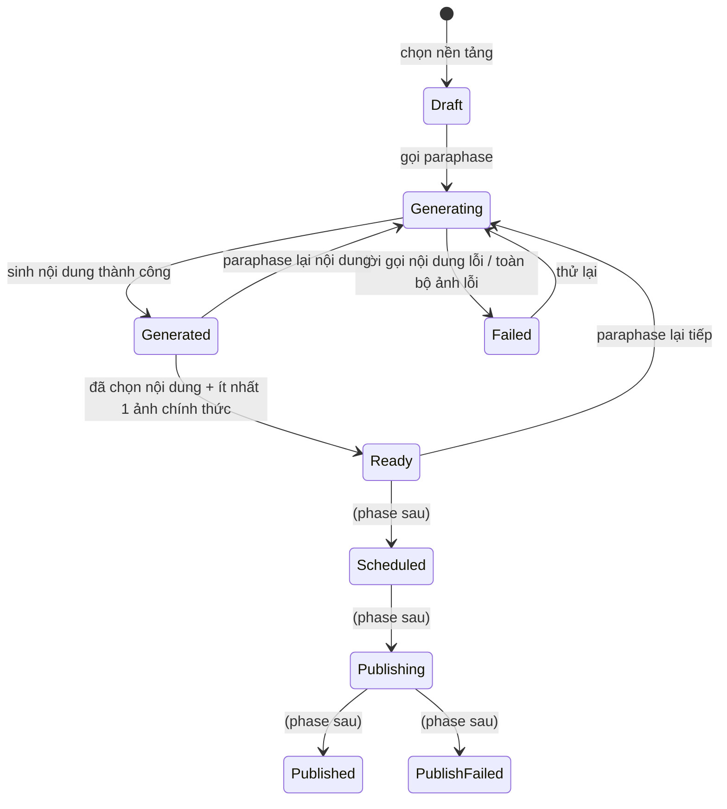

# PostGen — Dự án AI Marketing

> **Cập nhật 2026-09-14:** mốc 0–2 đã hiện thực trong working tree, chưa commit hoặc deploy. Các quyết định dưới đây đã cập nhật theo việc dùng Config chung cho chuẩn nền tảng và ratio preset; mốc 3–7 vẫn là thiết kế chưa triển khai.

Cập nhật 2026-09-14: đã bỏ bảng PlatformStandard và cả API chuẩn nền tảng/preset riêng. Admin dùng [Config chuẩn nền tảng](PlatformConfig.md) và [Config ratio preset](RatioPresetConfig.md).

## Đọc gì trước khi code

Tài liệu này đủ để bắt tay vào giai đoạn 2 và 3 mà không cần hỏi lại. Đọc kèm:

- **`CLAUDE.md` ở gốc repo** — quy ước feature folder `IService`/`Service`, đăng ký trong `Program.cs`, `ApiResponseFactory`, exception, và hai thư mục cố tình viết sai chính tả `Extentions` / `Abtraction`.
- **`HoaTheoMua.Service/XanhSm/Service.cs`** — mẫu để viết `AiService/`: typed `HttpClient`, `SendAsync<T>` tập trung, map lỗi provider sang `BadGatewayException`.
- **`HoaTheoMua.Service/Mockup/Service.cs`** — mẫu phân trang chuẩn (1-based, `pageSize` clamp 100).
- **`HoaTheoMua.Repository/Configurations/PostGenConfigurations.cs`** — cấu hình schema PostGen đã hiện thực; các phần AI khác ở `AiCustomizationConfigurations.cs`.

Các mục cần đọc kỹ nhất trong `DataModel.md`, vì chúng là chỗ dễ làm sai nhất: "Đánh số version lúc đọc", "Hai cái bẫy khi hiện thực hóa", "Cấu hình tái sử dụng", "Dữ liệu khởi tạo bắt buộc".

## Phạm vi dùng chung

BasePost và preset PostGen dùng chung cho mọi Staff/Admin. BasePost không có UserId; API Post Core không lọc theo người tạo. Preset chỉ có một cấu hình chung theo Group/Key; quản trị qua API Config chung với quyền Admin.

## Trạng thái

- **Thiết kế**: xong. Mô hình dữ liệu, hợp đồng API, contract AI, state machine đều đã chốt.
- **Tài liệu tách riêng**: đã có [DataModel.md](DataModel.md), [ApiContract.md](ApiContract.md), [AiServiceContract.md](AiServiceContract.md), [PublishingReserved.md](PublishingReserved.md).
- **Code**: đã triển khai mốc 0–2 (schema, 5 API Post Core, cấu hình nền tảng/preset qua API Config chung). Các thay đổi chưa commit hoặc deploy. Mốc 3–7 chưa triển khai.
- **Kiểm thử gần nhất**: 74 test Config/PostGen PASS, không fail/skip; HTTP probe có 31 request và 53 kiểm tra PASS. Migration Up/Down đã kiểm trên PostgreSQL 16 cục bộ, chưa áp dụng lên database triển khai. Chi tiết tại [Implementation.md](Implementation.md).
- **Chặn**: contract AI Service chưa được bên làm AI xác nhận — chặn mốc 3 (AI client) trở đi. Các tham chiếu giai đoạn 2/3/4 trong bản brief cũ tương ứng schema/CRUD/AI; bảng mốc 0–7 phía dưới là thứ tự hiện tại.

## Bối cảnh nghiệp vụ

### Post Core

Người dùng nhập một bài gốc gồm:

- Title
- Content
- Hashtag
- Nhiều hình ảnh

Từ bài gốc đó, AI Service paraphase ra nội dung mới phù hợp với từng nền tảng theo System Prompt, và dựng lại ảnh theo các tỷ lệ mà người dùng chọn.

### Nền tảng đích

- Facebook Page
- Instagram chuyên nghiệp
- Zalo Official Account (OA)

Mỗi nền tảng có các tỷ lệ ảnh đặc thù. Khả năng đăng qua API của từng nền tảng cần được kiểm chứng khi thiết kế tích hợp.

### Luồng tạo bài

1. **Nhập Post Core** — title, content, hashtag, các ảnh.

2. **Chọn nền tảng cần paraphase.** Không bắt buộc đủ ba: có những bài chỉ hợp với một vài nền tảng.

3. **Cấu hình cho từng nền tảng.** Chọn các tỷ lệ ảnh, rồi với mỗi tỷ lệ chọn những ảnh nào sẽ được dựng ra tỷ lệ đó. Nếu đã lưu cấu hình tái sử dụng thì bỏ qua bước này.

4. **Bấm tạo.** AI paraphase nội dung theo System Prompt của từng nền tảng, và dựng ảnh theo từng tỷ lệ.

5. **Nhận kết quả.** Hệ thống trả về nội dung và ảnh cho từng nền tảng. Người dùng chọn ảnh nào dùng chính thức và thứ tự xuất hiện.

### Paraphase lại

Nếu nội dung hoặc ảnh chưa phù hợp, người dùng tạo lại dựa trên feedback nhập liệu. Mỗi lần tạo lại sinh ra một phiên bản mới, phiên bản cũ vẫn giữ nguyên.

### Chọn bản chính thức

Đôi khi bản mới lại không hợp bằng bản cũ, nên người dùng phải chọn lại được bản trước đó. Cụ thể:

- Chọn **nội dung** và **từng ảnh** độc lập với nhau, từ các lần tạo khác nhau.
- Được phép ghép nội dung phiên bản cũ với ảnh phiên bản mới.
- Chọn ảnh nào dùng chính thức và thứ tự xuất hiện trên nền tảng.

### Xử lý ảnh

- AI đổi bố cục hoặc mở rộng nền theo tỷ lệ người dùng chọn.
- **Giữ nguyên sản phẩm và các chi tiết nhận diện trong ảnh gốc** — đây là ràng buộc cứng, mọi quyết định thiết kế về ảnh đều phải tôn trọng nó.

### Đăng bài — hoãn sang phase sau

Sau khi có nội dung cho các nền tảng, người dùng đăng ngay hoặc đặt lịch. Không bấm đăng và không đặt lịch thì bài không bao giờ được đăng.

Phần này **không nằm trong phạm vi đợt này**. Schema chừa sẵn các cột cần thiết để phase sau không phải migration lại bảng lớn.

## Quyết định đã chốt

| # | Vấn đề | Quyết định |
| --- | --- | --- |
| 1 | Phạm vi | Thiết kế trước, code sau. Phần đăng bài tách hẳn sang phase riêng |
| 2 | Cách gọi AI Service | HTTP **đồng bộ** từ backend |
| 3 | Đăng bài lên nền tảng | **Hoãn sang phase sau**, đợt này chỉ chừa sẵn field trong schema |
| 4 | Schema | **Mở rộng các bảng có sẵn**, không thiết kế bộ bảng mới |
| 5 | Lưu ảnh | AI Service trả **URL vĩnh viễn**, backend chỉ lưu chuỗi URL `varchar(2048)` như `CardTemplate`/`Mockup` |
| 6 | Tỷ lệ ảnh | **Enum cố định cho mã tỷ lệ/pixel; tỷ lệ chọn cho từng nền tảng chỉ lưu trong Config → postgen.ratio-preset** |
| 7 | Phân quyền | API Post Core giữ `StaffOrAdminPolicy`; quản trị chuẩn nền tảng và preset chỉ dùng API Config với `AdminPolicy` |
| 8 | System Prompt theo nền tảng | Giữ **một prompt `Post` chung**, ghép thêm `Config(postgen.platform.{platform}).Value.description` của nền tảng khi gọi AI |
| 9 | Sửa tay nội dung | Tạo một version `Source = Manual`, **tự động chốt làm bản chính thức**. Không dùng cột `ContentOverride` |
| 10 | Nguồn của lần paraphase tiếp theo | Một trường `sourceGenerationId`: `null` = làm lại từ bài gốc, id version bất kỳ = làm tiếp/rẽ nhánh từ version đó. Lịch sử version vì vậy là **cây**, không phải đường thẳng |
| 11 | Trục version của ảnh | Tách hẳn khỏi nội dung. Đơn vị đánh version là **cặp (ảnh gốc × tỷ lệ)**, thuộc `BasePost` và **dùng chung mọi nền tảng**; nền tảng chỉ chọn version nào |
| 12 | Số thứ tự version | **Không lưu cột `VersionNo`**, tính lúc đọc bằng `ROW_NUMBER()` theo `(CreatedAt, Id)` — bỏ hẳn tranh chấp khi cấp số |
| 13 | Paraphase ảnh | **Đối xứng với nội dung**: `sourceGeneratedPostImageId = null` → dựng từ ảnh gốc; có id → dựng tiếp trên ảnh của version đó. Feedback **không cộng dồn** ở cả hai bên |
| 14 | `PostHistory` / `ClientHistory` | **Bỏ khỏi phạm vi PostGen** — trùng lặp với chính dòng version. Lời gọi AI ghi log ứng dụng. Bật lại khi cần đối soát chi phí hoặc làm feed "những gì tôi đã tạo" |
| 15 | Title | Là **title của bài đăng**, AI sinh riêng cho từng nền tảng → thêm cột `Title` vào `GeneratedPost`. Không nền tảng nào có trường title riêng nên lúc đăng phải ghép vào đầu nội dung |
| 16 | Hashtag | AI sinh riêng cho từng nền tảng, lưu dạng chuỗi `varchar(1000)` |
| 17 | Lời gọi sinh nội dung | **Chỉ text**, không đính kèm ảnh cho AI |
| 18 | Giới hạn số ảnh của nền tảng | **Chưa validate** ở đợt này; trường `maxImageCount` trong Config chuẩn nền tảng, kiểm lúc đăng ở phase sau |
| 19 | Gán version ảnh cho nền tảng | **Tách khỏi việc sinh ảnh.** `POST /images/regenerate` chỉ thêm vào kho; việc ô nào dùng version nào chốt ở bước cuối qua `PUT .../platforms/{platform}/images` |
| 20 | Preset | Lưu **tỷ lệ + quy tắc chọn ảnh** (`imageSelectionMode`), trong bảng `Config` group `postgen`; **dùng chung cho mọi Staff/Admin, không phân theo UserId** |
| 21 | Quota chi phí | **Không giới hạn theo user.** Chỉ chặn 12 ảnh mỗi lượt sinh + rate limit `heavy` |
| 22 | Upload ảnh gốc | **Frontend tự upload**, backend chỉ nhận URL — không làm endpoint upload |

## Hiện trạng code (đã kiểm chứng)

- PostCoreController/PostCore.Service đã hiện thực 5 API CRUD bài gốc, dùng BasePost và các bảng ảnh/bài nền tảng để đọc chi tiết. Các luồng sinh AI, sửa/chọn version và đăng bài chưa triển khai.
- PlatformStandard đã bỏ khỏi model và service/controller. Migration mới chuyển dữ liệu sang ba key `postgen.platform.facebook`, `postgen.platform.instagram`, `postgen.platform.zalo` trước khi drop bảng. Chuẩn nền tảng và ratio preset dùng API Config chung; không còn API chuyên biệt.
- `SystemPrompt`, `CardTemplate`, `Mockup` tiếp tục dùng service/controller hiện có. Rule URL HTTP/HTTPS đã trích thành `HttpUrl()` dùng chung cho PostCore, CardTemplate và Mockup.
- `SystemPrompt` có **unique index trên `Type`**, tức mỗi loại đúng một dòng. `SystemPromptType` là `{ Flower, Card, Post }` nên PostGen chỉ có **một** dòng prompt duy nhất để dùng → khớp với quyết định #8, không cần đổi schema.
- `PlatformType`, `SystemPromptType`, `ClientHistoryType`, `CardFormType` là **native Postgres enum** (`HasPostgresEnum` trong `AppDbContext` + `MapEnum` trong `Program.cs`) → thêm giá trị phải có migration `ALTER TYPE`. Các enum mới của PostGen vì vậy lưu dạng `varchar` + `CHECK`, theo tiền lệ `CardTemplateType`/`GeneratedCardType`.
- Chưa có bất kỳ hạ tầng lưu file nào (không Cloudinary/S3/Blob) → khớp với quyết định #5 và #22.
- Chưa có tích hợp AI nào; `HoaTheoMua.Service/Consumer/` đang rỗng.
- MassTransit + RabbitMQ đã wired sẵn (saga Fulfillment, outbox/inbox) — dùng được cho phase đăng bài theo lịch sau này. Quartz có package nhưng chưa có job.

## Thiết kế Database

Xem [DataModel.md](DataModel.md) — nguồn thiết kế schema và ghi chú hiện thực.

## State machine

### PlatformPost



Guard:

- Đang `Generating` mà gọi sinh tiếp → `ConflictException`.
- Vào `Ready` phải có `OfficialGenerationId != null` **và** ít nhất một dòng `PlatformPostImage` có `SelectedGeneratedPostImageId != null`.
- Sửa tay nội dung không đưa `PlatformPost` về `Generating` — nó tạo version `Manual` và giữ nguyên trạng thái hiện tại (`Generated` hoặc `Ready`).
- Paraphase lại **một ô ảnh** cũng không đưa cả bài về `Generating` — nó chỉ thêm ảnh vào kho dùng chung.
- Các trạng thái sau `Ready` chỉ khai báo, đợt này không có code nào chuyển vào.

### Không có state machine cho version

`GeneratedPost` và `GeneratedPostImage` là dòng append-only, không chuyển trạng thái. `GeneratedPostImage.Status` chỉ có `Succeeded`/`Failed` và được quyết ngay lúc ghi. `GeneratedPost` không có cột trạng thái — lời gọi nội dung thất bại thì không ghi dòng nào.

Khái niệm "sinh được một phần" nằm ở **kết quả của lượt gọi**, không nằm trong bảng: lượt sinh trả về `status = Partial` khi có ô ảnh lỗi và có ô ảnh thành công.

## Hợp đồng API

Các endpoint PostGen dưới đây dùng `[Authorize(Policy = JwtExtensions.StaffOrAdminPolicy)]` (quyết định #7). **Ba** endpoint gọi AI — `generate`, `content/regenerate`, `images/regenerate` — thêm `[EnableRateLimiting(RateLimitExtensions.HeavyPolicy)]`; đó là ba chỗ duy nhất tiêu tiền.

`{platform}` trong route là tên enum viết thường: `facebook` | `instagram` | `zalo`.

Hiện chỉ 5 API Post Core đầu bảng có route thực thi. Các dòng sinh AI/version/official bên dưới là hợp đồng cho mốc 3–7. Chuẩn nền tảng và ratio preset dùng API Config chung, không nằm trong bảng endpoint PostGen.

| Method | Route | Service method | Ghi chú |
| --- | --- | --- | --- |
| POST | `/api/v1/posts` | `CreatePostCore` | Title, Content, Hashtag, danh sách ảnh |
| GET | `/api/v1/posts` | `GetPostCoreList` | phân trang + lọc `platform`, `keyword` |
| GET | `/api/v1/posts/{id:guid}` | `GetPostCoreDetail` | kèm bài nền tảng + version |
| PUT | `/api/v1/posts/{id:guid}` | `UpdatePostCore` | |
| DELETE | `/api/v1/posts/{id:guid}` | `DeletePostCore` | soft delete |
| POST | `/api/v1/posts/{id:guid}/generate` | `GeneratePlatformPosts` | **heavy**, chọn nền tảng + tỷ lệ + map ảnh nguồn |
| POST | `/api/v1/posts/{id:guid}/platforms/{platform}/content/regenerate` | `RegenerateContent` | **heavy**, `sourceGenerationId` + `feedback` — chỉ nội dung |
| PUT | `/api/v1/posts/{id:guid}/platforms/{platform}/content` | `EditPlatformContent` | sửa tay nội dung → tạo version `Manual` và chốt luôn |
| GET | `/api/v1/posts/{id:guid}/platforms/{platform}/content/versions` | `GetContentVersions` | danh sách version nội dung |
| PUT | `/api/v1/posts/{id:guid}/platforms/{platform}/content/official` | `SelectOfficialContent` | chọn version nội dung chính thức |
| POST | `/api/v1/posts/{id:guid}/images/regenerate` | `RegenerateImage` | **heavy**, paraphase lại **đúng một cặp** `(sourceBasePostImageId, ratioCode)`. Chỉ thêm ảnh vào kho, không đụng ô của nền tảng nào |
| GET | `/api/v1/posts/{id:guid}/images` | `GetImageVersions` | mọi version ảnh của bài gốc, gom theo cặp (ảnh × tỷ lệ) |
| PUT | `/api/v1/posts/{id:guid}/platforms/{platform}/images` | `UpdatePlatformImages` | ghi đè toàn bộ ô ảnh của nền tảng: ảnh nào, tỷ lệ nào, version nào, thứ tự nào |
| GET | `/api/v1/posts/{id:guid}/platforms/{platform}/official` | `GetOfficialVersion` | payload sẽ đem đi đăng |

Chừa sẵn, **ghi trong tài liệu nhưng không triển khai**: `POST .../platforms/{platform}/publish`, `POST .../platforms/{platform}/schedule`, `DELETE .../platforms/{platform}/schedule`, `GET /api/v1/post-gen/platform-accounts`.

### DTO chính

`POST /api/v1/posts/{id}/generate`

```json
{ "platforms": [
    { "platform": "facebook", "usePreset": false,
      "ratios": [ { "ratioCode": "Square1x1", "basePostImageIds": ["…A", "…B"] } ] },
    { "platform": "instagram", "usePreset": true }
] }
```

`usePreset` và `ratios` loại trừ nhau trên **mỗi nền tảng** — một nền tảng dùng preset, nền tảng khác cấu hình tay trong cùng một request là hợp lệ. Khi `usePreset = true`, server đọc preset dùng chung từ `Config` group `postgen` rồi khai triển theo `imageSelectionMode`.

Server gom các cặp `(sourceBasePostImageId, ratioCode)` của **tất cả** nền tảng trong request lại, loại trùng, rồi mới gọi AI. Trong ví dụ trên nếu Instagram cũng chọn `Square1x1` với cùng ảnh A thì cặp đó chỉ sinh một lần và cả hai nền tảng trỏ vào chung một tấm.

```json
{ "value": {
    "basePostId": "…",
    "images": [
      { "id": "…", "sourceBasePostImageId": "…A", "ratioCode": "Square1x1",
        "versionNo": 1, "pixelWidth": 1080, "pixelHeight": 1080,
        "imageUrl": "https://…", "status": "Succeeded" },
      { "id": "…", "sourceBasePostImageId": "…B", "ratioCode": "Landscape16x9",
        "versionNo": 1, "imageUrl": null,
        "status": "Failed", "errorMessage": "AI service timed out" }
    ],
    "platforms": [
      { "platform": "facebook", "platformPostId": "…", "status": "Partial",
        "content": { "generationId": "…", "versionNo": 1,
                     "title": "…", "content": "…", "hashtag": "…" },
        "images": [ { "sourceBasePostImageId": "…A", "ratioCode": "Square1x1",
                      "selectedGeneratedPostImageId": "…", "sortOrder": 1 } ] }
    ] },
  "isSuccess": true, "isFailed": false, "error": null,
  "traceId": "…", "timestampUtc": "…" }
```

Mảng `images` là kho ảnh dùng chung, mảng `platforms` là các ô ảnh trỏ vào kho đó. Trường `versionNo` **được tính lúc đọc**, không phải cột trong DB — mọi tham chiếu tới một version cụ thể đều dùng `id`. `GET /api/v1/posts/{id}` trả về đúng shape này, nên chuyển sang bất đồng bộ sau này không phải sửa DTO.

`POST .../platforms/{platform}/content/regenerate`

```json
{ "sourceGenerationId": "…v1…", "feedback": "trẻ trung hơn" }
```

`sourceGenerationId = null` nghĩa là làm lại từ `BasePost.Content`; truyền id của một version bất kỳ thuộc bài nền tảng này thì AI làm tiếp từ nội dung của version đó. Giá trị này được ghi thẳng vào `ParentGeneratedPostId` của version mới.

`POST /api/v1/posts/{id}/images/regenerate` — đúng **một** ô ảnh

```json
{ "sourceBasePostImageId": "…A", "ratioCode": "Portrait4x5",
  "sourceGeneratedPostImageId": "…v1…",
  "feedback": "nền sáng hơn" }
```

`sourceGeneratedPostImageId = null` → dựng lại từ ảnh gốc; truyền id một version → dựng tiếp trên ảnh của version đó. Giá trị này ghi thẳng vào `ParentGeneratedPostImageId`.

Endpoint này **chỉ thêm ảnh vào kho**, không đụng tới `PlatformPostImage` của bất kỳ nền tảng nào. Muốn dùng version mới thì chốt ở `PUT .../platforms/{platform}/images`.

`PUT .../platforms/{platform}/images` — ghi đè toàn bộ ô ảnh của một nền tảng

```json
{ "images": [
    { "sourceBasePostImageId": "…A", "ratioCode": "Square1x1",
      "selectedGeneratedPostImageId": "…", "sortOrder": 1 },
    { "sourceBasePostImageId": "…B", "ratioCode": "Landscape16x9",
      "selectedGeneratedPostImageId": "…", "sortOrder": 2 } ] }
```

Dùng cho cả việc đổi thứ tự, bỏ bớt ảnh, lẫn việc chọn version khác cho một ô.

`PUT .../platforms/{platform}/content` — sửa tay

```json
{ "title": "…", "content": "…", "hashtag": "#hoa #tet" }
```

Tạo version `Source = Manual` (hoặc ghi đè version `Manual` cuối nếu nó chưa bị tham chiếu), rồi trỏ `OfficialGenerationId` vào đó.

`PUT .../platforms/{platform}/content/official`

```json
{ "generationId": "…" }
```

### Lỗi

Response luôn bọc bằng `ApiResponseFactory.Base(...)` / `BasePagination(...)`. Lỗi **ném** ra từ service:

| Tình huống | Exception | Message |
| --- | --- | --- |
| Không tìm thấy Post Core hoặc bài đã bị xóa | `NotFoundException` | `Post not found` |
| Chưa sinh bài cho nền tảng đó | `NotFoundException` | `Platform post not found` |
| Nền tảng đó đang sinh dở | `ConflictException` | `Platform post is generating` |
| Vừa gửi preset vừa gửi `ratios` | `BadRequestException` | `Preset and ratios cannot be used together` |
| `basePostImageIds` chứa ảnh của bài khác | `BadRequestException` | `Image does not belong to this post` |
| `sourceGenerationId` không phải version của bài nền tảng này | `BadRequestException` | `Source generation does not belong to this platform post` |
| `sourceGeneratedPostImageId` không thuộc đúng cặp (ảnh gốc, tỷ lệ) đang paraphase | `BadRequestException` | `Source image does not match the requested ratio` |
| `sourceGeneratedPostImageId` trỏ vào version `Failed` | `BadRequestException` | `Cannot regenerate from a failed image` |
| Chọn version ảnh thuộc bài gốc khác | `BadRequestException` | `Selected image does not belong to this post` |
| Version ảnh được chọn không đúng cặp (ảnh gốc, tỷ lệ) của ô đó | `BadRequestException` | `Selected image does not match the slot` |
| Ảnh được chọn có `Status != Succeeded` | `BadRequestException` | `Selected image is not available` |
| `sortOrder` trùng nhau | `BadRequestException` | `Duplicate image order` |
| Chưa cấu hình System Prompt `Post` hoặc Config chuẩn của nền tảng | `BadRequestException` | `System prompt for platform {platform} is not configured` |
| AI trả 2xx nhưng JSON hỏng / thiếu field bắt buộc (`content`, `imageUrl`) | `BadGatewayException` | `AI service returned an invalid response` |
| AI không gọi được / 5xx / timeout lời gọi nội dung | `BadGatewayException` | `AI service is unavailable` |
| AI trả **400/422** (payload của ta sai) | `BadRequestException` | `AI service rejected the request` — log mã lỗi của provider, không dội nguyên văn ra client |
| Cờ `postgen.enabled = false` | `BadRequestException` | `PostGen is disabled` |
| Sai shape / vượt giới hạn độ dài, số ảnh, số tỷ lệ | FluentValidation → **422** qua `ValidationActionFilter` | |

## Contract với AI Service

Đăng ký theo tiền lệ `XanhSm`: typed `HttpClient` (`AddHttpClient<AiService.IService, AiService.Service>("AiService", c => c.Timeout = ...)`), option POCO bind bằng `configuration.GetSection(nameof(AiOption)).Bind(...)`.

| Khoá `AiOption` | Mặc định | |
| --- | --- | --- |
| `BaseUrl` | — | bắt buộc |
| `ApiKey` | — | gửi qua `Authorization: Bearer` |
| `TimeoutSeconds` | 120 | |
| `ContentPath` | `/v1/paraphrase` | |
| `ImagePath` | `/v1/image-ratio` | |
| `MaxParallelImageRequests` | 3 | |
| `MaxImagesPerGeneration` | 12 | |
| `ImageRetryCount` | 1 | chỉ áp dụng cho item ảnh |
| `ContentModel` / `ImageModel` | — | |

Trong Docker các khoá này vào bằng env `AiOption__*`. Một số khoá đổi được lúc chạy không cần deploy qua bảng `Config` group `postgen`: `postgen.enabled`, `postgen.max_images_per_generation`, `postgen.content_model`, `postgen.image_model`, `postgen.image_instruction` (dùng `ConfigHelper.GetConfigsByGroupsAsync`).

### Sinh nội dung

`POST {BaseUrl}{ContentPath}`

```json
{ "requestId": "guid",
  "platform": "facebook",
  "systemPrompt": "<SystemPrompt(Post).Content + Config(postgen.platform.{platform}).Value.description>",
  "source": { "title": "…", "content": "…", "hashtag": "#hoa #tet" },
  "previousContent": null,
  "feedback": null,
  "constraints": { "maxLength": 2200, "language": "vi", "model": "…" } }
```

Trả về: `{ "requestId": "…", "title": "…", "content": "…", "hashtag": "…", "model": "…", "usage": { "inputTokens": 0, "outputTokens": 0 } }`

AI sinh **cả ba** phần riêng cho từng nền tảng: title, content, hashtag. Lời gọi **chỉ gửi text**, không đính kèm ảnh.

**Lưu ý khi đăng bài (phase sau)**: Facebook, Instagram, Zalo OA đều không có trường title riêng — bài đăng chỉ là một khối nội dung. Nên lúc đăng phải ghép `Title` vào đầu `Content`. Quy tắc ghép (xuống dòng đơn hay đôi, hashtag đặt ở đâu) chốt ở `PublishingReserved.md`.

### Sinh ảnh

`POST {BaseUrl}{ImagePath}`, mỗi cặp (ảnh nguồn × tỷ lệ) một lời gọi:

```json
{ "requestId": "guid",
  "sourceImageUrl": "https://…/v1.jpg",
  "originalImageUrl": "https://…/original.jpg",
  "targetRatio": { "code": "Portrait4x5", "width": 1080, "height": 1350 },
  "instruction": "<Config: postgen.image_instruction>",
  "preserve": { "product": true, "brandingText": true, "logo": true },
  "feedback": "nền sáng hơn",
  "constraints": { "model": "…" } }
```

Trả về: `{ "requestId": "…", "imageUrl": "https://…", "width": 1080, "height": 1350, "model": "…", "expiresAt": null }`

Hai trường ảnh có vai trò khác nhau:

- `sourceImageUrl` — **tấm cần dựng lại**. Bằng ảnh gốc ở lần sinh đầu, bằng ảnh của version cha khi paraphase tiếp lên một version.
- `originalImageUrl` — **mốc nhận diện**, luôn là `BasePostImage.ImageUrl`. Để AI đối chiếu sản phẩm khi đã qua nhiều đời dựng lại. Ở lần sinh đầu hai trường bằng nhau.

Không có trường `platform`: theo quyết định #11 ảnh dùng chung mọi nền tảng nên lời gọi này không được mang thông tin riêng của nền tảng nào.

### Xử lý lỗi và rủi ro của việc gọi đồng bộ

Xử lý lỗi theo đúng `XanhSm/Service.cs`: một hàm `SendAsync<T>` tập trung, non-2xx / `JsonException` / thiếu field bắt buộc (`content`, `imageUrl`) → `BadGatewayException`.

Mỗi lời gọi ghi **log ứng dụng** kèm `requestId`, `HttpStatus`, `DurationMs` và mã lỗi của provider — không ghi vào bảng nào (quyết định #14). **Không log `ApiKey`**, và không log nguyên văn payload chứa dữ liệu khách hàng ở mức log mặc định.

Một lần sinh 3 nền tảng × 4 ảnh × 2 tỷ lệ là 24 lời gọi ảnh trong một HTTP request. Biện pháp:

- **Chặn cứng ở validator**: `MaxImagesPerGeneration = 12` — đếm trên **số cặp `(ảnh gốc, tỷ lệ)` thực sự phải sinh sau khi đã gom và loại trùng toàn bộ nền tảng trong request**, không phải đếm theo từng nền tảng. Cặp nào đã có ảnh `Succeeded` trong kho thì không tính vì không gọi AI. Vượt ngưỡng là 422 ngay, không phải một request chạy lâu rồi chết giữa chừng.
- Gọi ảnh song song có giới hạn bằng `SemaphoreSlim(MaxParallelImageRequests)`.
- **Hai tầng timeout**: mỗi lời gọi dùng `HttpClient.Timeout` 120s (tiền lệ `AddHttpClient<…>("XanhSmService", c => c.Timeout = …)`); cả lượt sinh dùng thêm một tổng ngân sách — `CancellationTokenSource.CreateLinkedTokenSource(HttpContext.RequestAborted)` + `CancelAfter(180s)`. Ảnh nào chưa kịp xong khi hết ngân sách thì ghi `Status = Failed`, `ErrorMessage = "Generation budget exceeded"`, **không** làm hỏng cả request.
- **Lưu ý hạ tầng**: API này chạy sau Cloudflare tunnel — tunnel/reverse proxy phải chịu được thời gian phản hồi lớn hơn tổng ngân sách, nếu không client nhận 524 trong khi backend vẫn đang ghi dữ liệu. Kiểm chứng trước khi bật.
- **Partial failure không rollback**: ảnh lỗi lưu thành một dòng `GeneratedPostImage` với `Status = Failed` + `ErrorMessage`, ô `PlatformPostImage` tương ứng để `SelectedGeneratedPostImageId = null`, lượt gọi trả 200 với `status = Partial`. Chỉ ném `BadGatewayException` khi **lời gọi nội dung lỗi** hoặc **toàn bộ ảnh đều lỗi**. Người dùng sinh lại đúng ô lỗi bằng `POST .../images/regenerate`, không phải chạy lại cả lượt.
- **Không có Polly** trong repo: tự retry đúng **một lần**, chỉ cho item ảnh, chỉ với timeout/429/5xx, không retry 4xx. Lời gọi nội dung không retry (tốn tiền và không idempotent). Hướng nâng cấp sau: `Microsoft.Extensions.Http.Resilience`.
- **Thiết kế sao cho chuyển async không phải viết lại**: response của `generate` và của `GET /api/v1/posts/{id}` đã cùng shape, đều có kho `images` kèm `status` từng tấm. Phase sau chỉ cần đổi `POST generate` trả `202` rồi publish message MassTransit (RabbitMQ + outbox đã wired sẵn) — frontend vẫn poll đúng cái GET nó đang gọi, không đổi DTO.

## Bộ tài liệu sẽ viết trong `Service - PostGen/`

**Tách ra từ file này** (dạng `#` design doc):

| File | Nội dung |
| --- | --- |
| `Plan.md` | Chính file này — brief nghiệp vụ, quyết định, kế hoạch |
| `DataModel.md` | ERD Mermaid, từng bảng một bảng markdown (Cột / Kiểu / Null / Ghi chú), index & khóa ngoại, lập trường soft delete, đánh số version lúc đọc, lý do không dùng `PostHistory`/`ClientHistory`, các trường chừa sẵn, thứ tự migration |
| `ApiContract.md` | Bảng endpoint (method, route, policy, rate limit), mẫu DTO, bảng lỗi, quy ước phân trang |
| `AiServiceContract.md` | Request/response với AI Service, bảng `AiOption`, nhóm config `postgen`, ánh xạ lỗi → `BadGatewayException`, quy tắc timeout/fan-out/partial failure, **sequence diagram Mermaid** Controller → Service → AI → DB, và cách chuyển sang async |
| `PublishingReserved.md` | Phase đăng bài: cột/trạng thái/route đã chừa, quy tắc ghép `Title` vào `Content`, những gì cần kiểm chứng với Facebook Graph / Instagram Content Publishing / Zalo OA (theo văn phong "Thông tin cần lấy" của `Service - XanhSM/IntegrationPlan.md`) |

**Viết dần khi implement từng endpoint** (dạng per-method `#### Request` / `#### Response` / `#### Flow diagram` / `#### Test case`) — chưa viết bây giờ vì cần payload và `traceId` thật:

`CreatePostCore.md`, `GetPostCoreList.md`, `GetPostCoreDetail.md`, `UpdatePostCore.md`, `DeletePostCore.md`, `GeneratePlatformPosts.md`, `RegenerateContent.md`, `EditPlatformContent.md`, `GetContentVersions.md`, `SelectOfficialContent.md`, `RegenerateImage.md`, `GetImageVersions.md`, `UpdatePlatformImages.md`, `GetOfficialVersion.md`.

Quy ước bám theo vault hiện có: không có frontmatter, thân bài tiếng Việt, tiêu đề per-method giữ nguyên từ khoá tiếng Anh, mẫu response luôn kèm envelope `value/isSuccess/isFailed/error/traceId/timestampUtc`, sơ đồ dùng Mermaid (tiền lệ `Service - Fulfillment/`) thay vì xuất PNG vào `Store-Image/`.

Đã tách `DataModel.md`; mục "Thiết kế Database" trong file này trỏ sang đó để schema chỉ có một nguồn sự thật.

## Câu hỏi còn mở

Các câu về nghiệp vụ đã chốt hết ở bảng quyết định. Còn lại ba thứ phụ thuộc bên ngoài, không tự quyết được:

1. **Contract AI Service** — chưa có endpoint/auth thực tế. Mục "Contract với AI Service" ở trên là **đề xuất**, phải chốt với bên làm AI trước khi viết `AiService/`. Đây là thứ duy nhất chặn giai đoạn 4; giai đoạn 2 và 3 làm được ngay mà không cần chờ.
2. **Độ bền của URL ảnh AI trả về** — đang giả định vĩnh viễn (quyết định #5). Nếu thực tế là link hết hạn thì phải có kho lưu trữ **trước khi** phase đăng bài lên sóng, nếu không bài đăng theo lịch sẽ đăng ảnh chết. Đã chừa sẵn `ImageExpiresAt` và `StorageProvider` để không phải migration lại.
3. **Phase đăng bài** — timezone lưu trữ, cơ chế retry, bảng token OAuth của Facebook Page / IG / Zalo OA, quy tắc ghép `Title` vào đầu `Content`. Thiết kế riêng ở `PublishingReserved.md`.

Đã thêm rule dùng chung `HttpUrl()` vào `Common/ValidationRules.cs`, tái sử dụng tại PostCore, CardTemplate và Mockup.

## Các giai đoạn triển khai

Tám mốc, mỗi mốc **tự kiểm được** rồi mới sang mốc sau. Chỉ hai mốc cần AI Service (mock được cả hai), nên phần lớn công việc không phải chờ bên ngoài.

| Mốc | Endpoint | Cần AI? |
| --- | --- | --- |
| 0 | — (schema) | không |
| 1 | 5 endpoint Post Core | không |
| 2 | Chuẩn nền tảng và preset dùng API Config chung (Admin) | không |
| 3 | `generate` — phần nội dung | mock |
| 4 | `generate` — thêm phần ảnh | mock |
| 5 | 4 endpoint version nội dung | mock |
| 6 | 3 endpoint version ảnh | mock |
| 7 | `official` | không |

Mốc 1 và 2 độc lập nhau, làm song song được. Việc tách `DataModel.md` / `ApiContract.md` / `AiServiceContract.md` chạy song song từ đầu, không chặn mốc nào.

### Mốc 0 — Schema

Entity + `Configurations/PostGenConfigurations.cs` (file mới; `ApplyConfigurationsFromAssembly` tự nhặt) + migration kèm seed.

Migration: mở rộng `BasePost` (bỏ `ImageUrl`), `GeneratedPost` (bỏ `ImageUrl`, thêm trục version nội dung); thêm `BasePostImage`, `PlatformPost`, `GeneratedPostImage`, `PlatformPostImage`. Không đụng `SystemPrompt`, `PostHistory`, `ClientHistory`.

**Kiểm:** `dotnet ef database update` chạy sạch trên DB rỗng; `SELECT` thấy đủ dòng seed ở `SystemPrompt` (1 dòng) và `Config` (5 khóa: 3 chuẩn nền tảng, 2 cấu hình chung); `dotnet build -c Release` pass. Không có câu `ALTER TYPE` nào trong file migration.

### Mốc 1 — Post Core CRUD

Feature `HoaTheoMua.Service/PostCore/` theo shape `IService.cs` / `Service.cs` / `Request.cs` / `Response.cs` / `Validate/`, alias + `AddScoped` trong `Program.cs`.

| Endpoint | |
| --- | --- |
| `POST /api/v1/posts` | `CreatePostCore` |
| `GET /api/v1/posts` | `GetPostCoreList` |
| `GET /api/v1/posts/{id}` | `GetPostCoreDetail` |
| `PUT /api/v1/posts/{id}` | `UpdatePostCore` |
| `DELETE /api/v1/posts/{id}` | `DeletePostCore` |

**Kiểm trên Swagger:** tạo một bài có 3 ảnh → `GET` danh sách thấy nó → `GET` chi tiết thấy đủ 3 ảnh đúng `SortOrder` → sửa title → xóa → danh sách không còn nhưng dòng DB vẫn còn với `IsDeleted = true`. Gửi bài không ảnh phải nhận 422.

### Mốc 2 — Cấu hình nền tảng và preset

Dùng API Config hiện có với quyền Admin. Mỗi nền tảng một key `postgen.platform.{platform}`, ratio giữ riêng. Migration `20260914055741_MovePlatformStandardsToConfig` giữ ID/metadata, chuyển dữ liệu rồi bỏ bảng cũ trong transaction; chặn xung đột key/ID và hỗ trợ Down có kiểm tra dữ liệu. Giữ `IsPublic = false`, không thêm quyền Staff. Xem [PlatformConfig.md](PlatformConfig.md).

Admin đọc bằng `GET /api/v1/configs/settings?groupName=postgen&key=postgen.platform.instagram`, chọn key khớp chính xác rồi lấy id để sửa/xóa. Mỗi nền tảng có JSON riêng gồm `description`, ba giới hạn nullable và `isActive`. Ratio vẫn ở `postgen.ratio-preset`. Config hiện không validate riêng shape của hai loại dữ liệu này; xem contract chi tiết trong tài liệu Config tương ứng.

**Kiểm:** hai tài khoản Admin dùng API Config chung để tạo, đọc, sửa và xóa cùng một preset theo Group/Key. Staff không gọi được API quản trị Config. Unique index giữ tối đa một preset còn hiệu lực; tạo và sửa là hai thao tác riêng, không có upsert preset. Xem [RatioPresetConfig.md](RatioPresetConfig.md).

### Mốc 3 — AI client + sinh nội dung

Feature `HoaTheoMua.Service/AiService/` (`AddHttpClient`, `SendAsync<T>` tập trung) + `PostGeneration/`. Endpoint `POST /api/v1/posts/{id}/generate` nhưng **chỉ sinh nội dung, chưa sinh ảnh**.

Tách riêng phần nội dung có lý do: cô lập được lỗi tầng HTTP client, ánh xạ lỗi và snapshot prompt trước khi thêm fan-out ảnh vào. Sai ở đây mà đã có 12 lời gọi ảnh song song thì rất khó lần ra.

**Kiểm bằng mock `HttpMessageHandler`:** gọi `generate` cho 2 nền tảng → sinh đúng 2 dòng `PlatformPost`, mỗi dòng 1 `GeneratedPost` với `Title`/`Content`/`Hashtag`, `Source = Ai`, `ParentGeneratedPostId = null`, `PromptSnapshot` chứa cả `SystemPrompt.Content` lẫn `Config(postgen.platform.{platform}).Value.description` của đúng nền tảng đó. `Status = Generated`, `OfficialGenerationId` trỏ vào version vừa sinh. Mock trả 500 → nhận `BadGatewayException`, **không** có dòng `GeneratedPost` nào được ghi.

### Mốc 4 — Sinh ảnh trong `generate`

Vẫn endpoint cũ, thêm phần ảnh: gom cặp, loại trùng, `SemaphoreSlim`, tổng ngân sách thời gian, partial failure, tạo ô `PlatformPostImage` và tự điền lần đầu.

**Kiểm — ba phép thử quan trọng nhất của cả feature:**

1. **Dùng chung ảnh**: Facebook và Instagram cùng chọn `(A, Portrait4x5)` → mock `HttpMessageHandler` chỉ được gọi **đúng một lần** cho cặp đó, và hai dòng `PlatformPostImage` trỏ vào cùng một `GeneratedPostImage.Id`.
2. **Partial failure**: mock cho 1 trong 3 ảnh lỗi → HTTP **200** với `status = Partial`, dòng ảnh lỗi có `Status = Failed` + `ErrorMessage`, ô tương ứng `SelectedGeneratedPostImageId = null`, hai ảnh kia vẫn dùng được.
3. **Chặn ngưỡng**: yêu cầu vượt 12 cặp phải sinh → **422 trước khi gọi AI**, mock không được gọi lần nào.

### Mốc 5 — Version nội dung

| Endpoint | |
| --- | --- |
| `POST .../platforms/{platform}/content/regenerate` | `RegenerateContent` |
| `PUT .../platforms/{platform}/content` | `EditPlatformContent` |
| `GET .../platforms/{platform}/content/versions` | `GetContentVersions` |
| `PUT .../platforms/{platform}/content/official` | `SelectOfficialContent` |

**Kiểm bằng đúng kịch bản trong mục "Sửa tay nội dung cũng là một version":** tạo → paraphase lại → sửa tay → paraphase lại nữa. Phải ra 4 version với `Source` lần lượt `Ai`/`Ai`/`Manual`/`Ai`, và sau bước sửa tay `OfficialGenerationId` tự trỏ vào v3.

Thêm ba phép thử:

- **Rẽ nhánh**: gửi `sourceGenerationId` = id của v1 → version mới có `ParentGeneratedPostId = v1`, và AI nhận `previousContent` là nội dung v1 chứ không phải v3.
- **Số version ổn định**: gọi `GET content/versions` hai lần liên tiếp → thứ tự và `versionNo` y hệt nhau.
- **Không đẻ version rác**: sửa tay hai lần liên tiếp khi chưa ai trỏ vào bản `Manual` → vẫn đúng 4 dòng, không thành 5.

### Mốc 6 — Version ảnh và chốt ảnh

| Endpoint | |
| --- | --- |
| `POST /api/v1/posts/{id}/images/regenerate` | `RegenerateImage` |
| `GET /api/v1/posts/{id}/images` | `GetImageVersions` |
| `PUT .../platforms/{platform}/images` | `UpdatePlatformImages` |

**Kiểm — kịch bản "Facebook v1, Instagram v2":**

1. Hai nền tảng đang cùng dùng `(A, Portrait4x5) v1`.
2. Gọi `images/regenerate` cho cặp đó → sinh v2 vào kho, và **không ô nào đổi** — cả hai nền tảng vẫn trỏ v1. Đây là điểm dễ làm sai nhất của quyết định #19.
3. `PUT .../facebook/images` đặt ô đó sang v2 → Facebook dùng v2, Instagram vẫn v1.
4. Đảo thứ tự ảnh trong một lần `PUT` → không vỡ vì `SortOrder` trùng giữa chừng.
5. Chọn một ảnh thuộc bài gốc khác, hoặc ảnh `Failed`, hoặc ảnh sai cặp (ảnh gốc, tỷ lệ) → đều phải ra `BadRequestException` với đúng message trong bảng lỗi.

### Mốc 7 — Payload đăng bài

`GET .../platforms/{platform}/official`.

**Kiểm:** trả về `Title`/`Content`/`Hashtag` của đúng version đang được `OfficialGenerationId` trỏ tới, kèm danh sách ảnh chính thức đúng thứ tự `SortOrder`. Bài chưa chốt đủ (thiếu nội dung hoặc không có ảnh nào) thì `Status` chưa phải `Ready` — endpoint vẫn trả được nhưng phải thể hiện rõ là chưa sẵn sàng đăng.

### Kiểm thử tự động

`HoaTheoMua.Service.Test/PostGenTest/`, mỗi service method một file theo quy ước sẵn có: tự dựng `AppDbContext` mock, mock `HttpMessageHandler` cho lời gọi AI, mock `ICurrentUserService`. Viết test của mốc nào ngay trong mốc đó, đừng dồn xuống cuối.

Nhớ chạy `dotnet test` bằng tay — git hook và CI đều chỉ build, không chạy test.

## Điều kiện hoàn thành

**Giai đoạn thiết kế — đã đạt:**

- Mọi cột, index, FK đủ chi tiết để viết thẳng migration mà không phải hỏi lại.
- Mỗi endpoint có route, policy, DTO và bảng lỗi.
- Mọi câu hỏi nghiệp vụ đã chốt; phần còn treo đều là phụ thuộc bên ngoài, có ghi rõ giả định đang dùng.

**Giai đoạn hiện thực hóa — sẽ đạt khi:**

- Không có migration nào đụng tới native PG enum (`PlatformType`, `SystemPromptType`, `ClientHistoryType`, `CardFormType`).
- `PostHistory`, `ClientHistory` không có dòng nào được ghi; `SystemPrompt` không đổi schema.
- Các field phục vụ đăng bài có mặt trong schema nhưng không endpoint nào ghi vào.
- Một cặp `(ảnh gốc, tỷ lệ)` dùng chung giữa các nền tảng chỉ tốn đúng một lời gọi AI — kiểm bằng test đếm số lần gọi `HttpMessageHandler` mock.
- Paraphase lại một ô ảnh không làm đổi ô của nền tảng nào.
- Contract với AI Service đã được bên làm AI xác nhận.
