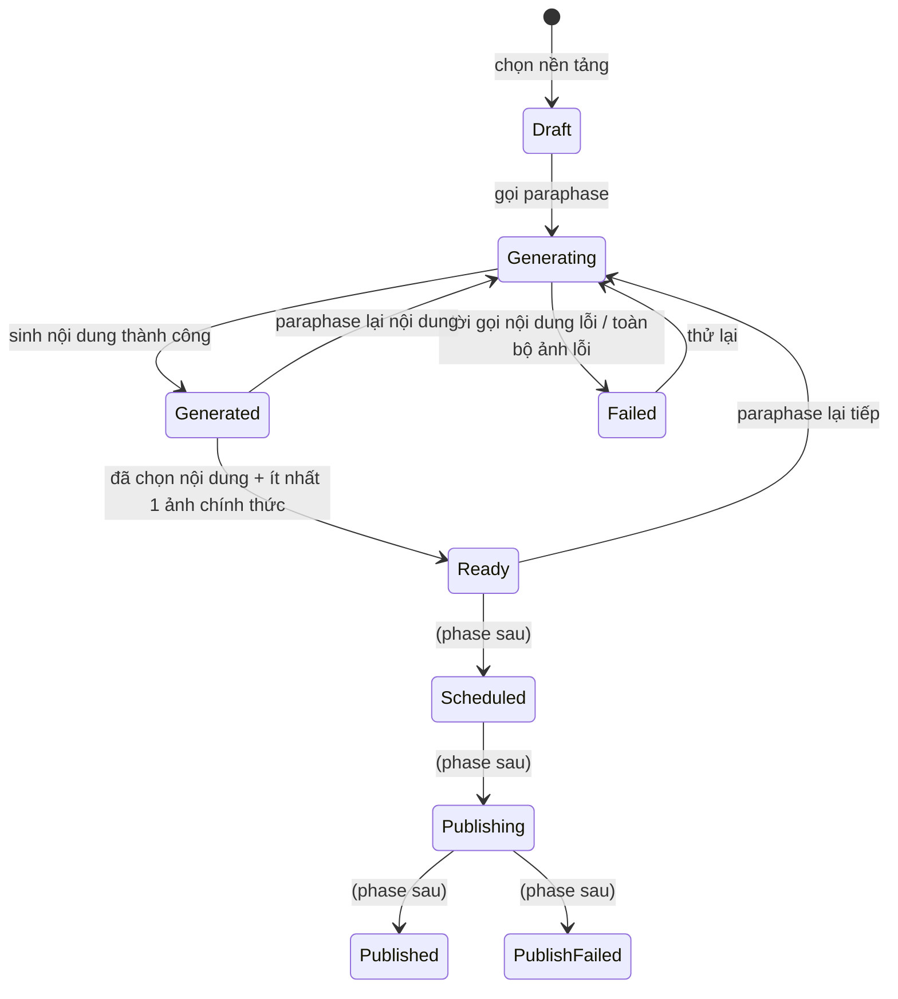

# PostGen — Dự án AI Marketing

> **Cập nhật 2026-09-14:** mốc 0–4 đã triển khai và commit trên `feature/post-gen`. **Mốc 5 đã triển khai trên nhánh `feature/post-gen`:** sinh lại nội dung theo nguồn/feedback, sửa tay, lịch sử và chọn nội dung chốt; chưa deploy. Tiếp theo mốc 6; mốc 6–7 chưa triển khai.

Cập nhật 2026-09-14: đã bỏ bảng PlatformStandard và cả API chuẩn nền tảng/preset riêng. Đã bỏ cả key `postgen.platform.*`; Admin dùng [Config prompt theo nền tảng](PlatformConfig.md) và [Config ratio preset](RatioPresetConfig.md).

## Đọc gì trước khi code

Mốc 0–5 đã hiện thực; tiếp theo mốc 6 version/chốt ảnh. Đọc kèm:

- **`CLAUDE.md` ở gốc repo** — quy ước feature folder `IService`/`Service`, đăng ký trong `Program.cs`, `ApiResponseFactory`, exception, và hai thư mục cố tình viết sai chính tả `Extentions` / `Abtraction`.
- **`HoaTheoMua.Service/XanhSm/Service.cs`** — mẫu để viết `AiService/`: typed `HttpClient`, `SendAsync<T>` tập trung, map lỗi provider sang `BadGatewayException`.
- **`HoaTheoMua.Service/Mockup/Service.cs`** — mẫu phân trang chuẩn (1-based, `pageSize` clamp 100).
- **`HoaTheoMua.Repository/Configurations/PostGenConfigurations.cs`** — cấu hình schema PostGen đã hiện thực; các phần AI khác ở `AiCustomizationConfigurations.cs`.

Các mục cần đọc kỹ nhất trong `DataModel.md`, vì chúng là chỗ dễ làm sai nhất: "Đánh số version lúc đọc", "Hai cái bẫy khi hiện thực hóa", "Cấu hình tái sử dụng", "Dữ liệu khởi tạo bắt buộc".

## Phạm vi dùng chung

BasePost và preset PostGen dùng chung cho mọi Staff/Admin. BasePost không có UserId; API Post Core không lọc theo người tạo. Preset chỉ có một cấu hình chung theo Group/Key; quản trị qua API Config chung với quyền Admin.

## Trạng thái

- **Thiết kế nghiệp vụ**: đã chốt mô hình dữ liệu, API PostGen và state machine. Contract AI proxy đã được người dùng cung cấp ngày 2026-09-14 và kiểm chứng một lời gọi text thật.
- **Tài liệu tách riêng**: đã có [DataModel.md](DataModel.md), [ApiContract.md](ApiContract.md), [AiServiceContract.md](AiServiceContract.md), [PublishingReserved.md](PublishingReserved.md).
- **Bàn giao FE mốc 5**: [FE-API-Handoff-PostGen-Milestone5.md](../FE-API-Handoff-PostGen-Milestone5.md) — sinh lại, sửa tay, lịch sử/chốt nội dung; dùng cùng detail chỉ trả bản chốt.
- **Bàn giao FE mốc 3**: [FE-API-Handoff-PostGen-Milestone3.md](../FE-API-Handoff-PostGen-Milestone3.md) — request/response, trạng thái UI, xử lý lỗi và Config prompt.
- **Code**: đã triển khai mốc 0–2 (schema, 5 API Post Core, cấu hình nền tảng/preset qua API Config chung). Code đã commit/push trên `feature/post-gen`, chưa deploy. Mốc 3 đã có migration seed prompt và migration gộp `20260914073414_ConsolidatePostGenPlatformConfigs`, AiService và PostGeneration; mốc 6–7 chưa triển khai.
- **Kiểm thử mốc 5 trước thay đổi ảnh tùy chọn**: mốc 5 có 102 test PostGen PASS (6 PostgreSQL integration, không fail/skip), HTTP probe 79 request / 168 kiểm tra PASS, gồm bốn API mới bằng AI mock. Không gọi proxy thật trong thay đổi này. Số request/check và evidence tại [Implementation.md](Implementation.md).
- **Tiếp theo**: mốc 6 sinh lại ảnh, đọc lịch sử ảnh và chọn/sắp xếp ảnh từng nền tảng. Mốc 5 đã có bốn API version nội dung. Mốc 4 đã sinh ảnh qua chat completions, trích URL Markdown, gom cặp và xử lý lỗi từng ảnh. Các tham chiếu giai đoạn 2/3/4 trong bản brief cũ tương ứng schema/CRUD/AI; bảng mốc 0–7 phía dưới là thứ tự hiện tại.

## Bối cảnh nghiệp vụ

### Post Core

Người dùng nhập một bài gốc gồm:

- Title
- Content
- Hashtag
- Nhiều hình ảnh

Từ bài gốc đó, AI Service paraphase ra nội dung mới phù hợp với từng nền tảng theo System Prompt, và dựng lại ảnh theo các tỷ lệ mà người dùng chọn.

### Nền tảng đích

- Facebook Page
- Instagram chuyên nghiệp
- Zalo Official Account (OA)

Mỗi nền tảng có các tỷ lệ ảnh đặc thù. Khả năng đăng qua API của từng nền tảng cần được kiểm chứng khi thiết kế tích hợp.

**Bổ sung 2026-09-14 — tạo bài chưa có ảnh:** đã sửa validation/service và tài liệu FE. 27 test tạo/sửa/sinh nội dung PASS; build API/probe PASS. Không cần migration, không gọi AI thật; HTTP probe đã cập nhật kịch bản mới nhưng chưa chạy lại trong thay đổi này.

### Luồng tạo bài

1. **Nhập Post Core** — title, content, hashtag; ảnh nguồn tùy chọn, có thể upload/bổ sung sau qua PUT. POST chấp nhận bỏ images/null/[]; PUT vẫn gửi mảng đầy đủ 0–20 ảnh. Có thể sinh nội dung trước bằng mode content.

2. **Chọn nền tảng cần paraphase.** Không bắt buộc đủ ba: có những bài chỉ hợp với một vài nền tảng.

3. **Cấu hình cho từng nền tảng.** Chọn các tỷ lệ ảnh, rồi với mỗi tỷ lệ chọn những ảnh nào sẽ được dựng ra tỷ lệ đó. Nếu đã lưu cấu hình tái sử dụng thì bỏ qua bước này.

4. **Bấm tạo.** AI paraphase nội dung theo System Prompt của từng nền tảng, và dựng ảnh theo từng tỷ lệ.

5. **Nhận kết quả.** Hệ thống trả về nội dung và ảnh cho từng nền tảng. Người dùng chọn ảnh nào dùng chính thức và thứ tự xuất hiện.

### Paraphase lại

Nếu nội dung hoặc ảnh chưa phù hợp, người dùng tạo lại dựa trên feedback nhập liệu. Mỗi lần tạo lại sinh ra một phiên bản mới, phiên bản cũ vẫn giữ nguyên.

### Chọn bản chính thức

Đôi khi bản mới lại không hợp bằng bản cũ, nên người dùng phải chọn lại được bản trước đó. Cụ thể:

- Chọn **nội dung** và **từng ảnh** độc lập với nhau, từ các lần tạo khác nhau.
- Được phép ghép nội dung phiên bản cũ với ảnh phiên bản mới.
- Chọn ảnh nào dùng chính thức và thứ tự xuất hiện trên nền tảng.

### Xử lý ảnh

- AI đổi bố cục hoặc mở rộng nền theo tỷ lệ người dùng chọn.
- **Giữ nguyên sản phẩm và các chi tiết nhận diện trong ảnh gốc** — đây là ràng buộc cứng, mọi quyết định thiết kế về ảnh đều phải tôn trọng nó.

### Đăng bài — hoãn sang phase sau

Sau khi có nội dung cho các nền tảng, người dùng đăng ngay hoặc đặt lịch. Không bấm đăng và không đặt lịch thì bài không bao giờ được đăng.

Phần này **không nằm trong phạm vi đợt này**. Schema chừa sẵn các cột cần thiết để phase sau không phải migration lại bảng lớn.

## Quyết định đã chốt

| # | Vấn đề | Quyết định |
| --- | --- | --- |
| 1 | Phạm vi | Thiết kế trước, code sau. Phần đăng bài tách hẳn sang phase riêng |
| 2 | Cách gọi AI Service | HTTP **đồng bộ** từ backend |
| 3 | Đăng bài lên nền tảng | **Hoãn sang phase sau**, đợt này chỉ chừa sẵn field trong schema |
| 4 | Schema | **Mở rộng các bảng có sẵn**, không thiết kế bộ bảng mới |
| 5 | Lưu ảnh | AI Service trả **URL vĩnh viễn**, backend chỉ lưu chuỗi URL `varchar(2048)` như `CardTemplate`/`Mockup` |
| 6 | Tỷ lệ ảnh | **Enum cố định cho mã tỷ lệ/pixel; tỷ lệ chọn cho từng nền tảng chỉ lưu trong Config → postgen.ratio-preset** |
| 7 | Phân quyền | API Post Core giữ `StaffOrAdminPolicy`; quản trị prompt nền tảng và preset chỉ dùng API Config với `AdminPolicy` |
| 8 | System Prompt theo nền tảng | **Mỗi nền tảng một system prompt hoàn chỉnh**, lưu tại `Config(postgen.system-prompt.{platform}).Value.content`; không dùng prompt Post chung, không ghép description lúc gọi AI |
| 9 | Sửa tay nội dung | Tạo một version `Source = Manual`, **tự động chốt làm bản chính thức**. Không dùng cột `ContentOverride` |
| 10 | Nguồn của lần paraphase tiếp theo | Một trường `sourceGenerationId`: `null` = làm lại từ bài gốc, id version bất kỳ = làm tiếp/rẽ nhánh từ version đó. Lịch sử version vì vậy là **cây**, không phải đường thẳng |
| 11 | Trục version của ảnh | Tách hẳn khỏi nội dung. Đơn vị đánh version là **cặp (ảnh gốc × tỷ lệ)**, thuộc `BasePost` và **dùng chung mọi nền tảng**; nền tảng chỉ chọn version nào |
| 12 | Số thứ tự version | **Không lưu cột `VersionNo`**, tính lúc đọc bằng `ROW_NUMBER()` theo `(CreatedAt, Id)` — bỏ hẳn tranh chấp khi cấp số |
| 13 | Paraphase ảnh | **Đối xứng với nội dung**: `sourceGeneratedPostImageId = null` → dựng từ ảnh gốc; có id → dựng tiếp trên ảnh của version đó. Feedback **không cộng dồn** ở cả hai bên |
| 14 | `PostHistory` / `ClientHistory` | **Bỏ khỏi phạm vi PostGen** — trùng lặp với chính dòng version. Lời gọi AI ghi log ứng dụng. Bật lại khi cần đối soát chi phí hoặc làm feed "những gì tôi đã tạo" |
| 15 | Title | Là **title của bài đăng**, AI sinh riêng cho từng nền tảng → thêm cột `Title` vào `GeneratedPost`. Không nền tảng nào có trường title riêng nên lúc đăng phải ghép vào đầu nội dung |
| 16 | Hashtag | AI sinh riêng cho từng nền tảng, lưu dạng chuỗi `varchar(1000)` |
| 17 | Lời gọi sinh nội dung | **Chỉ text**, không đính kèm ảnh cho AI |
| 18 | Giới hạn số ảnh của nền tảng | **Chưa validate** ở đợt này; không giữ maxImageCount trong Config chuẩn riêng; thiết kế kiểm giới hạn lúc đăng ở phase sau |
| 19 | Gán version ảnh cho nền tảng | **Tách khỏi việc sinh ảnh.** `POST /images/regenerate` chỉ thêm vào kho; việc ô nào dùng version nào chốt ở bước cuối qua `PUT .../platforms/{platform}/images` |
| 20 | Preset | Lưu **tỷ lệ + quy tắc chọn ảnh** (`imageSelectionMode`), trong bảng `Config` group `postgen`; **dùng chung cho mọi Staff/Admin, không phân theo UserId** |
| 21 | Quota chi phí | **Không giới hạn theo user.** Chỉ chặn 12 ảnh mỗi lượt sinh + rate limit `heavy` |
| 22 | Upload ảnh gốc | **Frontend tự upload**, backend chỉ nhận URL — không làm endpoint upload |

## Hiện trạng code (đã kiểm chứng)

- PostCoreController/PostCore.Service đã hiện thực 5 API CRUD bài gốc, dùng BasePost và các bảng ảnh/bài nền tảng để đọc chi tiết. Đã thêm POST generate nội dung qua PostGenerationController; sinh ảnh đã triển khai ở mốc 4; version nội dung đã triển khai ở mốc 5; version ảnh và đăng bài chưa triển khai.
- PlatformStandard và các API chuyên biệt đã bỏ. Migration mới nhất xóa `postgen.platform.*`, chuyển bật/tắt vào Config prompt cùng nền tảng. Ratio preset vẫn riêng trong Config.
- `SystemPrompt`, `CardTemplate`, `Mockup` tiếp tục dùng service/controller hiện có. Rule URL HTTP/HTTPS đã trích thành `HttpUrl()` dùng chung cho PostCore, CardTemplate và Mockup.
- Bảng `SystemPrompt` hiện vẫn có unique index trên `Type` và dòng Post do migration cũ seed. PostGen theo quyết định #8 mới sẽ đọc ba Config prompt riêng; không sửa API hoặc schema SystemPrompt của các chức năng khác.
- `PlatformType`, `SystemPromptType`, `ClientHistoryType`, `CardFormType` là **native Postgres enum** (`HasPostgresEnum` trong `AppDbContext` + `MapEnum` trong `Program.cs`) → thêm giá trị phải có migration `ALTER TYPE`. Các enum mới của PostGen vì vậy lưu dạng `varchar` + `CHECK`, theo tiền lệ `CardTemplateType`/`GeneratedCardType`.
- Chưa có bất kỳ hạ tầng lưu file nào (không Cloudinary/S3/Blob) → khớp với quyết định #5 và #22.
- Đã tích hợp AI proxy qua typed HttpClient tại `HoaTheoMua.Service/AiService/`, gọi đồng bộ; chưa thêm AI consumer.
- MassTransit + RabbitMQ đã wired sẵn (saga Fulfillment, outbox/inbox) — dùng được cho phase đăng bài theo lịch sau này. Quartz có package nhưng chưa có job.

## Thiết kế Database

Xem [DataModel.md](DataModel.md) — nguồn thiết kế schema và ghi chú hiện thực.

## State machine

### PlatformPost



Guard:

- Đang `Generating` mà gọi sinh tiếp → `ConflictException`.
- Vào `Ready` phải có `OfficialGenerationId != null` **và** ít nhất một dòng `PlatformPostImage` có `SelectedGeneratedPostImageId != null`.
- Sửa tay nội dung không đưa `PlatformPost` về `Generating` — nó tạo version `Manual` và giữ nguyên trạng thái hiện tại (`Generated` hoặc `Ready`).
- Paraphase lại **một ô ảnh** cũng không đưa cả bài về `Generating` — nó chỉ thêm ảnh vào kho dùng chung.
- Các trạng thái sau `Ready` chỉ khai báo, đợt này không có code nào chuyển vào.

### Không có state machine cho version

`GeneratedPost` và `GeneratedPostImage` là dòng append-only, không chuyển trạng thái. `GeneratedPostImage.Status` chỉ có `Succeeded`/`Failed` và được quyết ngay lúc ghi. `GeneratedPost` không có cột trạng thái — lời gọi nội dung thất bại thì không ghi dòng nào.

Khái niệm "sinh được một phần" nằm ở **kết quả của lượt gọi**, không nằm trong bảng: lượt sinh trả về `status = Partial` khi có ô ảnh lỗi và có ô ảnh thành công.

## Hợp đồng API

Các endpoint PostGen dưới đây dùng `[Authorize(Policy = JwtExtensions.StaffOrAdminPolicy)]` (quyết định #7). **Ba** endpoint gọi AI — `generate`, `content/regenerate`, `images/regenerate` — thêm `[EnableRateLimiting(RateLimitExtensions.HeavyPolicy)]`; đó là ba chỗ duy nhất tiêu tiền.

`{platform}` trong route là tên enum viết thường: `facebook` | `instagram` | `zalo`.

Hiện có 5 API Post Core và POST generate nội dung có route thực thi. Sinh ảnh đã có trong generate; bốn dòng version nội dung đã triển khai; các dòng version ảnh/payload official là hợp đồng mốc 6–7. Chuẩn nền tảng và ratio preset dùng API Config chung, không nằm trong bảng endpoint PostGen.

| Method | Route | Service method | Ghi chú |
| --- | --- | --- | --- |
| POST | `/api/v1/posts` | `CreatePostCore` | Title, Content, Hashtag, danh sách ảnh |
| GET | `/api/v1/posts` | `GetPostCoreList` | phân trang + lọc `platform`, `keyword` |
| GET | `/api/v1/posts/{id:guid}` | `GetPostCoreDetail` | kèm nội dung và ảnh chốt của nền tảng |
| PUT | `/api/v1/posts/{id:guid}` | `UpdatePostCore` | |
| DELETE | `/api/v1/posts/{id:guid}` | `DeletePostCore` | soft delete |
| POST | `/api/v1/posts/{id:guid}/generate` | `GeneratePlatformPosts` | **heavy**, sinh nội dung và ảnh theo lựa chọn/preset |
| POST | `/api/v1/posts/{id:guid}/platforms/{platform}/content/regenerate` | `RegenerateContent` | **heavy**, `sourceGenerationId` + `feedback` — chỉ nội dung |
| PUT | `/api/v1/posts/{id:guid}/platforms/{platform}/content` | `EditPlatformContent` | sửa tay nội dung → tạo version `Manual` và chốt luôn |
| GET | `/api/v1/posts/{id:guid}/platforms/{platform}/content/versions` | `GetContentVersions` | danh sách version nội dung |
| PUT | `/api/v1/posts/{id:guid}/platforms/{platform}/content/official` | `SelectOfficialContent` | chọn version nội dung chính thức |
| POST | `/api/v1/posts/{id:guid}/images/regenerate` | `RegenerateImage` | **heavy**, paraphase lại **đúng một cặp** `(sourceBasePostImageId, ratioCode)`. Chỉ thêm ảnh vào kho, không đụng ô của nền tảng nào |
| GET | `/api/v1/posts/{id:guid}/images` | `GetImageVersions` | mọi version ảnh của bài gốc, gom theo cặp (ảnh × tỷ lệ) |
| PUT | `/api/v1/posts/{id:guid}/platforms/{platform}/images` | `UpdatePlatformImages` | ghi đè toàn bộ ô ảnh của nền tảng: ảnh nào, tỷ lệ nào, version nào, thứ tự nào |
| GET | `/api/v1/posts/{id:guid}/platforms/{platform}/official` | `GetOfficialVersion` | payload sẽ đem đi đăng |

Chừa sẵn, **ghi trong tài liệu nhưng không triển khai**: `POST .../platforms/{platform}/publish`, `POST .../platforms/{platform}/schedule`, `DELETE .../platforms/{platform}/schedule`, `GET /api/v1/post-gen/platform-accounts`.

### DTO chính

**Mốc 4 đang chạy:** request chỉ có platform vẫn sinh nội dung. Thêm `ratios` hoặc `usePreset=true` để sinh ảnh; không dùng cả hai. Response chỉ có nội dung/ảnh chốt trong platforms, không có value.images hoặc platforms[].versions. Xem [bàn giao FE mốc 4](../FE-API-Handoff-PostGen-Milestone4.md).

**Mốc 4 đã triển khai:**

`POST /api/v1/posts/{id}/generate`

```json
{ "platforms": [
    { "platform": "facebook", "usePreset": false,
      "ratios": [ { "ratioCode": "Square1x1", "basePostImageIds": ["…A", "…B"] } ] },
    { "platform": "instagram", "usePreset": true }
] }
```

`usePreset` và `ratios` loại trừ nhau trên **mỗi nền tảng** — một nền tảng dùng preset, nền tảng khác cấu hình tay trong cùng một request là hợp lệ. Khi `usePreset = true`, server đọc preset dùng chung từ `Config` group `postgen` rồi khai triển theo `imageSelectionMode`.

Server gom các cặp `(sourceBasePostImageId, ratioCode)` của **tất cả** nền tảng trong request lại, loại trùng, rồi mới gọi AI. Trong ví dụ trên nếu Instagram cũng chọn `Square1x1` với cùng ảnh A thì cặp đó chỉ sinh một lần và cả hai nền tảng trỏ vào chung một tấm.

```json
{
  "value": {
    "basePostId": "…",
    "platforms": [
      {
        "platform": "facebook",
        "platformPostId": "…",
        "status": "Partial",
        "content": {
          "generationId": "…",
          "versionNo": 1,
          "title": "…",
          "content": "…",
          "hashtag": "…"
        },
        "images": [
          {
            "sourceBasePostImageId": "…A",
            "ratioCode": "Square1x1",
            "selectedGeneratedPostImageId": "…",
            "sortOrder": 1,
            "imageUrl": "https://cdn.example.com/flowers/generated-square.jpg",
            "pixelWidth": 1080,
            "pixelHeight": 1080
          }
        ]
      }
    ]
  },
  "isSuccess": true,
  "isFailed": false,
  "error": null,
  "traceId": "…",
  "timestampUtc": "…"
}
```

Response không có `value.images` hoặc `platforms[].versions`. `baseImages` chứa ảnh nguồn; mỗi nền tảng có một object `content` chốt (hoặc null) và `images` chỉ gồm ảnh đã chốt thành công, kèm `imageUrl`, `pixelWidth`, `pixelHeight`, theo `sortOrder`. Ô chưa chọn ảnh hoặc ảnh lỗi không xuất hiện trong danh sách này. Kho lịch sử vẫn lưu trong database; API lịch sử nội dung riêng đã triển khai ở mốc 5; lịch sử ảnh thuộc mốc 6. `versionNo` của nội dung được tính lúc đọc, định danh bằng `generationId`. Ví dụ trên rút gọn các trường bài gốc của `PostCoreDetail`.

`POST .../platforms/{platform}/content/regenerate`

```json
{ "sourceGenerationId": "…v1…", "feedback": "trẻ trung hơn" }
```

`sourceGenerationId = null` nghĩa là làm lại từ `BasePost.Content`; truyền id của một version bất kỳ thuộc bài nền tảng này thì AI làm tiếp từ nội dung của version đó. Giá trị này được ghi thẳng vào `ParentGeneratedPostId` của version mới.

`POST /api/v1/posts/{id}/images/regenerate` — đúng **một** ô ảnh

```json
{ "sourceBasePostImageId": "…A", "ratioCode": "Portrait4x5",
  "sourceGeneratedPostImageId": "…v1…",
  "feedback": "nền sáng hơn" }
```

`sourceGeneratedPostImageId = null` → dựng lại từ ảnh gốc; truyền id một version → dựng tiếp trên ảnh của version đó. Giá trị này ghi thẳng vào `ParentGeneratedPostImageId`.

Endpoint này **chỉ thêm ảnh vào kho**, không đụng tới `PlatformPostImage` của bất kỳ nền tảng nào. Muốn dùng version mới thì chốt ở `PUT .../platforms/{platform}/images`.

`PUT .../platforms/{platform}/images` — ghi đè toàn bộ ô ảnh của một nền tảng

```json
{ "images": [
    { "sourceBasePostImageId": "…A", "ratioCode": "Square1x1",
      "selectedGeneratedPostImageId": "…", "sortOrder": 1 },
    { "sourceBasePostImageId": "…B", "ratioCode": "Landscape16x9",
      "selectedGeneratedPostImageId": "…", "sortOrder": 2 } ] }
```

Dùng cho cả việc đổi thứ tự, bỏ bớt ảnh, lẫn việc chọn version khác cho một ô.

`PUT .../platforms/{platform}/content` — sửa tay

```json
{ "title": "…", "content": "…", "hashtag": "#hoa #tet" }
```

Tạo version `Source = Manual` (hoặc ghi đè version `Manual` cuối nếu nó chưa bị tham chiếu), rồi trỏ `OfficialGenerationId` vào đó.

`PUT .../platforms/{platform}/content/official`

```json
{ "generationId": "…" }
```

### Lỗi

Response luôn bọc bằng `ApiResponseFactory.Base(...)` / `BasePagination(...)`. Lỗi **ném** ra từ service:

| Tình huống | Exception | Message |
| --- | --- | --- |
| Không tìm thấy Post Core hoặc bài đã bị xóa | `NotFoundException` | `Post not found` |
| Chưa sinh bài cho nền tảng đó | `NotFoundException` | `Platform post not found` |
| Nền tảng đó đang sinh dở | `ConflictException` | `Platform post is generating` |
| Vừa gửi preset vừa gửi `ratios` | `BadRequestException` | `Preset and ratios cannot be used together` |
| `basePostImageIds` chứa ảnh của bài khác | `BadRequestException` | `Image does not belong to this post` |
| `sourceGenerationId` không phải version của bài nền tảng này | `BadRequestException` | `Source generation does not belong to this platform post` |
| `sourceGeneratedPostImageId` không thuộc đúng cặp (ảnh gốc, tỷ lệ) đang paraphase | `BadRequestException` | `Source image does not match the requested ratio` |
| `sourceGeneratedPostImageId` trỏ vào version `Failed` | `BadRequestException` | `Cannot regenerate from a failed image` |
| Chọn version ảnh thuộc bài gốc khác | `BadRequestException` | `Selected image does not belong to this post` |
| Version ảnh được chọn không đúng cặp (ảnh gốc, tỷ lệ) của ô đó | `BadRequestException` | `Selected image does not match the slot` |
| Ảnh được chọn có `Status != Succeeded` | `BadRequestException` | `Selected image is not available` |
| `sortOrder` trùng nhau | `BadRequestException` | `Duplicate image order` |
| Thiếu/rỗng Config system prompt của nền tảng | `BadRequestException` | `System prompt for platform {platform} is not configured` |
| AI trả 2xx nhưng JSON hỏng / thiếu field bắt buộc (`content`, `imageUrl`) | `BadGatewayException` | `AI service returned an invalid response` |
| AI không gọi được / 5xx / timeout lời gọi nội dung | `BadGatewayException` | `AI service is unavailable` |
| AI trả **400/422** (payload của ta sai) | `BadRequestException` | `AI service rejected the request` — log mã lỗi của provider, không dội nguyên văn ra client |
| Cờ `postgen.enabled = false` | `BadRequestException` | `PostGen is disabled` |
| Sai shape / vượt giới hạn độ dài, số ảnh, số tỷ lệ | FluentValidation → **422** qua `ValidationActionFilter` | |

## Contract với AI Service

Đã xác nhận và hiện thực endpoint `POST https://proxy.hoatheomua.com/v1/chat/completions`, model `chatgpt/gpt-5.6`, hiện chưa cần API key. Prompt riêng được gửi nguyên văn trong system message; source gửi bằng text trong user message. Đọc JSON title/content/hashtag từ `choices[0].message.content`. Chi tiết payload, cấu hình, timeout và lỗi nằm tại [AiServiceContract.md](AiServiceContract.md).

Ảnh dùng cùng endpoint, content parts giữ nguyên thứ tự text/ảnh và kết quả là Markdown chứa URL ảnh. Phần gọi/trích URL ảnh đã triển khai ở mốc 4; không dùng endpoint `/v1/image-ratio` đề xuất cũ.

## Bộ tài liệu sẽ viết trong `Service - PostGen/`

**Tách ra từ file này** (dạng `#` design doc):

| File | Nội dung |
| --- | --- |
| `Plan.md` | Chính file này — brief nghiệp vụ, quyết định, kế hoạch |
| `DataModel.md` | ERD Mermaid, từng bảng một bảng markdown (Cột / Kiểu / Null / Ghi chú), index & khóa ngoại, lập trường soft delete, đánh số version lúc đọc, lý do không dùng `PostHistory`/`ClientHistory`, các trường chừa sẵn, thứ tự migration |
| `ApiContract.md` | Bảng endpoint (method, route, policy, rate limit), mẫu DTO, bảng lỗi, quy ước phân trang |
| `AiServiceContract.md` | Request/response với AI Service, bảng `AiOption`, nhóm config `postgen`, ánh xạ lỗi → `BadGatewayException`, quy tắc timeout/fan-out/partial failure, **sequence diagram Mermaid** Controller → Service → AI → DB, và cách chuyển sang async |
| `PublishingReserved.md` | Phase đăng bài: cột/trạng thái/route đã chừa, quy tắc ghép `Title` vào `Content`, những gì cần kiểm chứng với Facebook Graph / Instagram Content Publishing / Zalo OA (theo văn phong "Thông tin cần lấy" của `Service - XanhSM/IntegrationPlan.md`) |

**Viết dần khi implement từng endpoint** (dạng per-method `#### Request` / `#### Response` / `#### Flow diagram` / `#### Test case`) — chưa viết bây giờ vì cần payload và `traceId` thật:

`CreatePostCore.md`, `GetPostCoreList.md`, `GetPostCoreDetail.md`, `UpdatePostCore.md`, `DeletePostCore.md`, `GeneratePlatformPosts.md`, `RegenerateContent.md`, `EditPlatformContent.md`, `GetContentVersions.md`, `SelectOfficialContent.md`, `RegenerateImage.md`, `GetImageVersions.md`, `UpdatePlatformImages.md`, `GetOfficialVersion.md`.

Quy ước bám theo vault hiện có: không có frontmatter, thân bài tiếng Việt, tiêu đề per-method giữ nguyên từ khoá tiếng Anh, mẫu response luôn kèm envelope `value/isSuccess/isFailed/error/traceId/timestampUtc`, sơ đồ dùng Mermaid (tiền lệ `Service - Fulfillment/`) thay vì xuất PNG vào `Store-Image/`.

Đã tách `DataModel.md`; mục "Thiết kế Database" trong file này trỏ sang đó để schema chỉ có một nguồn sự thật.

## Câu hỏi còn mở

Các câu về nghiệp vụ đã chốt hết ở bảng quyết định. Còn lại ba thứ phụ thuộc bên ngoài, không tự quyết được:

1. **API key tương lai** — hiện proxy không cần auth. Client có tùy chọn Bearer, cần đối chiếu cơ chế key khi proxy bật auth. Endpoint/model/message format hiện đã xác nhận; không còn chặn mốc 3.
2. **Độ bền của URL ảnh AI trả về** — đang giả định vĩnh viễn (quyết định #5). Nếu thực tế là link hết hạn thì phải có kho lưu trữ **trước khi** phase đăng bài lên sóng, nếu không bài đăng theo lịch sẽ đăng ảnh chết. Đã chừa sẵn `ImageExpiresAt` và `StorageProvider` để không phải migration lại.
3. **Phase đăng bài** — timezone lưu trữ, cơ chế retry, bảng token OAuth của Facebook Page / IG / Zalo OA, quy tắc ghép `Title` vào đầu `Content`. Thiết kế riêng ở `PublishingReserved.md`.

Đã thêm rule dùng chung `HttpUrl()` vào `Common/ValidationRules.cs`, tái sử dụng tại PostCore, CardTemplate và Mockup.

## Các giai đoạn triển khai

Tám mốc, mỗi mốc **tự kiểm được** rồi mới sang mốc sau. Chỉ hai mốc cần AI Service (mock được cả hai), nên phần lớn công việc không phải chờ bên ngoài.

| Mốc | Endpoint | Cần AI? |
| --- | --- | --- |
| 0 | — (schema) | không |
| 1 | 5 endpoint Post Core | không |
| 2 | Chuẩn nền tảng và preset dùng API Config chung (Admin) | không |
| 3 | `generate` — phần nội dung | mock |
| 4 | `generate` — thêm phần ảnh | mock |
| 5 | 4 endpoint version nội dung | mock |
| 6 | 3 endpoint version ảnh | mock |
| 7 | `official` | không |

Mốc 1 và 2 độc lập nhau, làm song song được. Việc tách `DataModel.md` / `ApiContract.md` / `AiServiceContract.md` chạy song song từ đầu, không chặn mốc nào.

### Mốc 0 — Schema

Entity + `Configurations/PostGenConfigurations.cs` (file mới; `ApplyConfigurationsFromAssembly` tự nhặt) + migration kèm seed.

Migration: mở rộng `BasePost` (bỏ `ImageUrl`), `GeneratedPost` (bỏ `ImageUrl`, thêm trục version nội dung); thêm `BasePostImage`, `PlatformPost`, `GeneratedPostImage`, `PlatformPostImage`. Không đụng `SystemPrompt`, `PostHistory`, `ClientHistory`.

**Kiểm:** `dotnet ef database update` chạy sạch trên DB rỗng; `SELECT` thấy đủ dòng seed ở `SystemPrompt` (1 dòng) và `Config` (5 khóa sau toàn bộ migrations: 3 prompt nền tảng, 2 cấu hình chung); `dotnet build -c Release` pass. Không có câu `ALTER TYPE` nào trong file migration.

### Mốc 1 — Post Core CRUD

Feature `HoaTheoMua.Service/PostCore/` theo shape `IService.cs` / `Service.cs` / `Request.cs` / `Response.cs` / `Validate/`, alias + `AddScoped` trong `Program.cs`.

| Endpoint | |
| --- | --- |
| `POST /api/v1/posts` | `CreatePostCore` |
| `GET /api/v1/posts` | `GetPostCoreList` |
| `GET /api/v1/posts/{id}` | `GetPostCoreDetail` |
| `PUT /api/v1/posts/{id}` | `UpdatePostCore` |
| `DELETE /api/v1/posts/{id}` | `DeletePostCore` |

**Kiểm trên Swagger:** tạo một bài có 3 ảnh → `GET` danh sách thấy nó → `GET` chi tiết thấy đủ 3 ảnh đúng `SortOrder` → sửa title → xóa → danh sách không còn nhưng dòng DB vẫn còn với `IsDeleted = true`. Gửi bài không ảnh phải nhận 422.

### Mốc 2 — Cấu hình nền tảng và preset

Admin dùng API Config chung. Mỗi nền tảng một key `postgen.system-prompt.{platform}`, value gồm content và isActive. Ratio giữ riêng. Migration `20260914073414_ConsolidatePostGenPlatformConfigs` xóa các key standard cũ, giữ nội dung/ID prompt và chuyển trạng thái bật/tắt. Down yêu cầu khôi phục backup thay vì tự dựng lại dữ liệu đã bỏ. Xem [PlatformConfig.md](PlatformConfig.md).

**Kiểm:** hai tài khoản Admin dùng API Config chung để tạo, đọc, sửa và xóa cùng một preset theo Group/Key. Staff không gọi được API quản trị Config. Unique index giữ tối đa một preset còn hiệu lực; tạo và sửa là hai thao tác riêng, không có upsert preset. Xem [RatioPresetConfig.md](RatioPresetConfig.md).

### Mốc 3 — AI client + sinh nội dung

**Cập nhật quyết định #8:** tạo ba Config riêng `postgen.system-prompt.facebook`, `postgen.system-prompt.instagram`, `postgen.system-prompt.zalo`, `Group = postgen`, `Kind = Setting`, `IsPublic = false`; `Value = {"isActive": true, "content": "<prompt hoàn chỉnh>"}`. Admin dùng API Config chung để đọc/tạo/sửa/xóa. Dữ liệu đầy đủ tại [ParaphrasePromptData.md](ParaphrasePromptData.md).

Chỉ còn Config prompt cho từng nền tảng, gồm content và isActive; ratio giữ riêng. Khi gọi AI, chọn đúng prompt theo nền tảng, gửi nguyên `value.content`, không ghép prompt Post chung hoặc description. `PromptSnapshot` chụp đúng nội dung đã gửi.

**Đã triển khai phần chuẩn bị:** migration `20260914065606_AddPostGenSystemPromptConfigs` seed ba prompt độc lập, giữ cấu hình đã có và unique index cho từng key còn hiệu lực; thêm `GeneratedPost.SystemPromptConfigId` nullable FK tới Config (`Restrict`) để truy vết nguồn mới. Giữ `SystemPromptId`/FK cũ cho lịch sử, không gán Config.Id vào cột đó. Version AI mới dùng SystemPromptConfigId; version Manual để cả hai tham chiếu và PromptSnapshot null. Không xóa prompt Post cũ hoặc đổi enum SystemPromptType.


Migration seed prompt đã kiểm trên PostgreSQL 16: giữ nguyên prompt tùy chỉnh và lịch sử xóa mềm; key đang hoạt động trùng làm Up thất bại nguyên transaction. Down giữ toàn bộ Config và chặn nếu GeneratedPost còn tham chiếu SystemPromptConfigId. API Config vẫn chỉ dành cho Admin.

**Đã triển khai phần AI:**

Feature `HoaTheoMua.Service/AiService/` (`AddHttpClient`, `SendAsync<T>` tập trung) + `PostGeneration/`. Endpoint `POST /api/v1/posts/{id}/generate` **chỉ sinh nội dung, chưa sinh ảnh**. Đã kiểm 108 test Config/PostGen và 48 request HTTP. Lỗi ở bất kỳ nền tảng nào không tạo version mới; giữ official trước đó và chuyển các nền tảng đã claim sang Failed.

Tách riêng phần nội dung có lý do: cô lập được lỗi tầng HTTP client, ánh xạ lỗi và snapshot prompt trước khi thêm fan-out ảnh vào. Sai ở đây mà đã có 12 lời gọi ảnh song song thì rất khó lần ra.

**Kiểm bằng mock `HttpMessageHandler`:** gọi `generate` cho 2 nền tảng → sinh đúng 2 dòng `PlatformPost`, mỗi dòng 1 `GeneratedPost` với `Title`/`Content`/`Hashtag`, `Source = Ai`, `ParentGeneratedPostId = null`, `PromptSnapshot` bằng nội dung `Config(postgen.system-prompt.{platform}).Value.content` đã gửi cho đúng nền tảng. Test ba prompt khác nhau, cập nhật một prompt không ảnh hưởng hai prompt còn lại; thiếu prompt thì báo lỗi, không fallback về Post chung. `Status = Generated`, `OfficialGenerationId` trỏ vào version vừa sinh. Mock trả 500 → nhận `BadGatewayException`, **không** có dòng `GeneratedPost` nào được ghi.

**Cập nhật response 2026-09-14:** bỏ `value.images` và `platforms[].versions`; mỗi nền tảng trả `content` chốt và `images` đã chốt thành công kèm URL/kích thước. Giữ `baseImages`. Đã kiểm lại 53 test PostGen (gồm 5 PostgreSQL integration), 48 request HTTP / 93 kiểm tra PASS. Lịch sử vẫn lưu trong database.

### Mốc 4 — Sinh ảnh trong `generate`

**Kiểm chứng mode:** 86 test PostGen, 58 HTTP request / 124 kiểm tra PASS; toàn bộ AI mock, không gọi proxy thật.

**Bổ sung mode:** API generate nhận `content | images | all` (mặc định all). Images chỉ sinh ảnh, giữ nguyên nội dung/OfficialGenerationId/SelectedAt và không tạo version nội dung. Content chỉ sinh nội dung, giữ nguyên ảnh đã chốt. Images yêu cầu lựa chọn ảnh cho từng nền tảng; content không nhận lựa chọn ảnh. Tham khảo [bàn giao FE](../FE-API-Handoff-PostGen-Milestone4.md).

**Quy tắc kiểm thử:** ưu tiên mock AI; chỉ gọi proxy thật khi người dùng yêu cầu hoặc đã trao đổi trước, không tự retry vì rate limit.

**Live smoke 2026-09-14:** hàm GenerateImage gọi proxy thật thành công sau 49,6 giây, nhận PNG 941×1672 cho mục tiêu 1080×1920. Gần 9:16 nhưng chưa đạt chính xác; backend chưa đo/chuẩn hóa file. Xem [evidence](Verification/results/proxy-image-9x16-smoke.json).

**Kiểm chứng:** 76 test PostGen (5 PostgreSQL integration), 54 request HTTP / 129 kiểm tra PASS với fake AI và PostgreSQL thật.

Đã triển khai trên endpoint cũ: gom cặp, loại trùng, `SemaphoreSlim(3)`, ngân sách AI 180 giây, partial failure, tạo ô `PlatformPostImage` và tự điền ô chưa chọn. Giữ ảnh đã chốt khi gọi lại. Chỉ dẫn chung đọc từ Config `postgen.image_instruction`; không ghép prompt nội dung của nền tảng. Không cần migration mới.

Proxy trả Markdown URL; pixelWidth/pixelHeight lưu kích thước mục tiêu, chưa xác minh kích thước thực hoặc độ bền URL. Kiểm chứng sử dụng fake AI + PostgreSQL thật; xem [Implementation.md](Implementation.md).

**Kiểm — ba phép thử quan trọng nhất của cả feature:**

1. **Dùng chung ảnh**: Facebook và Instagram cùng chọn `(A, Portrait4x5)` → mock `HttpMessageHandler` chỉ được gọi **đúng một lần** cho cặp đó, và hai dòng `PlatformPostImage` trỏ vào cùng một `GeneratedPostImage.Id`.
2. **Partial failure**: mock cho 1 trong 3 ảnh lỗi → HTTP **200** với `status = Partial`, database giữ dòng ảnh lỗi với `Status = Failed` + `ErrorMessage`, ô tương ứng `SelectedGeneratedPostImageId = null`; response `platforms[].images` chỉ có hai ảnh thành công đã chốt, không có `value.images`.
3. **Chặn ngưỡng**: yêu cầu vượt 12 cặp phải sinh → **422 trước khi gọi AI**, mock không được gọi lần nào.

### Mốc 5 — Version nội dung

**Đã triển khai trên nhánh `feature/post-gen`:** 4 API tại PostGenerationController/Service, không thêm migration. Sinh lại tự chốt version Ai mới, snapshot nguồn/feedback/prompt; sửa tay tự chốt Manual, chỉ coalesce khi bản đó đang official/mới nhất/chưa có con. Chọn bản cũ rồi sửa sẽ tạo nhánh mới. GET lịch sử riêng có feedback và isOfficial, chưa phân trang. Sửa/chốt giữ nguyên ảnh và trạng thái xử lý; regenerate lỗi giữ official cũ và không thêm version. Toàn bộ mutation dùng khóa BasePost để bảo vệ nguồn trong lúc AI đang sinh.

Xem [bàn giao FE mốc 5](../FE-API-Handoff-PostGen-Milestone5.md) và [Implementation.md](Implementation.md) để biết contract và kiểm chứng.

Lịch sử nội dung đã trả qua GET content/versions riêng ở mốc này. Response generate và GET chi tiết chỉ có một object content chốt cho mỗi nền tảng; không trả mảng versions.

| Endpoint | |
| --- | --- |
| `POST .../platforms/{platform}/content/regenerate` | `RegenerateContent` |
| `PUT .../platforms/{platform}/content` | `EditPlatformContent` |
| `GET .../platforms/{platform}/content/versions` | `GetContentVersions` |
| `PUT .../platforms/{platform}/content/official` | `SelectOfficialContent` |

**Kiểm bằng đúng kịch bản trong mục "Sửa tay nội dung cũng là một version":** tạo → paraphase lại → sửa tay → paraphase lại nữa. Phải ra 4 version với `Source` lần lượt `Ai`/`Ai`/`Manual`/`Ai`, và sau bước sửa tay `OfficialGenerationId` tự trỏ vào v3.

Thêm ba phép thử:

- **Rẽ nhánh**: gửi `sourceGenerationId` = id của v1 → version mới có `ParentGeneratedPostId = v1`, và AI nhận `previousContent` là nội dung v1 chứ không phải v3.
- **Số version ổn định**: gọi `GET content/versions` hai lần liên tiếp → thứ tự và `versionNo` y hệt nhau.
- **Không đẻ version rác**: sửa tay hai lần liên tiếp khi chưa ai trỏ vào bản `Manual` → vẫn đúng 4 dòng, không thành 5.

### Mốc 6 — Version ảnh và chốt ảnh

| Endpoint | |
| --- | --- |
| `POST /api/v1/posts/{id}/images/regenerate` | `RegenerateImage` |
| `GET /api/v1/posts/{id}/images` | `GetImageVersions` |
| `PUT .../platforms/{platform}/images` | `UpdatePlatformImages` |

**Kiểm — kịch bản "Facebook v1, Instagram v2":**

1. Hai nền tảng đang cùng dùng `(A, Portrait4x5) v1`.
2. Gọi `images/regenerate` cho cặp đó → sinh v2 vào kho, và **không ô nào đổi** — cả hai nền tảng vẫn trỏ v1. Đây là điểm dễ làm sai nhất của quyết định #19.
3. `PUT .../facebook/images` đặt ô đó sang v2 → Facebook dùng v2, Instagram vẫn v1.
4. Đảo thứ tự ảnh trong một lần `PUT` → không vỡ vì `SortOrder` trùng giữa chừng.
5. Chọn một ảnh thuộc bài gốc khác, hoặc ảnh `Failed`, hoặc ảnh sai cặp (ảnh gốc, tỷ lệ) → đều phải ra `BadRequestException` với đúng message trong bảng lỗi.

### Mốc 7 — Payload đăng bài

`GET .../platforms/{platform}/official`.

**Kiểm:** trả về `Title`/`Content`/`Hashtag` của đúng version đang được `OfficialGenerationId` trỏ tới, kèm danh sách ảnh chính thức đúng thứ tự `SortOrder`. Bài chưa chốt đủ (thiếu nội dung hoặc không có ảnh nào) thì `Status` chưa phải `Ready` — endpoint vẫn trả được nhưng phải thể hiện rõ là chưa sẵn sàng đăng.

### Kiểm thử tự động

`HoaTheoMua.Service.Test/PostGenTest/`, mỗi service method một file theo quy ước sẵn có: tự dựng `AppDbContext` mock, mock `HttpMessageHandler` cho lời gọi AI, mock `ICurrentUserService`. Viết test của mốc nào ngay trong mốc đó, đừng dồn xuống cuối.

Chạy test phù hợp trong lúc phát triển. Hook Husky `pre-push` hiện cũng chạy toàn bộ test suite; không dùng hook thay cho kiểm chứng PostgreSQL local của từng mốc.

## Điều kiện hoàn thành

**Giai đoạn thiết kế — đã đạt:**

- Mọi cột, index, FK đủ chi tiết để viết thẳng migration mà không phải hỏi lại.
- Mỗi endpoint có route, policy, DTO và bảng lỗi.
- Mọi câu hỏi nghiệp vụ đã chốt; phần còn treo đều là phụ thuộc bên ngoài, có ghi rõ giả định đang dùng.

**Giai đoạn hiện thực hóa — sẽ đạt khi:**

- Không có migration nào đụng tới native PG enum (`PlatformType`, `SystemPromptType`, `ClientHistoryType`, `CardFormType`).
- `PostHistory`, `ClientHistory` không có dòng nào được ghi; `SystemPrompt` không đổi schema.
- Các field phục vụ đăng bài có mặt trong schema nhưng không endpoint nào ghi vào.
- Một cặp `(ảnh gốc, tỷ lệ)` dùng chung giữa các nền tảng chỉ tốn đúng một lời gọi AI — kiểm bằng test đếm số lần gọi `HttpMessageHandler` mock.
- Paraphase lại một ô ảnh không làm đổi ô của nền tảng nào.
- Contract với AI Service đã được bên làm AI xác nhận.
