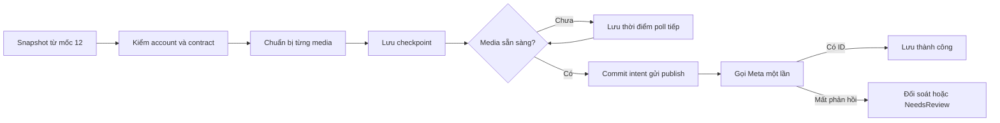

# Mốc 13 — Nghiên cứu adapter Facebook / Instagram

Ngày đối chiếu: **2026-09-15**. Trạng thái tài liệu: **ghi nhận nghiên cứu ban đầu, không phải contract implementation hiện hành**. Mốc 12–13 nay đã triển khai local; xem [PublishingAdapters.md](PublishingAdapters.md). Chưa smoke lên account thật. Phạm vi: 13A Facebook Page → 13B Instagram professional qua Facebook Login. 13C Zalo, video/Reels/Stories, quảng cáo và broadcast nằm ngoài đợt này.

## 1. Kết luận và phụ thuộc

Có thể bắt đầu contract, formatter, HTTP adapter và test bằng fake provider của mốc 13 trước. Để tiếp nhận yêu cầu đăng thật cần hoàn thành phần job/snapshot/attempt/outbox/lease của **mốc 12**, đã hiện thực sau lần nghiên cứu này. Không nối thẳng controller hoặc `generate` vào lệnh đăng Meta.

Mốc 9–10 tiếp tục tạm hoãn. Adapter dùng URL đã chốt; không tự tải về chuyển PNG thành JPEG, crop, rehost hoặc gọi AI lại. URL/media không đáp ứng provider phải trả lỗi có hướng xử lý. `GET official.isReady` chưa chứng minh bài đăng được.

Các lựa chọn formatter, giới hạn vận hành và interface bên dưới là đề xuất cho implementation, không phải quyết định người dùng đã xác nhận hoặc tính năng đã triển khai.

## 2. Code có thể tái sử dụng và khoảng trống

| Thành phần | Hiện trạng / tác động đến mốc 13 |
| --- | --- |
| `HoaTheoMua.Service/PlatformAccount/OAuthProvider.cs` | Đã lấy Page access token cho Facebook và Instagram; Instagram lưu IG user ID riêng và Page liên kết. Có kiểm scopes/tasks khi connect, refresh kiểm token và liên kết account. |
| `PlatformAccountOptions.Meta.GraphApiVersion` | Version bắt buộc cấu hình, chưa có mặc định. Adapter phải dùng version đã pin cho app; không lấy version trong ví dụ tài liệu làm version production. |
| `PlatformAccount` | Có ID ngoài, PageId, scopes, token mã hóa, hạn token, revision và refresh lease. `Connected` không bảo đảm quyền vẫn còn tại lúc đăng. |
| `TokenProtector` | Tái sử dụng mã hóa/giải mã. Credentials hiện là JSON với purpose `postgen:account:{id}`; cần helper nội bộ dùng chung, không sao chép literal hoặc trả token qua DTO. |
| `OAuthProvider.Send` | Không tái sử dụng nguyên trạng cho publishing: hiện gom nhiều HTTP 4xx thành lỗi auth, mất phân biệt validation/media/quota. |
| `PostGeneration` và official payload | Đã có version và ảnh chốt. Manual có thể coalesce/sửa tại chỗ; phải snapshot text/URL/order, không chỉ giữ FK. |
| `ServiceCollectionExtensions.AddConfigureEndpointsCallback` | Retry chung 1/5/15/30/60 giây và EF inbox/outbox. Consumer đăng mới không được mặc nhiên kế thừa retry gửi lại HTTP sau timeout. |
| Mốc 12 | Đã hiện thực sau nghiên cứu: PostPublication, attempt/checkpoint, dispatcher/consumer. Xem Publications.md. |

## 3. Contract provider đã đọc

Nguồn lấy trực tiếp từ Meta; công cụ web gặp HTTP 429, đã đọc được nội dung qua HTTP GET công khai. Reference Facebook mặc định hiển thị v26.0, trong khi ví dụ ở guide Instagram vẫn dùng v25.0: cần kiểm chứng version thực tế của app khi bật.

### Facebook Page

Page token cần quyền tạo nội dung trên đúng Page. Reference tạo ảnh nêu `pages_manage_posts`, `pages_read_engagement`, `pages_show_list` và task `CREATE_CONTENT`. Scope discovery của code hiện có phù hợp hướng này; vẫn phải kiểm quyền trên Page thực tế. [Page Photos](https://developers.facebook.com/docs/graph-api/reference/page/photos/).

| Loại bài | Lời gọi dự kiến | Kết quả cần lưu |
| --- | --- | --- |
| Một ảnh | `POST /{page-id}/photos`: `url`, `caption`, `published=true` | `id` là photo ID, `post_id` là post ID; không tráo hai ID |
| Nhiều ảnh, chuẩn bị | Với từng ảnh: `POST /{page-id}/photos`, `url`, `published=false` | Photo ID ứng với snapshot item/order |
| Nhiều ảnh, đăng | `POST /{page-id}/feed`: `message`, `attached_media` theo thứ tự, `published=true` | `id` của bài đã đăng |

Reference hỗ trợ `.jpeg/.bmp/.png/.gif/.tiff`, tối đa 10 MB/ảnh; ảnh chưa đăng có vòng đời tạm khoảng 24 giờ. `caption` dùng cho photos; `message` của photos đã deprecated, còn `message` của feed vẫn là trường nội dung. [Page Photos](https://developers.facebook.com/docs/graph-api/reference/page/photos/), [Page Feed](https://developers.facebook.com/docs/graph-api/reference/page/feed/).

Chưa xác minh được giới hạn số ảnh cho bài multi-photo và độ dài `message` từ các mục reference đã đọc. Không lấy giới hạn `child_attachments` của bài link làm giới hạn `attached_media` của bài ảnh. Đề xuất khởi đầu cap sản phẩm 10 ảnh/lượt đăng, ghi rõ đây là giới hạn nội bộ và phải kiểm fixture/smoke trước khi bật multi-photo.

GET theo post ID dùng để đọc lại kết quả; guide còn cung cấp `/page-id/feed` và cấu trúc permalink từ post ID. Việc tìm bài có nội dung giống nhau trên feed không đủ chứng minh một attempt đã thành công. [Pages API Posts](https://developers.facebook.com/docs/pages-api/posts/).

### Instagram qua Facebook Login

Account phải là Business/Creator liên kết Page. Guide publishing hiện mô tả **Facebook Page access token + `graph.facebook.com`**, phù hợp code mốc 11; không chuyển sang scope `instagram_business_*` của Instagram Login. Quyền cơ bản là `instagram_basic`, `instagram_content_publish`, `pages_read_engagement`; `pages_show_list` phục vụ discovery. Account được cấp role qua Business Manager có thể cần quyền bổ sung theo reference. Không tự thêm quyền quảng cáo cho mọi account. [Content Publishing](https://developers.facebook.com/docs/instagram-platform/content-publishing/), [Meta Postman — Facebook Login](https://www.postman.com/meta/instagram/folder/u4g5a2a/instagram-api-with-facebook-login).

| Mục | Contract quan sát được |
| --- | --- |
| Ảnh đơn | `POST /{ig-user-id}/media` với `image_url`, `caption`; nhận container ID |
| Carousel | Tạo từng container ảnh với `is_carousel_item=true`, không caption; tạo parent với `media_type=CAROUSEL`, `children` theo thứ tự, caption tại parent |
| Đăng | `POST /{ig-user-id}/media_publish` với `creation_id`; nhận **media ID**, khác container ID |
| Kiểm tiến độ | `GET /{container-id}?fields=status_code,status` |
| Loại ảnh | JPEG, tối đa 8 MB, tỷ lệ 4:5 đến 1.91:1; width 320–1440 theo reference hiện tại, provider có thể scale |
| Caption | Tối đa 2.200 ký tự, 30 hashtag, 20 @mention; đếm trên toàn caption sau formatter |
| Carousel | Tối đa 10 phần tử; dùng route ảnh đơn khi chỉ có một ảnh |
| Container | Hết hạn sau 24 giờ; giới hạn tạo 400 container/24 giờ theo reference |

Các trường request và giới hạn trong bảng lấy từ [IG User Media](https://developers.facebook.com/docs/instagram-platform/instagram-graph-api/reference/ig-user/media/); publish ID từ [Media Publish](https://developers.facebook.com/docs/instagram-platform/instagram-graph-api/reference/ig-user/media_publish/); trạng thái từ [IG Container](https://developers.facebook.com/docs/instagram-platform/instagram-graph-api/reference/ig-container/).

**Các điểm chưa thể coi là contract đã nghiệm thu:**

- Guide tổng ghi 100 bài/24 giờ, nhưng phần carousel và reference `media_publish` ghi 50. Adapter đọc `/content_publishing_limit` khi preflight/execution, dùng quota provider trả và xử lý lỗi quota; không hardcode 100. Cần fixture của response limit theo version app. [Content Publishing](https://developers.facebook.com/docs/instagram-platform/content-publishing/), [Media Publish](https://developers.facebook.com/docs/instagram-platform/instagram-graph-api/reference/ig-user/media_publish/).
- Guide tổng và Postman dùng Page token, một số reference vẫn ghi User token. Giữ lựa chọn Page token hiện có nhưng cần contract smoke cho create/status/publish/read trước khi bật; không âm thầm đổi cách lưu token. [Meta Postman](https://www.postman.com/meta/instagram/documentation/6yqw8pt/instagram-api?entity=request-23987686-66f145c2-29b1-4d97-afbd-5710369027c0), [IG Container](https://developers.facebook.com/docs/instagram-platform/instagram-graph-api/reference/ig-container/).
- Carousel có thể crop theo ảnh đầu, mặc định vuông. Đây là xung đột tiềm tàng với yêu cầu giữ sản phẩm. Khi chưa xác minh tỷ lệ file và cách hiển thị, preview phải ghi chưa xác minh media, không hứa không crop; chỉ bật carousel cho tập media đã nghiệm thu. Không dùng tỷ lệ mục tiêu trong DB làm bằng chứng. [Content Publishing](https://developers.facebook.com/docs/instagram-platform/content-publishing/).
- `is_ai_generated` được tài liệu mô tả là trường tùy chọn; nếu đưa vào contract sản phẩm phải snapshot và hiển thị preview, chỉ gắn parent cho carousel. Chưa tự bổ sung hành vi này trong lần nghiên cứu. [IG User Media](https://developers.facebook.com/docs/instagram-platform/instagram-graph-api/reference/ig-user/media/).

Tài liệu AI hiện có ví dụ URL `.png`, không cam kết MIME JPEG. Vì mốc 10 đang hoãn, không thể mặc định mọi ảnh sinh ra đều đăng Instagram được. Không đoán MIME từ đuôi URL; nếu chưa có phép đo thì ghi `unverified`, và lỗi provider là căn cứ từ chối. Xem [AiServiceContract.md](AiServiceContract.md).

## 4. Formatter và payload mẫu đề xuất

Hai formatter độc lập, ban đầu có thể cùng ghép các phần không rỗng `title`, `content`, `hashtag` bằng hai xuống dòng. Lưu `formatterVersion`, chuỗi cuối cùng và revision/hash vào snapshot. Đây là lựa chọn sản phẩm để preview, không phải Meta bắt buộc ghép title. Không tự cắt caption, loại hashtag, bỏ ảnh hoặc sửa chính tả.

Ví dụ sau là fixture thiết kế bằng ID/URL giả, không phải response từ account thật. Mọi request dùng `Authorization: Bearer <page-token>`; không ghi token vào URL, checkpoint hoặc log.

```text
POST /{version}/{page-id}/photos
{ "url": "https://media.example.test/one.jpg", "caption": "Hoa mùa thu\n\nNội dung đã chốt\n\n#hoatheomua", "published": true }
→ { "id": "photo-1", "post_id": "page-1_post-1" }

POST /{version}/{page-id}/photos
{ "url": "https://media.example.test/one.jpg", "published": false }
→ { "id": "photo-1" }
POST /{version}/{page-id}/feed
{ "message": "Nội dung snapshot", "attached_media": [{"media_fbid":"photo-1"},{"media_fbid":"photo-2"}], "published": true }
→ { "id": "page-1_post-2" }

POST /{version}/{ig-user-id}/media
{ "image_url": "https://media.example.test/one.jpg", "is_carousel_item": true }
→ { "id": "container-1" }
POST /{version}/{ig-user-id}/media
{ "media_type": "CAROUSEL", "children": "container-1,container-2", "caption": "Nội dung snapshot" }
→ { "id": "parent-1" }
GET /{version}/parent-1?fields=status_code,status
→ { "id": "parent-1", "status_code": "FINISHED" }
POST /{version}/{ig-user-id}/media_publish
{ "creation_id": "parent-1" }
→ { "id": "ig-media-1" }
```

## 5. Ranh giới adapter và mốc 12

Đề xuất feature `HoaTheoMua.Service/PostPublishing/` theo quy ước `IService.cs`, `Service.cs`, `Request.cs`, `Response.cs`; adapter nội bộ `FacebookPublisher`, `InstagramPublisher` và typed `MetaPublishingClient`. Đăng ký rõ tại `Program.cs`. Feature flag publishing riêng từng kênh, mặc định false; `Meta.Enabled` hiện tại chỉ bật kết nối, không được ngầm cho phép đăng.

**Interface nội bộ dự kiến:**

| Thao tác | Trách nhiệm |
| --- | --- |
| `Validate` / `Format` | Kiểm snapshot và tạo preview xác định, không gọi Meta hoặc AI |
| `Preflight` | Đọc account/quyền/quota cần thiết; tách `verified`, `unverified`, `rejected`; không tạo ảnh/container |
| `PrepareNext` | Thực hiện tối đa một bước tạo media; trả checkpoint để lưu ngay trước bước kế tiếp |
| `Publish` | Gửi một lệnh làm bài xuất hiện, chỉ sau khi attempt intent đã commit |
| `ReadStatus` / `Reconcile` | Đọc theo ID đã biết; kết quả `Succeeded`, `Pending`, `Rejected`, `Unknown` |

Job mốc 12 cung cấp snapshot chứa account ID, external target ID, platform, formatter/API version, text cuối cùng, generation ID, danh sách ảnh `{generatedImageId,url,order}`. Credentials lấy từ account lúc thực thi, không có trong snapshot hoặc message queue. Account bị disconnect/reconnect phải kiểm revision và định danh để không đổi nơi đăng.

Checkpoint bền vững phải có: publication/attempt ID, stage, ordinal ảnh, provider media/container IDs, thời điểm tạo, bước đã gửi/chưa có phản hồi, thời điểm poll tiếp, error code/subcode/trace ID đã lọc. Worker lưu kết quả từng bước trước khi gọi bước sau. Adapter chỉ trả một kết quả tổng cuối luồng là không đủ để phục hồi crash.

Chuỗi xử lý đề xuất:



Lease/revision ngăn worker cũ ghi đè checkpoint, nhưng không thể thu hồi request HTTP đã gửi. Worker nhận job sau lease hết hạn phải thấy intent và đi đối soát; không tự gửi publish lần hai. Không giữ transaction hoặc EF inbox transaction qua lời gọi HTTP; mốc 12 phải kiểm cách đăng ký endpoint riêng thay vì dùng nguyên callback chung hiện tại.

Không tạo trước container/photo tạm ngay khi đặt lịch nhiều ngày. Mốc 14 chỉ lưu snapshot/lịch; đến giờ worker mới chuẩn bị media, phù hợp vòng đời tạm của provider.

## 6. Timeout, retry và đối soát

| Tình huống | Xử lý đề xuất |
| --- | --- |
| GET status/quota timeout, 429, 5xx | Retry có backoff, giới hạn số lần và tổng thời gian; lưu `nextPollAt`, không giữ worker chờ dài |
| Token hết hạn/thiếu quyền | Lỗi account/quyền riêng; cập nhật account có điều kiện revision, không làm mất token của phiên reconnect mới |
| URL hết hạn, MIME/tỷ lệ/caption sai | Lỗi media/validation; không tự đổi snapshot hoặc gọi AI |
| Tạo media tạm mất response | Ghi nhận kết quả không rõ của bước chuẩn bị; chưa có ID thì không giả lập checkpoint. Có thể thiết kế tạo lại có giới hạn vì chưa xuất bản, nhưng phải tính quota và media mồ côi |
| POST publish timeout/5xx/response thiếu ID/crash sau gửi | `Unknown` → `NeedsReview` hoặc đối soát; không mặc định retry toàn consumer |
| Có external ID, GET link sau đó lỗi | Giữ bằng chứng đăng thành công, thử đọc link riêng; không gửi lại bài |
| Container `IN_PROGRESS` | Poll có giới hạn; không tạo lại parent |
| Container `PUBLISHED`, mất media ID | Đã có bằng chứng được đăng; giữ `NeedsReview` với thông tin đó nếu chưa tra ra media ID. Không gọi publish lại |
| Container `FINISHED` sau publish timeout | Không coi ngay là bằng chứng chưa đăng do thời điểm quan sát; tiếp tục đối soát có giới hạn |
| `ERROR` / `EXPIRED` | Nếu chưa từng gửi publish có thể kết thúc lỗi chuẩn bị; nếu đã gửi mà kết quả không rõ, không suy luận chắc chắn chưa đăng chỉ từ một lần đọc |

IG Container reference chỉ có ID/trạng thái, không cung cấp field ánh xạ media ID đã xuất bản. Quét media theo caption/thời gian chỉ tạo ứng viên để review, không là khóa đối soát chắc chắn. Facebook cũng không được suy ra thất bại từ việc chưa thấy bài trên feed. Khi chưa có cơ chế chắc chắn, giữ `NeedsReview`.

HTTP error DTO nội bộ cần lưu riêng status/code/subcode/trace ID, phân loại auth/permission/media/quota/transient/unknown và `retryAfter`. Không lưu response raw có secret. Một lỗi HTTP 400 không tự động có nghĩa JWT người dùng hết hạn; một HTTP 5xx không tự động có nghĩa publish chưa xảy ra. Fixture mã provider cụ thể phải đối chiếu error reference/version app trước implementation, không tạo mapping suy đoán.

## 7. Kế hoạch thực hiện và kiểm thử

1. **Contract chung:** snapshot input, checkpoint/output, formatter version, error categories, feature flag; hoàn thiện fixture lỗi theo reference.
2. **13A Facebook:** single image trước, multi-photo sau; xác nhận caption/photo ID/post ID, ảnh tạm và thứ tự `attached_media`.
3. **13B Instagram:** single image trước, carousel sau; status/poll/checkpoint, quota và lỗi media; xử lý các điểm chưa xác minh ở mục 3.
4. **Tích hợp mốc 12:** job/attempt/outbox, durable checkpoint, guard sửa/xóa/chốt bài, account revision, crash recovery và ngăn publish trùng.
5. **Bàn giao:** preview/readiness riêng, mã lỗi để FE sửa media/reconnect/đối soát; smoke chỉ khi có account/bài thử được chỉ định.

| Nhóm test cần có | Bằng chứng mong đợi |
| --- | --- |
| Formatter | Unicode/emoji, dòng trống, caption biên và vượt giới hạn; preview bằng đúng request; không cắt dữ liệu |
| Facebook | 1/N ảnh, ID đúng loại, `published=false` mọi bước chuẩn bị; lỗi ảnh giữa chừng không gọi feed; resume bỏ qua ảnh đã có ID |
| Instagram | 1/2/10/11 ảnh; child không caption, parent đúng order; phân biệt container/media ID; đủ nhánh status |
| URL/media | URL hỏng/hết hạn, PNG bị IG từ chối, tỷ lệ mục tiêu khác file; lỗi có chỉ số ảnh, không tự chuyển đổi |
| HTTP | 401/403, provider error trong JSON, 429/retry-after, 5xx, timeout, response sai schema; không lộ token trong log/DTO |
| Crash/concurrency | DB commit intent trước HTTP; crash sau từng bước; message trùng; lease hết hạn khi request còn chạy; không có lệnh publish thứ hai khi chưa rõ kết quả |
| Account | Disconnect/reconnect/refresh đua với worker; không đăng sang account khác hoặc ghi đè revision mới |
| Phạm vi | Flag tắt thì không gọi provider; không gọi AI; không bật Zalo; `GET official` và preview không tạo media |

Test formatter/adapter dùng fake `HttpMessageHandler` và `TimeProvider`, assertion theo request thực gửi và số lần publish. Khi nối mốc 12, dùng PostgreSQL/RabbitMQ để chứng minh lưu checkpoint/outbox và crash recovery. Các ca trên **chưa được chạy trong lần nghiên cứu này**.

## 8. Điều kiện còn lại trước bật kênh

- Mốc 12 hoàn thành và tích hợp các guard/checkpoint/retry nêu trên.
- Xác minh Graph API version, app access level, quyền và account thực tế; scope được lưu local chưa thay thế kiểm tra bên provider.
- Contract fixture lỗi, giới hạn Facebook multi-photo/text và kết quả đọc lại external ID/link.
- Instagram: quota thực tế, Page token trên toàn luồng, file JPEG phù hợp và carousel không làm mất sản phẩm. Phần chưa nghiệm thu giữ flag tắt riêng, không chặn Facebook đã đủ điều kiện.
- Kết quả build/test khi viết code và một lượt smoke được cho phép trên bài/account cụ thể trước khi tuyên bố hỗ trợ đăng thật.

Liên quan: [Plan.md](Plan.md), [PublishingReserved.md](PublishingReserved.md), [PlatformAccounts.md](PlatformAccounts.md), [DataModel.md](DataModel.md).
