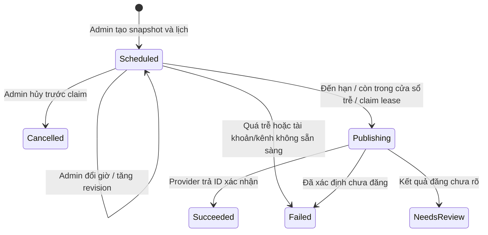

# Mốc 14 — Đặt, đổi và hủy lịch đăng

Triển khai local ngày **2026-09-15**. Lịch dùng snapshot/worker mốc 12 và adapter mốc 13. API chỉ dành cho Admin. Chưa deploy hoặc đăng thử lên account Meta thật; giữ flag publishing mặc định false. Không tạo media/container hoặc gọi AI khi đặt lịch.

## Quy tắc thời gian

- `scheduledAt` là chuỗi ISO 8601 có giây và `Z` hoặc offset, ví dụ `2026-09-20T09:00:00+07:00`. Không nhận giờ thiếu offset, ngày không có giờ hoặc giá trị ngày không hợp lệ.
- Chuẩn hóa UTC và độ chính xác microsecond của PostgreSQL trước khi hash/lưu. Hai cách biểu diễn offset của cùng một thời điểm là cùng yêu cầu idempotent.
- Mặc định lịch cách thời điểm backend nhận yêu cầu **ít nhất 60 giây**, tối đa **30 ngày**, tính cả hai biên. FE nên chọn thời điểm có dư thời gian gửi request. Các ngưỡng có thể cấu hình.
- Worker bắt đầu khi đến hạn; độ trễ có thể gồm chu kỳ scanner (mặc định 15 giây), hàng đợi, tải media và xử lý của Meta. Không cam kết bài xuất hiện chính xác ở giây đã chọn.
- Nếu chưa được worker nhận mà đã trễ **hơn 900 giây**, chuyển `Failed / PUBLICATION_SCHEDULE_MISSED`, không có attempt/provider call và `canRetry=false`. Admin lấy preview rồi tạo job/lịch mới sau khi xem xét.
- Cửa sổ trễ áp dụng cho **lúc bắt đầu xử lý**. Job đã claim đi theo timeout/checkpoint/recovery của mốc 12–13; không suy ra chưa đăng vì giờ dự kiến đã qua.

## API và request

Prefix: `/api/v1/posts/{id}/platforms/{platform}`. Role: `AdminPolicy`. Response dùng envelope hiện có; object job thêm `scheduledAt` nullable cho cả API tạo, detail, list và các lệnh tác vụ. Job đăng ngay trả null; job từng đặt lịch giữ giờ cuối đã chọn trong lịch sử sau khi thành công/thất bại/hủy.

### Tạo lịch

`POST .../schedule` → **202**, Location trỏ `/api/v1/post-gen/publications/{publicationId}`.

```json
{
  "accountId": "<uuid>",
  "idempotencyKey": "schedule-request-unique",
  "expectedRevision": "<revision SHA-256 từ publication-preview>",
  "scheduledAt": "2026-09-20T09:00:00+07:00"
}
```

Tái sử dụng preview và validator mốc 12–13. Snapshot cố định text/version ảnh/URL/order/account ngay trong transaction tạo lịch. Cùng key và cùng yêu cầu trả job hiện có, kể cả khi lịch đã đổi hoặc giờ đặt ban đầu đã qua. Cùng key nhưng khác giờ, account, revision hoặc thao tác publish/schedule trả 409. Không tạo outbox message trước hạn; lịch đã commit là dữ liệu bền vững mà scanner sẽ đọc.

### Đổi lịch

`PUT .../schedule` → **200**.

```json
{
  "publicationId": "<uuid>",
  "expectedRevision": 2,
  "scheduledAt": "2026-09-20T10:00:00+07:00"
}
```

`expectedRevision` ở đây là số revision của job, không phải hash preview. Chỉ đổi khi job vẫn Scheduled, chưa lease/attempt/publish intent. Có thể cứu một lịch vừa đến hạn nhưng worker chưa nhận bằng cách đổi sang giờ tương lai hợp lệ. Không đổi snapshot/account; muốn đổi nội dung/ảnh/account thì hủy lịch, sửa/chốt và tạo lịch mới.

Đổi giờ tăng revision, cập nhật ScheduledAt/NextRunAt, xóa dấu dispatch cũ và ghi review `Reschedule` chứa thời điểm trước/sau cùng actor/time. Thông điệp hàng đợi cũ có revision trước sẽ bị bỏ qua.

### Hủy lịch

`DELETE .../schedule?publicationId=<uuid>&expectedRevision=3` → **200**.

Không dùng body cho DELETE. Backend kiểm publicationId đúng bài/nền tảng và revision hiện hành. Hủy trước claim chuyển Cancelled, bỏ lịch chạy tiếp, mở khóa chỉnh sửa bản chốt; giữ snapshot/ScheduledAt/review trong lịch sử. Lặp lại revision cũ trả 409. Không gọi provider xóa media/bài; không có media được tạo từ bước đặt lịch.

Nếu worker đã nhận việc, PUT/DELETE trả 409 dù chưa có bài xuất hiện. Các API cancel/retry mốc 12 giữ phạm vi riêng: cancel job Queued; retry Failed/canRetry là yêu cầu chạy lại **ngay**, không đặt lại lịch. Lịch quá hạn có canRetry=false nên phải tạo yêu cầu mới.

## Trạng thái và transaction



- Tạo/đổi/hủy dùng khóa BasePost → PlatformPost → account → job theo thứ tự mốc 12. Check revision và trạng thái trong cùng transaction; job/platform pointer/audit commit nguyên tử.
- Scanner chọn tối đa 50 job đến hạn, ưu tiên NextRunAt, dùng `FOR UPDATE SKIP LOCKED`; phát PublicationRequested qua bus outbox và cập nhật LastDispatchedAt cùng transaction. Nhiều scanner không phát cùng lượt; retry/giao trùng vẫn do revision/lease bảo vệ.
- Scanner không đổi Scheduled sang Queued: đến lúc worker claim, Admin vẫn có thể đổi/hủy nếu giành khóa trước. Worker kiểm lại ScheduledAt, NextRunAt, revision và cửa sổ trễ trước khi gọi adapter.
- Restart không mất lịch: scanner mới đọc lại DB; message cũ bị bỏ qua; claim/publish intent/checkpoint tiếp tục theo mốc 12. Không cần timer trong bộ nhớ hoặc Quartz mới.
- Account/scopes/token, flags và media/quota vẫn được kiểm khi chạy. Account Connected lúc đặt lịch không bảo đảm đủ điều kiện đến giờ đăng. Guards Scheduled của mốc 12 bảo vệ sửa/xóa/chốt dữ liệu và disconnect account.

## Schema và migration

Migration `20260915160000_AddPostPublicationSchedule` thêm `PostPublication.ScheduledAt timestamptz NULL`. Lịch sử đăng ngay hiện hữu giữ null; không thay snapshot hoặc native enum. Dùng index recovery hiện có `(Status, NextRunAt, LeaseUntil)` và unique active PlatformPost.

Check constraint: Scheduled phải có ScheduledAt và NextRunAt ≥ ScheduledAt; chưa lease, chưa attempt và chưa có khả năng publish. Trigger chỉ cho đổi ScheduledAt khi old/new đều Scheduled và chưa claim. Snapshot trigger mốc 12 vẫn giữ nguyên. `PlatformPost.ScheduledAt` là pointer tiện đọc, được cập nhật cùng job và xóa khi cancel; nguồn lịch sử là job/review.

Migration Up dừng nếu DB cũ có job Scheduled do writer ngoài mốc 12 tạo (mốc 12 chưa có API schedule); cần xử lý các dòng đó trước, không đoán giờ lịch từ timestamp retry. Up bình thường bảo toàn lịch sử cũ. Down bị chặn nếu có bất kỳ ScheduledAt không null, kể cả job đã hủy/thành công, để không xóa lịch sử. DB chỉ có job đăng ngay có thể downgrade cột này; rollback nhiều migration có thể đã hoàn tất bước Down này trước khi mốc 12 từ chối xóa lịch sử, nên cần migrate về version ứng dụng đang chạy nếu rollback không thành công.

EF scaffold đã có lỗi enum comparer được ghi nhận ở mốc 11–12; migration này viết rõ DDL và metadata snapshot/designer đồng bộ, được kiểm tra trên PostgreSQL thật.

## Lỗi và cấu hình

| HTTP / mã | Ý nghĩa |
| --- | --- |
| 400 `PUBLICATION_SCHEDULE_OFFSET_REQUIRED` | Thiếu offset hoặc sai ISO/date |
| 400 `PUBLICATION_SCHEDULE_OUT_OF_RANGE` | Chưa đủ lead time hoặc vượt horizon |
| 404 `PUBLICATION_SCHEDULE_NOT_FOUND` | Job không thuộc bài/nền tảng trong URL |
| 409 `PUBLICATION_CHANGED` | Revision cũ; đọc job lại |
| 409 `PUBLICATION_SCHEDULE_NOT_EDITABLE` | Đã claim hoặc kết thúc |
| 409 `IDEMPOTENCY_CONFLICT` | Key đã dùng cho yêu cầu khác |
| Job `PUBLICATION_SCHEDULE_MISSED` | Chưa bắt đầu trong cửa sổ trễ; không tự đăng bù |

Lỗi preview/account/provider khác giữ contract mốc 12–13. Idempotency key/revision/expectedRevision đều bắt buộc như API publish hiện tại.

| PublishingOptions | Docker/GitHub Environment Secret | Mặc định / phạm vi |
| --- | --- | --- |
| MinScheduleLeadSeconds | POSTGEN_SCHEDULE_MIN_LEAD_SECONDS | 60 / 1–86400 giây |
| MaxScheduleDays | POSTGEN_SCHEDULE_MAX_DAYS | 30 / 1–365 ngày |
| ScheduleLatenessSeconds | POSTGEN_SCHEDULE_LATENESS_SECONDS | 900 / 0–86400 giây |

Không bật flag hoặc sửa secret môi trường trong lần triển khai này. Phạm vi hiện tại vẫn Facebook/Instagram; Zalo, kho ảnh và xác thực AI tiếp tục hoãn.


## Kiểm chứng

Build Release PASS; 21 test mới mốc 14, toàn suite **1.115 PASS / 0 fail / 0 skip**. PostgreSQL kiểm upgrade lịch sử cũ, downgrade guard, constraint/trigger, outbox, hai scanner/worker, đổi/hủy/claim race và stale message. Probe HTTP **37 request / 90 checks PASS** với clock điều khiển, PostgreSQL/RabbitMQ thật, adapter production và fake Meta/media; bao phủ auth, offset/biên thời gian, idempotency, đổi/hủy, đến hạn, quá trễ và token hết hạn. Không gọi Meta/AI thật. [Evidence HTTP](PublicationVerification/results/schedule-api-evidence.json), [tổng hợp](PublicationVerification/results/milestone14-verification.json).
